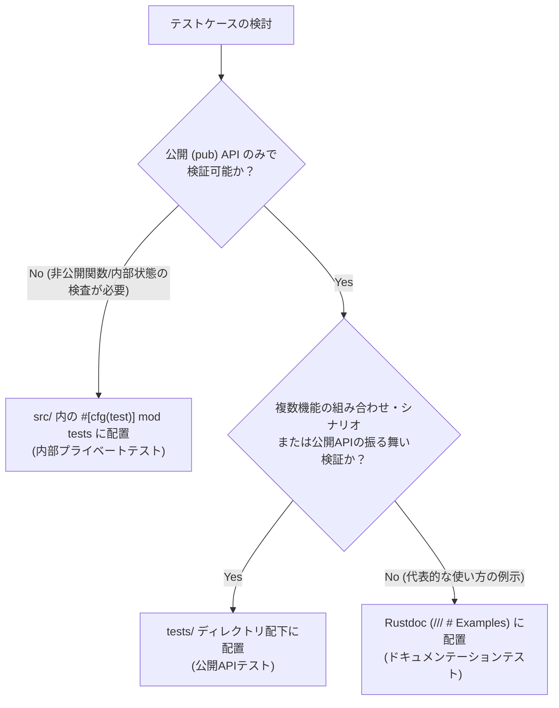

# Rust テスト設計・分離規約 (Rust Testing Architecture & Separation Rules)

> [!IMPORTANT]
> 本規約は、`vivivi` プロジェクトにおけるテストコードの配置、責務分離、および公開API/内部プライベートテストの使い分けを規定する恒久ルールです。
> ソースコードの肥大化を防ぎ、公開APIのエルゴノミクス（使いやすさ）と内部アルゴリズムの健全性を両立させることを目的とします。

---

## 1. 基本方針（責務の明確な分離）

テストコードはその検証対象とテスト観点（外部視点 vs 内部視点）に応じて、配置場所を厳格に分離します。

```
                    ┌─────────────────────────────────────────┐
                    │            Rust テスト体系              │
                    └────────────────────┬────────────────────┘
                                         │
                 ┌───────────────────────┴───────────────────────┐
                 ▼                                               ▼
     【公開APIテスト (結合・仕様)】                  【内部プライベートテスト (単体)】
     ・配置: tests/*.rs (tests/ ディレクトリ)        ・配置: src/ 内 (#[cfg(test)] mod tests)
     ・視点: 外部利用者 (ブラックボックス)           ・視点: モジュール内部 (ホワイトボックス)
     ・対象: クレート公開API (pub)                   ・対象: 非公開関数・内部状態・低レイヤ詳細
     ・インポート: use <crate_name>::...;            ・インポート: use super::*;
```

---

## 2. テストの分類と配置基準

### 2.1 公開APIテスト（Integration / Public API Tests）
- **配置ディレクトリ**: 各クレートのルート直下 `tests/`（例: `crates/vivivi-core/tests/`）
- **アクセス権限**: クレート外部の利用者と全く同じ権限（`pub` なシンボルのみアクセス可能）。
- **目的**:
  - クレートが外部に提供する公開APIの仕様・振る舞い・エルゴノミクスを検証する。
  - 複数モジュールや構造体を組み合わせたシナリオテスト、ユースケーステスト。
  - 外部利用者にとって破壊的変更（Breaking Change）がないかの検知。
- **ファイル命名・構成**:
  - 機能やコンポーネント単位でファイル分割（例: `tests/buffer_api.rs`, `tests/register_api.rs`）。
  - テスト間で共有するフィクスチャやユーティリティは `tests/common/mod.rs` に配置する（独立したテストターゲットとしてビルドされるのを防ぐため）。

### 2.2 内部プライベートテスト（Unit / Internal Private Tests）
- **配置場所**: 各ソースコード末尾の `#[cfg(test)] mod tests { use super::*; ... }`
- **アクセス権限**: モジュール内の非公開（プライベート）関数、未公開構造体フィールド、`pub(crate)` シンボルに直接アクセス可能。
- **目的**:
  - 外部に公開していない内部ヘルパー関数や複雑な計算ロジックのホワイトボックステスト。
  - 外部APIからは直接再現しにくい特殊なエッジケース、異常系、内部境界値のピンポイント検証。
  - 公開APIを介すとセットアップが過剰に複雑になる低レイヤの動作確認。
- **制約（アンチパターンの排除）**:
  - **公開APIのみで十分に検証可能なテストを `src/` 内に大量に記述することは避ける**。
  - モジュールコードがテストコードで埋もれるのを防ぎ、`src/` 配下は「内部ロジックの健全性保証」に特化する。

### 2.3 ドキュメンテーションテスト（Rustdoc Tests）
- **配置場所**: ソースコード内の `/// # Examples`
- **目的**: 公開APIの代表的な使い方とAPIシグネチャの検証（`cargo test --doc` で実行）。
- **詳細は [.agents/rules/rustdoc.md](file:///.agents/rules/rustdoc.md) を参照**。

---

## 3. 使い分けの判断フロー

テストコードを追加・修正する際は、以下の判断フローに従って配置場所を決定してください。



---

## 4. ディレクトリ構成パターン

```text
crates/vivivi-core/
├── Cargo.toml
├── src/
│   ├── lib.rs
│   ├── buffer.rs                   # 内部プライベートテストのみを内包
│   │   └── #[cfg(test)]
│   │       mod tests {
│   │           use super::*;
│   │           // 非公開メソッドや内部バイト境界のピンポイントテスト
│   │       }
│   └── gap_buffer.rs
└── tests/                          # 公開APIテスト（tests/ ディレクトリに集約）
    ├── common/
    │   └── mod.rs                  # テスト共通フィクスチャ・ヘルパー
    ├── buffer_lifecycle.rs         # 公開APIのライフサイクル・シナリオテスト
    └── encoding_integration.rs     # 公開APIによるエンコーディング統合テスト
```

---

## 5. テスト実行コマンドと検証

| コマンド                         | 検証対象                                                |
| :------------------------------- | :------------------------------------------------------ |
| `cargo test --all-targets`       | 単体テスト、公開API統合テスト、バイナリ等すべてのテスト |
| `cargo test --test <ファイル名>` | 指定した `tests/<ファイル名>.rs` の統合テストのみ実行   |
| `cargo test --lib`               | `src/` 配下のライブラリ単体テストのみ実行               |
| `cargo test --doc`               | Rustdoc 内のコード例テストのみ実行                      |

---

## 6. 運用・移行方針

1. **新規機能開発**:
   - 新規に追加する機能の仕様テスト・シナリオテストは、最初からクレート直下の `tests/` に配置する。
2. **既存テストのリファクタリング**:
   - 既存の `src/` 配下に存在するテストのうち、公開APIのみを利用しているものは、機能修正やリファクタリングの機会に合わせて段階的に `tests/` 配下へ移設・分離する。
