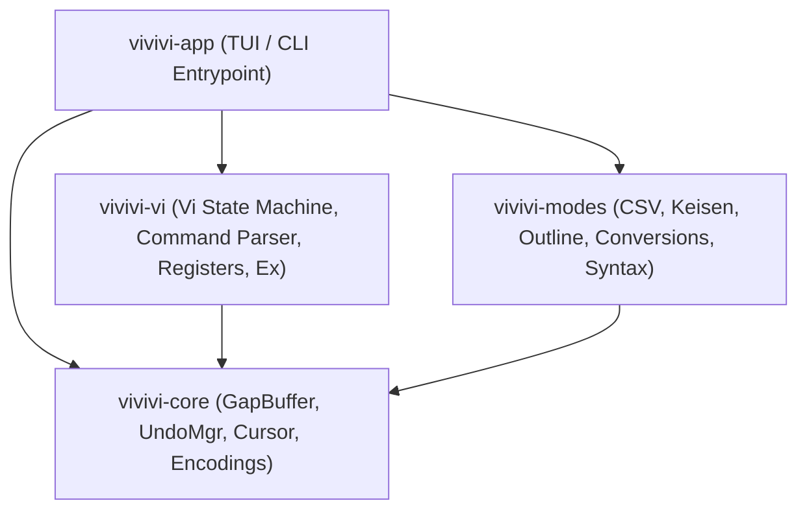

<div align="center">

# ⚡ vivivi

**Modern, Memory-Safe, and High-Performance Reconstruction of the Classic "OpenViVi" Text Editor in Rust**

[](LICENSE)
[](https://www.rust-lang.org)
[](Cargo.toml)
[](https://github.com/tkshnkgwr/vivivi)

[English](./README.md) | [日本語](./README_JA.md)

</div>

---

## 📌 Overview

`vivivi` is a ground-up reimagining in **Rust** of the classic C++ / Qt text editor "**OpenViVi**", engineered for memory safety, concurrency, and uncompromising performance.

It faithfully ports the core Vi editing mechanics and data structures while integrating unique, high-productivity features from commercial editions (ViVi 3 & 4), such as **Inline CSV/TSV mode**, **Unicode Box-Drawing (Keisen) auto-joining mode**, and **Character Conversions**, alongside essential daily driver features from Gvim: **Window Splitting (`:split` / `:vsplit`)**, **Visual Block multi-line editing**, and **Outline navigation**.

---

## ✨ Key Features

- 🚀 **$O(1)$ Amortized Local Edits via GapBuffer**:
  - Implements OpenViVi's `gap_buffer.h` design, maintaining an empty gap at the edit cursor for instantaneous character insertions and deletions.
- 🔄 **Transactional Undo / Redo with Typing Merging**:
  - Automatically merges contiguous typings into single undo steps.
  - Combines compound vi actions (e.g. `dd`, `cw`, `:%s`) into atomic undo blocks.
  - Tracks save points to accurately restore `is_modified == false`.
- ⌨️ **Faithful Vi Command Engine & Visual Block Editing**:
  - State machine supporting Normal, Insert, Replace, Visual, VisualLine, VisualBlock, and CommandLine modes.
  - **Full Visual Block Support**: `Ctrl-v` selection, block yank (`y`), block delete (`d`/`x`), multi-line block insert (`I`/`A` $\to$ `Esc`), and space-padded block paste (`p`/`P`).
  - Full register support (unnamed, named `"a` - `"z`, system clipboard).
- 🪟 **Split & Multi-Window Views (Gvim-compatible)**:
  - Horizontal (`:split`) and vertical (`:vsplit`) layout splitting.
  - `Ctrl-w` window keybindings (`Ctrl-w w` cycle, `Ctrl-w c` close, `Ctrl-w o` single window).
- 🌲 **Outline Analysis & Side Pane**:
  - Symbol hierarchy extraction for Markdown headings, Rust, C/C++, and Python.
  - Toggle with `F8` / `:outline`, navigate with `Ctrl-o` + `j`/`k`, and jump immediately with `Enter`.
- 🔤 **Rich Character Conversions**:
  - Batch whole-buffer conversion via ex commands: `:%zenkaku`, `:%hankaku`, `:%hiragana`, `:%katakana` (with automatic voiced mark synthesis).
- 📊 **Inline CSV/TSV Alignment & Editing**:
  - Formats separated values into clean columnar tables with full CJK wide-character support.
  - Transparently hides quote marks while reading, exposing raw text on the cursor line for precision editing.
- 📐 **Unicode Box-Drawing (Keisen) Auto-Joining**:
  - Seamlessly draws and connects Unicode box characters (U+2500 - U+254B) using `Ctrl + Arrow keys`, automatically resolving corners, T-junctions, and cross intersections.
- 🌐 **Charset & Newline Auto-Detection**:
  - Auto-detects UTF-8, Shift_JIS (CP932), EUC-JP, and CRLF / LF, preserving original formatting on save.

---

## 🏗️ Workspace Architecture



| Crate Name     | Responsibilities & Roles                                                   | Dependencies  |
| :------------- | :------------------------------------------------------------------------- | :------------ |
| `vivivi-core`  | GapBuffer, line manager, cursor, Undo/Redo, charset & newline detection    | None          |
| `vivivi-vi`    | Vi state machine, command parser, registers, block editing, ex commands    | `vivivi-core` |
| `vivivi-modes` | CSV/TSV mode, Unicode box drawing, outline parser, conversions, syntax     | `vivivi-core` |
| `vivivi-app`   | Full-screen TUI (Ratatui + crossterm), window splitting, main loop         | All crates    |

---

## 🚀 Installation & Build

### Prerequisites
- Rust 1.80+ (Edition 2024 support)
- Cargo

### Local Build
```powershell
# Clone repository
git clone https://github.com/tkshnkgwr/vivivi.git
cd vivivi

# Build workspace
cargo build

# Run application (TUI)
cargo run

# Build optimized release binary
cargo build --release
```

### Run Tests
```powershell
# Run unit tests across all crates (all 47 tests passing)
cargo test
```

---

## 📄 License

This project is licensed under the **[MIT License](LICENSE)**.

```text
Copyright (c) 2026 tkshnkgwr
Portions of the vi command engine and specifications are adapted from openViVi:
https://github.com/vivisuke/openViVi (MIT License)
```
