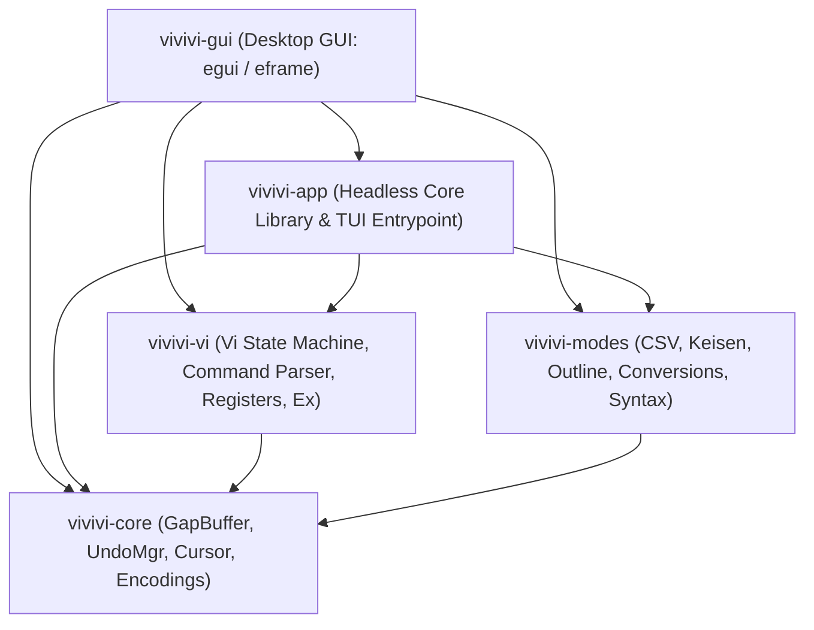

<div align="center">

# ⚡ vivivi

**Modern, Memory-Safe, and High-Performance Reconstruction of the Classic "OpenViVi" Text Editor in Rust**

[](LICENSE)
[](https://www.rust-lang.org)
[](Cargo.toml)
[](https://github.com/tkshnkgwr/vivivi)

[English](./README.md) | [日本語](./README_JA.md)

</div>

---

## Background & Motivation

The text editor "vivivi" is rooted in the design philosophy of the classic vi-compatible Windows editor "ViVi 3 / ViVi 4" and its open-source reincarnation "OpenViVi".

As a long-time user of ViVi, I had high expectations for OpenViVi, but when its development ceased, I felt the need to create a successor environment for daily use.  
Taking over and maintaining the original C++ codebase via a direct fork felt far beyond my capabilities and somewhat daunting. Therefore, I decided to build a fresh implementation from scratch in Rust, faithfully referencing OpenViVi's architecture and data structures.

It would be a privilege if former ViVi or OpenViVi users find a home here, though meeting everyone's expectations remains a humble challenge. I am striving to recreate that familiar, intuitive workflow in a modern language.

* **Development Approach**:  
  The Rust implementation is developed in active collaboration with AI (Gemini). As I am relatively new to GitHub and open-source workflows, I appreciate your patience and understanding.
* **Current Status**:  
  Currently in Beta (`v0.9.7-beta`). Both the full-featured terminal TUI (`vivivi`) and the native desktop GUI (`vivivi-gui`) powered by `egui` / `eframe` are implemented and share a unified headless core.
* **GUI & TUI Dual Architecture**:  
  Use `vivivi` for ultra-fast terminal/SSH workflows, or launch `vivivi-gui` for a modern Tokyo Night desktop experience with PlemolJP typography, inline Japanese IME, minimap, and gravity-drop deletion animations.

---

## 🙏 Special Thanks & Respect

The `vivivi` project is developed with the utmost respect and heartfelt gratitude to **Nobuhide Tsuda**, the original author of the legendary Windows vi-compatible editor "**ViVi**" and its open-source reincarnation "**openViVi**".

Unique and innovative features pioneered by ViVi—such as automatic Unicode box-drawing connectivity, inline columnar CSV/TSV editing, Migemo Japanese incremental search, and meticulous charset/newline preservation—remain unmatched and profoundly inspiring even today.  
We express our deepest appreciation to Nobuhide Tsuda for creating such an exceptional editor and graciously entrusting its architecture to the open-source community under the MIT License.

---

## 📌 Overview

`vivivi` is a ground-up reimagining in **Rust** of the classic C++ / Qt text editor "**OpenViVi**", engineered for memory safety, concurrency, and uncompromising performance.

It faithfully ports the core Vi editing mechanics and data structures while integrating unique, high-productivity features from commercial editions (ViVi 3 & 4), such as **Inline CSV/TSV mode**, **Unicode Box-Drawing (Keisen) auto-joining mode**, and **Character Conversions**, alongside essential daily driver features from Gvim: **Window Splitting (`:split` / `:vsplit`)**, **Visual Block multi-line editing**, and **Outline navigation**.

---

## ✨ Key Features

- 🚀 **$O(1)$ Amortized Local Edits via GapBuffer**:
  - Implements OpenViVi's `gap_buffer.h` design, maintaining an empty gap at the edit cursor for instantaneous character insertions and deletions.
- 🔄 **Transactional Undo / Redo with Typing Merging**:
  - Automatically merges contiguous typings into single undo steps.
  - Combines compound vi actions (e.g. `dd`, `cw`, `:%s`) into atomic undo blocks.
  - Tracks save points to accurately restore `is_modified == false`.
- ⌨️ **Faithful Vi Command Engine & Visual Block Editing**:
  - State machine supporting Normal, Insert, Replace, Visual, VisualLine, VisualBlock, and CommandLine modes.
  - **Full Visual Block Support**: `Ctrl-v` selection, block yank (`y`), block delete (`d`/`x`), multi-line block insert (`I`/`A` $\to$ `Esc`), and space-padded block paste (`p`/`P`).
  - Full register support (unnamed, named `"a` - `"z`, system clipboard).
- 🪟 **Split & Multi-Window Views (Gvim-compatible)**:
  - Horizontal (`:split`) and vertical (`:vsplit`) layout splitting.
  - `Ctrl-w` window keybindings (`Ctrl-w w` cycle, `Ctrl-w c` close, `Ctrl-w o` single window).
- 🌲 **Outline Analysis & Side Pane**:
  - Symbol hierarchy extraction for Markdown headings, Rust, C/C++, and Python.
  - Toggle with `F8` / `:outline`, navigate with `Ctrl-o` + `j`/`k`, and jump immediately with `Enter`.
- 🔤 **Rich Character Conversions**:
  - Batch whole-buffer conversion via ex commands: `:%zenkaku`, `:%hankaku`, `:%hiragana`, `:%katakana` (with automatic voiced mark synthesis).
- 📊 **Inline CSV/TSV Alignment & Editing**:
  - Formats separated values into clean columnar tables with full CJK wide-character support.
  - Transparently hides quote marks while reading, exposing raw text on the cursor line for precision editing.
- 📐 **Unicode Box-Drawing (Keisen) Auto-Joining**:
  - Seamlessly draws and connects Unicode box characters (U+2500 - U+254B) using `Ctrl + Arrow keys`, automatically resolving corners, T-junctions, and cross intersections.
- 🔍 **External Grep & Quickfix List (`:grep`, `:cnext`, `:cprev`)**:
  - Fast whole-workspace text search via `ripgrep` (`rg`) or `git grep`, with quickfix navigation across matches.
- 🏷️ **CTags Tag Jump & Generation (`:tag`, `:tags`, `:maketags`, `Ctrl-]`, `Ctrl-t`)**:
  - Instant navigation to symbol definitions using `tags` files, complete with tag stack history.
- 📁 **Code Folding (`zf`, `zo`, `zc`, `za`, `zd`, `:fold`)**:
  - Manual range folding, fold/unfold toggling, and fold deletion, with compact `+--- X lines: ...` summary lines in TUI.
- 🔄 **Advanced Search & Replace with Expression Evaluation (`:s`, `:%s`, `\=`)**:
  - Vim-compatible regex replacement with `:%s/pattern/\=expr/g` evaluation support (e.g. line numbers or arithmetic).
- ⚖️ **Diff Preview & External Diff (`:diff [path]`, `:difflog`)**:
  - View syntax-highlighted diffs between unsaved buffers and disk files, or compare against external files.
- 📄 **Direct Markdown to PDF Export (`:pdf [path]`)**:
  - Directly export active Markdown documents to PDF with embedded Japanese font support.
- 📑 **Template Auto-Expansion & Persistent Undo (`:undofile`, `doc/templates/`)**:
  - Auto-populates new files from language templates and supports manual persistent undo history storage.
- 🌐 **Early Charset & Newline Auto-Detection**:
  - Instant early-return detection for UTF-8, UTF-8 BOM, Shift_JIS (CP932), EUC-JP, UTF-16LE/BE, and CRLF / LF / CR (resolving on first signature byte and 3 consecutive line endings), preserving original formatting on save.
- 🖥️ **Native Desktop GUI (`vivivi-gui` via `egui` / `eframe`)**:
  - **Tokyo Night 3-Tier Contrast Theme**: Eye-friendly dark palette (`#1A1B26` editor, `#16161E` panels, `#292E42` statusline) with 4px rounded corners.
  - **PlemolJP Monospace Priority Loader**: Automatically discovers bundled or system-installed PlemolJP fonts with BIZ UD Gothic / Consolas fallback.
  - **Custom `ui.painter()` Grid & Inline Japanese IME**: Renders crisp CJK/ASCII 2:1 columns, underlined IME preedit strings, mode-aware cursors, and OS IME candidate window tracking without using `egui::TextEdit`.
  - **Gravity-Drop Character Deletion Animation & 0% CPU Idle**: Deleted characters fall with 2D gravity and fade out over 0.5s, returning immediately to 0% CPU reactive idle once animations finish.

---

## 🏗️ Workspace Architecture



| Crate Name     | Responsibilities & Roles                                                      | Dependencies      |
| :------------- | :---------------------------------------------------------------------------- | :---------------- |
| `vivivi-core`  | GapBuffer, line manager, cursor, Undo/Redo, early charset & newline detection | None              |
| `vivivi-vi`    | Vi state machine, command parser, registers, block editing, ex commands       | `vivivi-core`     |
| `vivivi-modes` | CSV/TSV mode, Unicode box drawing, outline parser, conversions, syntax        | `vivivi-core`     |
| `vivivi-app`   | Headless editor session library (`App`, `Tab`, `WindowTreeNode`) & TUI binary | Core / Vi / Modes |
| `vivivi-gui`   | Native desktop GUI (`egui` / `eframe`), inline IME, minimap, particle physics | All crates        |

---

## 🚀 Installation & Build

### Prerequisites
- Rust 1.85+ (Edition 2024 support)
- Cargo

### Local Build
```powershell
# Clone repository
git clone https://github.com/tkshnkgwr/vivivi.git
cd vivivi

# Build workspace (TUI & GUI)
cargo build --workspace

# Run Terminal TUI application
cargo run -p vivivi-app

# Run Desktop GUI application
cargo run -p vivivi-gui

# Build optimized release binaries
cargo build --release --workspace
```

### Run Tests
```powershell
# Run unit, public API integration, and doc tests across all crates
cargo test --all-targets
cargo test --doc
```

---

## 📄 License

This project is licensed under the **[GNU General Public License v3.0 or later (GPL-3.0-or-later)](LICENSE)**.

```text
Copyright (c) 2026 tkshnkgwr
Portions of the vi command engine and specifications are adapted from openViVi:
https://github.com/vivisuke/openViVi (MIT License)
```

---

## 🙏 Acknowledgments

This project is deeply indebted to and inspired by the incredible, selfless efforts of the open-source community who have developed and maintained foundational software and linguistic datasets for decades:

### 1. The SKK Project (SKK Development Team)
- **Overview**: The "Simple Kana to Kanji conversion" (SKK) input method system originating from Emacs.
- **Tribute**: We express our deepest gratitude to Masahiko Sato, the original author, and the entire successive development team and dictionary maintainers. Maintaining massive, high-quality Japanese dictionaries freely available for over 30 years represents an extraordinary contribution to the open-source world. `vivivi`'s Romaji-to-Japanese search parsing engine fully benefits from the clean, robust format established by the SKK project.
- **External Dictionaries**: Optional external dictionary files (e.g., `SKK-JISYO.L`) that users may configure are licensed under the GNU General Public License (GPL). `vivivi` loads these dictionaries strictly as external data files, keeping core binary licenses clean.

### 2. Migemo (Romaji Incremental Japanese Search)
- **Creator**: Satoru Takabayashi
- **Tribute**: Our sincerest admiration and thanks to Satoru Takabayashi for inventing the brilliant concept and algorithm of searching Japanese text incrementally directly from Romaji input without toggling the IME.

### 3. openViVi
- **Author**: vivisuke ([https://github.com/vivisuke/openViVi](https://github.com/vivisuke/openViVi))
- **Tribute**: Sincere thanks to vivisuke for preserving and sharing the architecture and spirit of the classic ViVi editor as open source under the MIT license.

