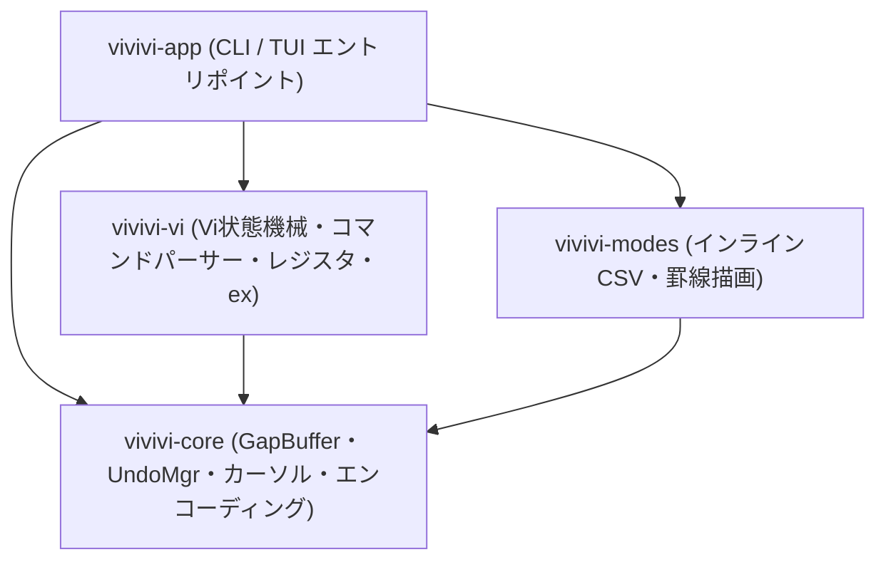

<div align="center">

# ⚡ vivivi (ヴィヴィヴィ)

**高機能テキストエディタ「OpenViVi」を現代のRustで安全・高速に再構築するオープンソースプロジェクト**

[](LICENSE)
[](https://www.rust-lang.org)
[](Cargo.toml)
[](https://github.com/tkshnkgwr/vivivi)

[English](./README.md) | [日本語](./README_JA.md)

</div>

---

## 📌 概要

`vivivi` は、長年親しまれてきた C++ / Qt 製テキストエディタ「**OpenViVi**」の洗練されたvi編集体験と優れたデータ構造をベースに、メモリ安全性と並行処理性能に優れた **Rust** で完全に再構築するプロジェクトです。

また、有償版（ViVi 3 / ViVi 4）に搭載されていた強力な独自機能である **「インラインCSV/TSV表示・編集モード」** や **「Unicode罫線自動結合モード」** も忠実に再現・統合しています。

---

## ✨ 主な特徴

- 🚀 **$O(1)$ 局所編集 GapBuffer**:
  - OpenViVi の `gap_buffer.h` に準拠し、編集カーソル位置に空き領域（Gap）を常駐させることで、連続タイピングや文字削除を $O(1)$（償却）で高速処理。
- 🔄 **トランザクション対応 Undo/Redo**:
  - 連続キー入力の自動マージ（1回の `u` で取り消し可能）と、Vi複合コマンド（`dd`, `cw`, `:%s` 等）をアトミックに戻す「Undoブロック」を実装。
  - 保存点（Save Point）の自動追跡により、Undoで保存時の状態に戻った際は `is_modified == false` に完全復帰。
- ⌨️ **忠実な Vi コマンドエンジン**:
  - Normal, Insert, Replace, Visual, VisualLine, VisualBlock, CommandLine の各モードを状態機械としてモデル化。
  - レジスタ管理（無名レジスタ、名前付きレジスタ `"a`〜`"z`、クリップボード連携）。
- 📊 **インライン CSV/TSV 表示・編集モード**:
  - 各列の最大幅に合わせてインラインで自動整列。全角文字（CJK）の表示幅も正しく計算。
  - 閲覧時はクォート記号を非表示にし、カーソル行のみ生テキストで直接編集可能。
- 📐 **Unicode 罫線自動結合描画モード**:
  - Unicode 罫線ブロック（U+2500〜U+254B）の交差判定に基づき、`Ctrl + 矢印キー` で十字（`┼`）やT字（`┬`, `┴`, `├`, `┤`）へ自動変換して接続。
- 📦 **UI非依存のマルチクレート設計 (Cargo Workspace)**:
  - エディタのコアロジックを UI から完全に分離し、高カバレッジな単体テストを実現。

---

## 🏗️ クレート構成



| クレート名     | 役割・責務                                                   | 依存クレート  |
| :------------- | :----------------------------------------------------------- | :------------ |
| `vivivi-core`  | テキストバッファ、行管理、カーソル、Undo/Redo、エンコーディング | なし          |
| `vivivi-vi`    | Vi状態機械、コマンドパーサー、レジスタ、exコマンド           | `vivivi-core` |
| `vivivi-modes` | インラインCSV/TSVモード、Unicode罫線描画・結合モード         | `vivivi-core` |
| `vivivi-app`   | アプリケーション本体・実行エントリポイント                   | 全クレート    |

---

## 🚀 インストール & ビルド

### 必要要件
- Rust 1.80 以上 (Edition 2024 対応)
- Cargo

### ローカルビルド
```powershell
# リポジトリのクローン
git clone https://github.com/tkshnkgwr/vivivi.git
cd vivivi

# ワークスペース全体のビルド
cargo build

# アプリケーションの実行
cargo run

# リリースバイナリのビルド
cargo build --release
```

### テスト実行
```powershell
# 全クレートの単体テスト実行 (全15テスト合格)
cargo test
```

---

## 📚 ドキュメント一覧

詳細なドキュメントは [`docs/`](./docs) ディレクトリに日・英で配備されています：

| ドキュメント | 日本語版 (JA) | 英語版 (EN) | 概要 |
| :--- | :--- | :--- | :--- |
| **アーキテクチャ** | [ja/ARCHITECTURE.md](./docs/ja/ARCHITECTURE.md) | [en/ARCHITECTURE.md](./docs/en/ARCHITECTURE.md) | システム設計・マルチクレート構造 |
| **機能仕様書** | [ja/SPECIFICATION.md](./docs/ja/SPECIFICATION.md) | [en/SPECIFICATION.md](./docs/en/SPECIFICATION.md) | バッファ、Undo、Vi、CSV、罫線仕様 |
| **開発者ガイド** | [ja/DEVELOPMENT.md](./docs/ja/DEVELOPMENT.md) | [en/DEVELOPMENT.md](./docs/en/DEVELOPMENT.md) | 環境構築・ビルド・開発フロー |
| **テスト計画** | [ja/TESTING.md](./docs/ja/TESTING.md) | [en/TESTING.md](./docs/en/TESTING.md) | テスト戦略・検証方法 |
| **テスト報告書** | [ja/TEST_REPORT.md](./docs/ja/TEST_REPORT.md) | [en/TEST_REPORT.md](./docs/en/TEST_REPORT.md) | 単体テスト結果記録 |
| **ユーザーガイド** | [ja/USER_GUIDE.md](./docs/ja/USER_GUIDE.md) | [en/USER_GUIDE.md](./docs/en/USER_GUIDE.md) | 操作方法・キーバインド |
| **ロードマップ** | [ja/TODO.md](./docs/ja/TODO.md) | [en/TODO.md](./docs/en/TODO.md) | 開発進捗・タスク一覧 |

---

## 📄 ライセンス

本プロジェクトは [MIT License](LICENSE) のもとで公開されています。
