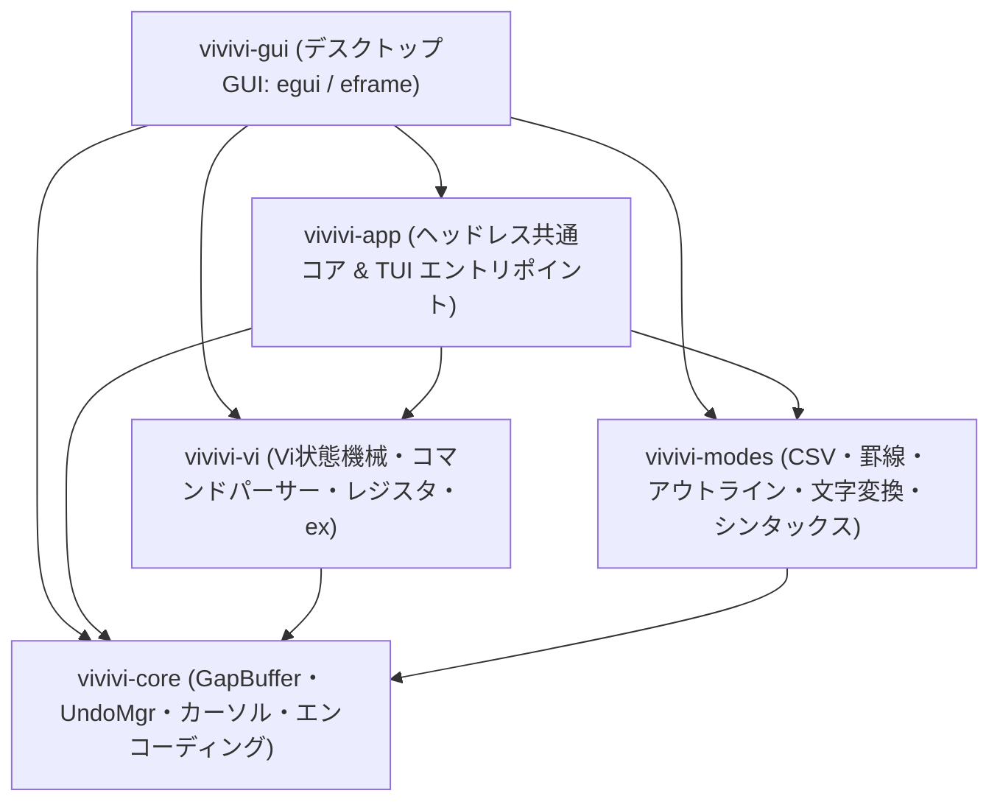

<div align="center">

# ⚡ vivivi (ヴィヴィヴィ)

**高機能テキストエディタ「OpenViVi」を現代のRustで安全・高速に再構築するオープンソースプロジェクト**

[](LICENSE)
[](https://www.rust-lang.org)
[](Cargo.toml)
[](https://github.com/tkshnkgwr/vivivi)

[English](./README.md) | [日本語](./README_JA.md)

</div>

---

## 背景と開発方針

本エディタ『vivivi』は、Windows向けの名作vi互換エディタ「ViVi 3 / ViVi 4」およびそのオープンソース版「OpenViVi」の設計思想をルーツとしています。

筆者は長年ViViを日常的に使用しており、OpenViViにも大いに期待しておりましたが、開発が休止してしまったことを受け、自ら後継となる環境を用意したいと考えました。  
既存のC++コードベースをそのままフォークして継続することは自身の技量として荷が重く恐れ多かったため、OpenViViの設計思想とデータ構造を参考に、Rustで一から再実装する方針をとっています。

かつてのViViやOpenViViユーザーの方に再び触れていただける機会があれば幸いですが、どこまでご期待に添えるかは手探りな部分もございます。あの使い心地を少しでも現代の環境に再現できるよう努めてまいります。

* **開発体制**:  
  Rustによるコード実装は、AI（Gemini）と相談しながら進めています。また、筆者自身GitHubの運用全般に不慣れな点が多く、至らない点があるかと思いますがご容赦ください。
* **現在のステータス**:  
  現在はβ版（`v0.9.5-beta`）です。共通のヘッドレスコア（`vivivi-app`）を基盤として、ターミナルTUI版（`vivivi`）とデスクトップGUI版（`vivivi-gui` / `egui` + `eframe`）の両方が動作します。
* **TUI ＆ GUI ハイブリッド構成**:  
  コンソールやSSH環境では超軽量な `vivivi`（TUI）、デスクトップ環境では Tokyo Night テーマ・PlemolJP 等幅フォント・日本語IMEインライン変換・削除文字落下アニメーションを備えた `vivivi-gui`（GUI）をシームレスに使い分けられます。

---

## 🙏 謝辞とリスペクト (Special Thanks & Respect)

本プロジェクト『vivivi』は、津田伸秀氏が心血を注いで開発されたWindows向け名作vi互換エディタ「**ViVi**」、およびそのオープンソース版「**openViVi**」の革新的な機能と設計思想に、最大限の敬意と心からの感謝を表して開発されています。

Unicode罫線の自動結合、インラインCSV/TSV高速整列・編集、Migemoローマ字日本語検索、文字コード・改行保持といったViVi独自の至高の編集支援機能は、四半世紀近く経った現代の最新エディタと比較しても色褪せない唯一無二の価値を持っています。  
長年にわたり偉大なエディタを生み出し、その貴重な知見をMITライセンスのオープンソースとして後世に託してくださった津田伸秀氏に、心より深く御礼申し上げます。

---

## 📌 概要

`vivivi` は、長年親しまれてきた C++ / Qt 製テキストエディタ「**OpenViVi**」の洗練されたvi編集体験と優れたデータ構造をベースに、メモリ安全性と並行処理性能に優れた **Rust** で完全に再構築するプロジェクトです。

元祖ViVi（ViVi 3 / ViVi 4）に搭載されていた強力な独自機能である **「インラインCSV/TSV表示・編集モード」**、**「Unicode罫線自動結合モード」**、**「文字変換機能」** に加え、Gvim常用機能である **「画面分割（Split / Vsplit）」**、**「BOX選択・矩形一括編集（VisualBlock）」**、**「アウトライン解析サイドペイン」** も忠実に統合しています。

---

## ✨ 主な特徴

- 🚀 **$O(1)$ 局所編集 GapBuffer**:
  - OpenViVi の `gap_buffer.h` に準拠し、編集カーソル位置に空き領域（Gap）を常駐させることで、連続タイピングや文字削除を $O(1)$（償却）で高速処理。
- 🔄 **トランザクション対応 Undo/Redo**:
  - 連続キー入力の自動マージ（1回の `u` で取り消し可能）と、Vi複合コマンド（`dd`, `cw`, `:%s` 等）をアトミックに戻す「Undoブロック」を実装。
  - 保存点（Save Point）の自動追跡により、Undoで保存時の状態に戻った際は `is_modified == false` に完全復帰。
- ⌨️ **忠実な Vi コマンドエンジン & 矩形編集**:
  - Normal, Insert, Replace, Visual, VisualLine, VisualBlock, CommandLine の各モードを状態機械としてモデル化。
  - **Insertキーによるトグル切替**: Vim互換の `Insert` キーによる Insert ⇄ Replace モード切替に対応。
  - **BOX選択・矩形編集完全対応**: `Ctrl-v` 選択、矩形ヤンク（`y`）、矩形削除（`d`/`x`）、矩形一括挿入（`I`/`A` $\to$ `Esc` 反映）、スペース自動補填矩形ペースト（`p`/`P`）。
  - レジスタ管理（無名レジスタ、名前付きレジスタ `"a`〜`"z`、クリップボード連携）。
- 🪟 **画面分割・マルチビュー (Gvim互換)**:
  - 水平分割（`:split`）および垂直分割（`:vsplit`）による複数ウィンドウ並行表示。
  - `Ctrl-w` 系統キーバインド（`Ctrl-w w` ウィンドウ巡回、`Ctrl-w c` クローズ、`Ctrl-w o` 単一ウィンドウ化等）。
- 🌲 **アウトライン解析・サイドペイン**:
  - Markdown（見出し全階層）、Rust、C/C++、Python等のシンボルツリー解析。
  - `F2` / `F8` / `:outline` によるトグル表示、`Tab` / `Esc` でのエディタ⇄アウトライン相互フォーカス切り替え、および `Enter` による該当行即時ジャンプ。
  - 選択カーソルに追従する自動縦スクロールに対応。
- 🔤 **多彩な文字変換機能**:
  - `:%zenkaku`, `:%hankaku`, `:%hiragana`, `:%katakana` 等のexコマンドによるバッファ全文一括変換（全角/半角英数、カタカナ/ひらがな、半角カナ濁点自動結合対応）。
- 📊 **インライン CSV/TSV 表示・編集モード**:
  - 各列の最大幅に合わせてインラインで自動整列。全角文字（CJK）の表示幅も正しく計算。
  - 閲覧時はクォート記号を非表示にし、カーソル行のみ生テキストで直接編集可能。
- 📐 **Unicode 罫線自動結合描画モード**:
  - Unicode 罫線ブロック（U+2500〜U+254B）の交差判定に基づき、`Ctrl + 矢印キー` で十字（`┼`）やT字（`┬`, `┴`, `├`, `┤`）へ自動変換して接続。
- 🔍 **外部Grep検索 & クイックフィックス (`:grep`, `:cnext`, `:cprev`)**:
  - `ripgrep` (`rg`) や `git grep` と連動した高速プロジェクト全文検索。検索結果一覧から該当箇所へ即時ジャンプ。
- 🏷️ **CTagsタグジャンプ & タグ一括生成 (`:tag`, `:tags`, `:maketags`, `Ctrl-]`, `Ctrl-t`)**:
  - `tags` ファイルに基づく関数・構造体定義への瞬時ジャンプとタグスタック履歴管理。
- 📁 **コード折り畳み (Folding - `zf`, `zo`, `zc`, `za`, `zd`, `:fold`)**:
  - 選択範囲の手動折り畳み、個別展開・折り畳み、トグル、全解除。TUIエディタ描画時に折り畳み行（`+--- X lines: ...`）をコンパクト表示。
- 🔄 **高度な文字列置換 & 計算式置換 (`:s`, `:%s`, `\=`)**:
  - Vim互換の正規表現置換に加え、`:%s/パターン/\=式/g` による評価置換（行番号 `line(".")` や数値加算計算など）に対応。
- ⚖️ **外部差分比較プレビュー (`:diff [path]`, `:difflog`)**:
  - 未保存バッファと保存済み実ファイルの差分比較、または指定した外部ファイルとの差分をシンタックスハイライト付きで専用プレビューウィンドウに表示。
- 📄 **Markdown文書の直接PDF出力 (`:pdf [path]`)**:
  - 編集中のMarkdown文書を、日本語フォントを適切に埋め込んだPDFドキュメントとして直接生成・エクスポート。
- 📑 **ファイルテンプレート自動展開 & 永続Undo手動保存 (`:undofile`, `doc/templates/`)**:
  - 新規ファイル作成時の言語別テンプレート自動適用、および編集履歴の手動永続化対応。
- 🌐 **特有文字・決定打による文字コード・改行の超高速早期自動判別**:
  - UTF-8, UTF-8 BOM, Shift_JIS (CP932), EUC-JP, UTF-16LE/BE（1文字目の特有バイトで即時確定）および CRLF, LF, CR（3行連続出現で即時確定）を自動判別し、保存時も元の文字コードと改行体系を完全維持。
- 🖥️ **ネイティブ・デスクトップ GUI (`vivivi-gui` / `egui` + `eframe`)**:
  - **Tokyo Night 3段階コントラスト外観**: エディタ背景 (`#1A1B26`)、パネル背景 (`#16161E`)、ステータスライン (`#292E42`) の3段階配色と角丸 4px によるモダンな視覚設計。
  - **PlemolJP フォント最優先ロード**: `fonts/` またはシステム導入済みの PlemolJP を自動検出し、BIZ UDゴシック / Consolas への多段フォールバックを構成。
  - **`ui.painter()` カスタムグリッド描画 ＆ 日本語 IME インライン統合**: 標準 `TextEdit` を使わず、行番号・ガター変更マーカー・対応括弧・不可視文字・IME 未確定文字列（シアン下線付き）を等幅セルで直接描画し、OS の IME 候補ウィンドウ座標を毎フレーム同期。
  - **削除文字落下物理アニメーション ＆ 0% CPU 省電力制御**: 文字削除時にグリフが放物線を描いて落下・フェードアウト（0.5秒）し、消滅後は再描画要求を停止してアイドル時 CPU 0% のリアクティブ待機を維持。

---

## 🏗️ クレート構成



| クレート名     | 役割・責務                                                               | 依存クレート      |
| :------------- | :----------------------------------------------------------------------- | :---------------- |
| `vivivi-core`  | テキストバッファ、行管理、カーソル、Undo/Redo、文字コード・改行早期判別  | なし              |
| `vivivi-vi`    | Vi状態機械、コマンドパーサー、レジスタ、矩形編集、exコマンド             | `vivivi-core`     |
| `vivivi-modes` | CSV/TSVモード、Unicode罫線描画、アウトライン解析、文字変換、シンタックス | `vivivi-core`     |
| `vivivi-app`   | ヘッドレス共通セッション基盤 (`App`, `Tab`, `WindowTreeNode`) ＆ TUI本体 | Core / Vi / Modes |
| `vivivi-gui`   | デスクトップGUI (`egui` / `eframe`)、日本語IME統合、ミニマップ、落下演出 | 全クレート        |

---

## 🚀 インストール & ビルド

### 必要要件
- Rust 1.85 以上 (Edition 2024 対応)
- Cargo

### ローカルビルド
```powershell
# リポジトリのクローン
git clone https://github.com/tkshnkgwr/vivivi.git
cd vivivi

# ワークスペース全体のビルド (TUI & GUI)
cargo build --workspace

# ターミナル TUI 版の実行
cargo run -p vivivi-app

# デスクトップ GUI 版の実行
cargo run -p vivivi-gui

# リリースバイナリのビルド
cargo build --release --workspace
```

### テスト実行
```powershell
# 全クレートの単体・公開API統合・ドキュメントテスト実行
cargo test --all-targets
cargo test --doc
```

---

## 📄 ライセンス

本プロジェクトは **[MIT License](LICENSE)** のもとで公開されています。

```text
Copyright (c) 2026 tkshnkgwr
Portions of the vi command engine and specifications are adapted from openViVi:
https://github.com/vivisuke/openViVi (MIT License)
```

---

## 🙏 謝辞・クレジット (Acknowledgments)

本プロジェクトの各種機能は、長年にわたり無償で知見やデータを公開・維持し続けてくださっているオープンソースコミュニティの多大な労力と成果に深く支えられています。ここに心より感謝の意を表します。

### 1. openViVi / ViVi (津田伸秀 氏)
- **作者**: 津田伸秀 (vivisuke) 氏 ([https://github.com/vivisuke/openViVi](https://github.com/vivisuke/openViVi))
- **謝意**: Windows環境で四半世紀近くにわたり愛されてきた名作エディタ「ViVi」の比類なき編集体験とアーキテクチャを生み出し、その貴重な知見をMITライセンスのオープンソースとして後世に託してくださった津田伸秀氏に、心より深く御礼申し上げます。

### 2. SKKプロジェクト (SKK Development Team)
- **概要**: Emacs発祥の日本語入力システム「SKK」およびその辞書システム。
- **謝意**: 創始者である佐藤雅彦氏をはじめ、歴代の開発者および辞書メンテナーの皆様に深く感謝いたします。30年以上にわたる膨大な労力と情熱によって無償で公開・保守され続けているSKK辞書のデータと設計思想は、日本のオープンソース文化における至宝です。`vivivi` のローマ字日本語検索における辞書読み込みエンジンは、SKKプロジェクトが築き上げた辞書フォーマットの恩恵を全面的に受けています。
- **外部辞書のライセンスについて**: ユーザーが任意で配置・利用できる公式外部SKK辞書ファイル群（`SKK-JISYO.L` 等）は、GNU General Public License (GPL) に基づいて公開されています。`vivivi` はこれら外部辞書を独立したデータファイルとして透過的に読み込みます。

### 3. Migemo (高林哲 氏)
- **考案者**: 高林 哲 (Satoru Takabayashi) 氏
- **謝意**: 「IMEをONにすることなく、アルファベット入力のまま日本語テキストを高速インクリメンタル検索する」という革新的かつ素晴らしい着想とアルゴリズムを考案・公開された高林氏に心より敬意と感謝を表します。


