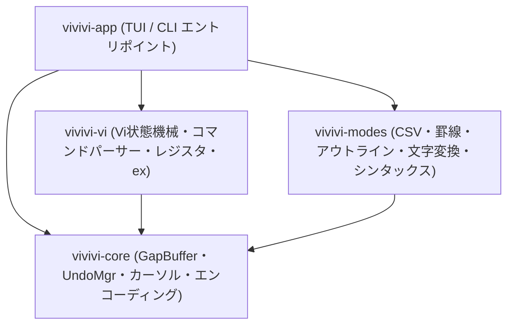

<div align="center">

# ⚡ vivivi (ヴィヴィヴィ)

**高機能テキストエディタ「OpenViVi」を現代のRustで安全・高速に再構築するオープンソースプロジェクト**

[](LICENSE)
[](https://www.rust-lang.org)
[](Cargo.toml)
[](https://github.com/tkshnkgwr/vivivi)

[English](./README.md) | [日本語](./README_JA.md)

</div>

---

## 📌 概要

`vivivi` は、長年親しまれてきた C++ / Qt 製テキストエディタ「**OpenViVi**」の洗練されたvi編集体験と優れたデータ構造をベースに、メモリ安全性と並行処理性能に優れた **Rust** で完全に再構築するプロジェクトです。

元祖ViVi（ViVi 3 / ViVi 4）に搭載されていた強力な独自機能である **「インラインCSV/TSV表示・編集モード」**、**「Unicode罫線自動結合モード」**、**「文字変換機能」** に加え、Gvim常用機能である **「画面分割（Split / Vsplit）」**、**「BOX選択・矩形一括編集（VisualBlock）」**、**「アウトライン解析サイドペイン」** も忠実に統合しています。

---

## ✨ 主な特徴

- 🚀 **$O(1)$ 局所編集 GapBuffer**:
  - OpenViVi の `gap_buffer.h` に準拠し、編集カーソル位置に空き領域（Gap）を常駐させることで、連続タイピングや文字削除を $O(1)$（償却）で高速処理。
- 🔄 **トランザクション対応 Undo/Redo**:
  - 連続キー入力の自動マージ（1回の `u` で取り消し可能）と、Vi複合コマンド（`dd`, `cw`, `:%s` 等）をアトミックに戻す「Undoブロック」を実装。
  - 保存点（Save Point）の自動追跡により、Undoで保存時の状態に戻った際は `is_modified == false` に完全復帰。
- ⌨️ **忠実な Vi コマンドエンジン & 矩形編集**:
  - Normal, Insert, Replace, Visual, VisualLine, VisualBlock, CommandLine の各モードを状態機械としてモデル化。
  - **BOX選択・矩形編集完全対応**: `Ctrl-v` 選択、矩形ヤンク（`y`）、矩形削除（`d`/`x`）、矩形一括挿入（`I`/`A` $\to$ `Esc` 反映）、スペース自動補填矩形ペースト（`p`/`P`）。
  - レジスタ管理（無名レジスタ、名前付きレジスタ `"a`〜`"z`、クリップボード連携）。
- 🪟 **画面分割・マルチビュー (Gvim互換)**:
  - 水平分割（`:split`）および垂直分割（`:vsplit`）による複数ウィンドウ並行表示。
  - `Ctrl-w` 系統キーバインド（`Ctrl-w w` ウィンドウ巡回、`Ctrl-w c` クローズ、`Ctrl-w o` 単一ウィンドウ化等）。
- 🌲 **アウトライン解析・サイドペイン**:
  - Markdown（見出し階層）、Rust、C/C++、Python等のシンボルツリー解析。
  - `F8` / `:outline` によるトグル表示、`Ctrl-o` でのサイドペイン操作と `Enter` での該当行即時ジャンプ。
- 🔤 **多彩な文字変換機能**:
  - `:%zenkaku`, `:%hankaku`, `:%hiragana`, `:%katakana` 等のexコマンドによるバッファ全文一括変換（全角/半角英数、カタカナ/ひらがな、半角カナ濁点自動結合対応）。
- 📊 **インライン CSV/TSV 表示・編集モード**:
  - 各列の最大幅に合わせてインラインで自動整列。全角文字（CJK）の表示幅も正しく計算。
  - 閲覧時はクォート記号を非表示にし、カーソル行のみ生テキストで直接編集可能。
- 📐 **Unicode 罫線自動結合描画モード**:
  - Unicode 罫線ブロック（U+2500〜U+254B）の交差判定に基づき、`Ctrl + 矢印キー` で十字（`┼`）やT字（`┬`, `┴`, `├`, `┤`）へ自動変換して接続。
- 🌐 **文字コード・改行自動判別**:
  - UTF-8, Shift_JIS (CP932), EUC-JP / CRLF, LF, CR を自動判別し、保存時も元の文字コードと改行体系を完全維持。

---

## 🏗️ クレート構成



| クレート名     | 役割・責務                                                             | 依存クレート  |
| :------------- | :--------------------------------------------------------------------- | :------------ |
| `vivivi-core`  | テキストバッファ、行管理、カーソル、Undo/Redo、文字コード・改行判別    | なし          |
| `vivivi-vi`    | Vi状態機械、コマンドパーサー、レジスタ、矩形編集、exコマンド           | `vivivi-core` |
| `vivivi-modes` | CSV/TSVモード、Unicode罫線描画、アウトライン解析、文字変換、シンタックス | `vivivi-core` |
| `vivivi-app`   | フルスクリーンTUI（Ratatui + crossterm）、画面分割、メインループ       | 全クレート    |

---

## 🚀 インストール & ビルド

### 必要要件
- Rust 1.80 以上 (Edition 2024 対応)
- Cargo

### ローカルビルド
```powershell
# リポジトリのクローン
git clone https://github.com/tkshnkgwr/vivivi.git
cd vivivi

# ワークスペース全体のビルド
cargo build

# アプリケーションの実行 (TUI)
cargo run

# リリースバイナリのビルド
cargo build --release
```

### テスト実行
```powershell
# 全クレートの単体テスト実行 (全47テスト完全合格)
cargo test
```

---

## 📄 ライセンス

本プロジェクトは **[MIT License](LICENSE)** のもとで公開されています。

```text
Copyright (c) 2026 tkshnkgwr
Portions of the vi command engine and specifications are adapted from openViVi:
https://github.com/vivisuke/openViVi (MIT License)
```
