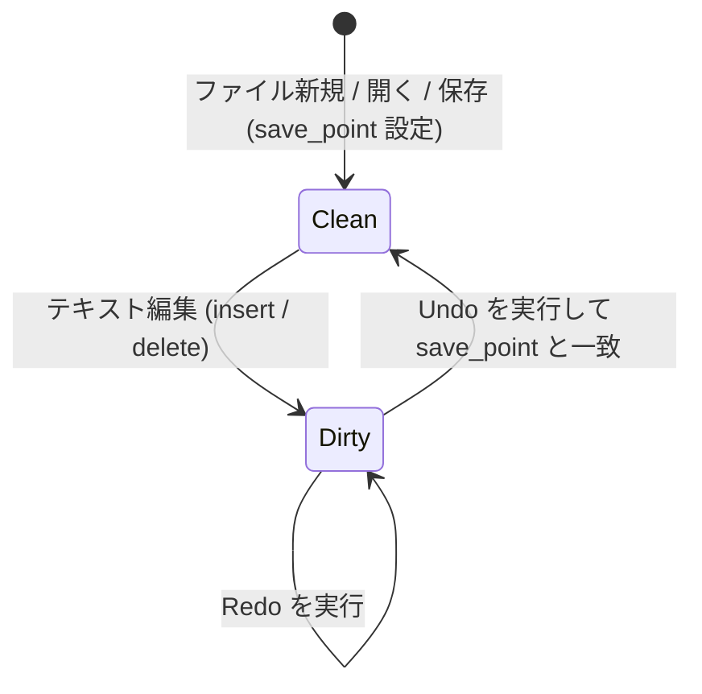

# vivivi: ギャップバッファ＆アンドゥマネージャ 詳細設計・仕様書

## 1. 概要
本仕様書は、`vivivi-core` クレートの中核をなす **GapBuffer（ギャップバッファ）** および **UndoMgr（アンドゥマネージャ）** の内部データ構造、動作アルゴリズム、API仕様、ならびに参考元である OpenViVi (`vivi/buffer/`) からの移植設計についてまとめたものです。

---

## 2. GapBuffer（ギャップバッファ）仕様

### 2.1 背景と設計目的
テキストエディタにおける文字編集は、「現在のカーソル位置周辺で連続して文字の入力や削除が行われる」という極めて強い**編集の局所性（Locality）**を持ちます。

通常の連続配列（`Vec<T>`）の中間に挿入を行うと、挿入位置以降の全要素をシフトするため毎回 $O(N)$ のコストが発生します。
これに対し、GapBuffer はバッファ内部の編集位置に**「ギャップ（空き領域）」**を常駐させることで、局所的な挿入・削除を **$O(1)$** で実行します。

### 2.2 メモリ配置とインデックス変換
バッファは「データ前半部」「ギャップ（空き領域）」「データ後半部」の3要素で構成されます。

```
【論理テキスト】: "HelloWorld" (有効要素数: 10)

【物理メモリ構造】:
  Index:   0   1   2   3   4   5   6   7   8   9  10  11  12  13  14
         [ H | e | l | l | o | ■ | ■ | ■ | ■ | ■ | W | o | r | l | d ]
                             ├─── ギャップ領域 ───┤
          gap_start = 5      gap_len = 5         capacity = 15
```

- **論理インデックス $\to$ 物理インデックス変換式**:
  $$
  \text{physical\_index}(i) = \begin{cases}
  i & (i < \text{gap\_start}) \\
  i + \text{gap\_len} & (i \ge \text{gap\_start})
  \end{cases}
  $$

### 2.3 主要アルゴリズム

| 操作 | 計算量 | 動作概要 |
| :--- | :--- | :--- |
| **文字挿入** (`insert`) | $O(1)$ (償却) | ギャップ先頭に要素を書き込み、`gap_start += 1`、`gap_len -= 1` とする。 |
| **文字削除** (`remove`) | $O(1)$ | ギャップ手前（BS）またはギャップ直後（DEL）を空き領域に組み入れ、`gap_len += 1` とする。 |
| **ギャップ移動** (`move_gap`) | $O(K)$ | カーソル移動時のみ実行。ギャップと目的位置の間の $K$ 要素を反対側へスライド移動させる。 |
| **容量拡張** (`reserve_gap`)| $O(N)$ | ギャップ枯渇時のみ実行。配列サイズを倍増させ、後半データを末尾に退避させてギャップを拡大する。 |

---

## 3. UndoMgr（アンドゥマネージャ）仕様

### 3.1 背景と設計目的
Viエディタにおいて、ユーザーにとって直感的で快適なUndo/Redoを提供するには、単なる「1文字ずつの操作記録」では不十分です。
OpenViViの設計思想に基づき、以下の3つの高度な要件を満たす設計としています。

1. **連続入力の自動マージ（タイピング統合）**
2. **Vi複合コマンド（`dd`, `cw`, `:%s` 等）を1回で戻す「トランザクションUndoブロック」**
3. **ファイル保存位置（Save Point）の追跡と `is_modified` フラグの自動整合**



### 3.2 アクションモデル（`UndoAction`）
各編集操作は以下の3種類の列挙体として表現され、Undo実行時にはそれぞれ「逆操作（Inverse）」が生成されます。

- `Insert { pos, text, prohibit_merge }` $\longleftrightarrow$ 逆操作: `Delete { pos, text, is_backspace: false }`
- `Delete { pos, text, is_backspace }` $\longleftrightarrow$ 逆操作: `Insert { pos, text, prohibit_merge: true }`
- `Replace { pos, old_text, new_text }` $\longleftrightarrow$ 逆操作: `Replace { pos, old_text: new_text, new_text: old_text }`

### 3.3 連続タイピングの自動マージ仕様
- **マージ条件**:
  - 直前の操作が `UndoAction::Insert` であること。
  - 今回の挿入位置が直前のアクションの末尾（`last_pos + last_len == current_pos`）と完全に一致していること。
  - 改行文字（`\n`）を含まないこと。
  - 直前のアクションに `prohibit_merge` フラグが立っていないこと。
- **マージ禁止の契機 (`prohibit_merge`)**:
  - 矢印キーやマウスによるカーソル移動。
  - 挿入モードからノーマルモードへの復帰（`Escape`）。
  - 改行キーの押下。

### 3.4 トランザクション対応「Undoブロック」仕様
- `open_undo_block()` を呼ぶと、ブロックネストレベル（`block_nest_level`）をインクリメントし、トランザクションを開始します。
- `close_undo_block()` でネストレベルをデクリメントし、0に達した時点で内部に含まれる全アクションをひとつの `UndoBlock` として確定します。
- **Undoの実行**:
  `UndoBlock` に格納されたアクション群を**末尾から先頭に向かって逆順（LIFO）**で走査し、各々の逆操作をバッファに適用します。

### 3.5 保存点（Save Point）と変更フラグ追跡
- ファイル保存時に `undo_mgr.on_saved()` を呼ぶと、現在の `undo_stack.len()` が `save_point` として記憶されます。
- `is_modified()` は、`current_undo_stack_len != save_point` の場合に `true` を返します。
- ユーザーが変更を加えた後、Undoを複数回実行して保存時の状態にぴったり戻った場合、自動的に `is_modified() == false` に復帰します。

---

## 4. TextBuffer による統合インターフェース

`TextBuffer` は、`GapBuffer<char>` と `UndoMgr` を内部にカプセル化し、上位レイヤー（ViEngineやUI）に対してシンプルかつ安全な高水準APIを提供します。

```rust
// 高水準編集（Undo自動記録）
pub fn insert_text(&mut self, pos: usize, text: &str);
pub fn delete_text(&mut self, pos: usize, len: usize, is_backspace: bool) -> String;

// トランザクション制御
pub fn open_undo_block(&mut self);
pub fn close_undo_block(&mut self);
pub fn undo(&mut self) -> bool;
pub fn redo(&mut self) -> bool;

// カーソル座標変換
pub fn position_to_cursor(&self, pos: usize) -> CursorPosition;
pub fn cursor_to_position(&self, cursor: CursorPosition) -> usize;
```

---

## 5. 参考元（OpenViVi）との対応対照表

| 本プロジェクト (`vivivi-core`) | OpenViVi (`vivi/buffer/`) | 備考 |
| :--- | :--- | :--- |
| [`GapBuffer<T>`](file:///c:/Users/632792/Documents/自作/vivivi/crates/vivivi-core/src/gap_buffer.rs) | `gap_buffer<Type>` (`gap_buffer.h`) | OpenViViのメモリ移動アルゴリズムをRust安全コードへ移植 |
| [`UndoMgr`](file:///c:/Users/632792/Documents/自作/vivivi/crates/vivivi-core/src/undo.rs) | `UndoMgr` (`undoMgr.h` / `undoMgr.cpp`) | ブロックネスト・マージ判定・逆操作生成を再現 |
| [`UndoBlock`](file:///c:/Users/632792/Documents/自作/vivivi/crates/vivivi-core/src/undo.rs) | `UndoAction::FLAG_BLOCK` | OpenViViのビットフラグ管理をRustの型安全な構造体へ昇華 |
| [`TextBuffer`](file:///c:/Users/632792/Documents/自作/vivivi/crates/vivivi-core/src/buffer.rs) | `Buffer` (`Buffer.h` / `Buffer.cpp`) | GapBufferとUndoMgrを統合し、行・カーソル変換を提供 |
