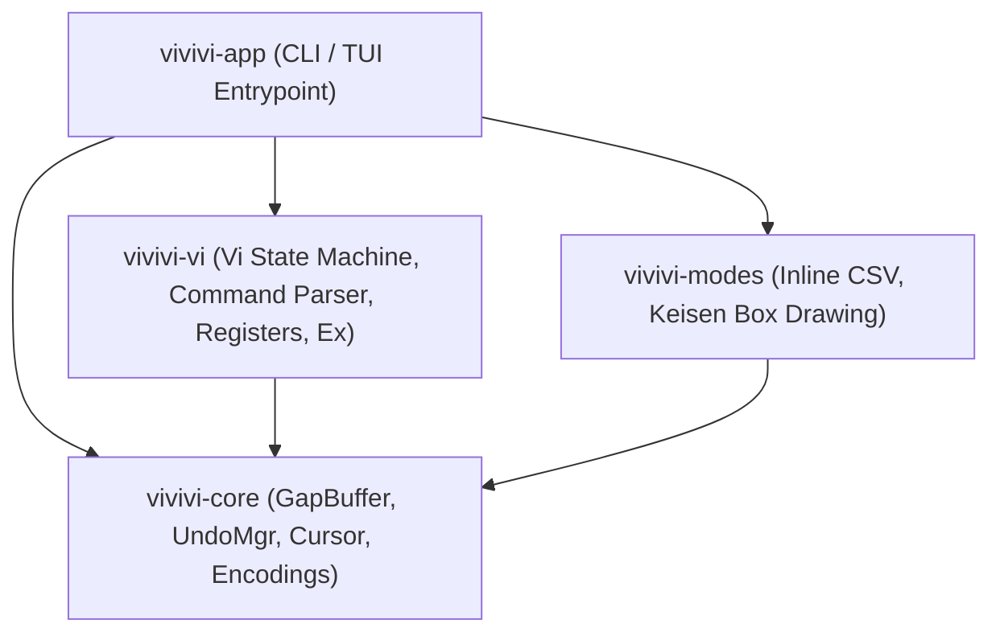

# vivivi: System Architecture Design (ARCHITECTURE)

## 1. Project Purpose
This project is a modern, memory-safe, and high-performance reconstruction in **Rust** of the classic text editor "OpenViVi" (originally implemented in C++ / Qt).
Furthermore, advanced features from the commercial editions (ViVi 3 and ViVi 4), such as inline CSV/TSV mode and box-drawing (keisen) mode, are faithfully ported and integrated.

---

## 2. Reference Resources
- **OpenViVi Source Code**: `%USERPROFILE%\Documents\参考元アプリ\openViVi`
  - Text buffer algorithms (`vivi/buffer/`)
  - Vi command engine (`vivi/vivi64/ViEngine.*`, `vivi/vivi64/TestViCommands.*`)
  - Box-drawing implementation (`vivi/vivi64/keisen.cpp`)
- **Commercial Editions (ViVi 3 & 4)**:
  - ViVi 3: `%USERPROFILE%\Documents\個人ツール\vivi3`
  - ViVi 4: `%USERPROFILE%\Documents\個人ツール\vivi4`
  - Help documentation (`vivihelp.CHM`): Decompiled into `docs/references/vivi4_help/` for specification lookups.

---

## 3. Multi-Crate Architecture (Cargo Workspace)
The editor core is decoupled from frontends (CLI, TUI, or future GUI) to enable high unit test coverage and modularity.

| Crate Name     | Responsibilities & Roles                                                                                                      | Dependencies  |
| :------------- | :---------------------------------------------------------------------------------------------------------------------------- | :------------ |
| `vivivi-core`  | GapBuffer, line manager, cursor, UndoMgr, persistent undo (undofile), charset/newline conversion, bracket match               | None          |
| `vivivi-vi`    | Vi state machine, command parser, register history, motions, visual block, custom extensions, folding, Phase 4.5 ex commands  | `vivivi-core` |
| `vivivi-modes` | Editing assists & tooling: keisen, CSV, expr subst, DIFF, DiffLog, template, ToDo, folding, grep, filer, project, PDF export  | `vivivi-core` |
| `vivivi-app`   | Ratatui TUI frontend, window splits, macro engine, print preview, persistent undo/difflog hooks, AI command slots, entrypoint | All crates    |

---

## 4. Crate Details & Module Hierarchy

### 4.1 `vivivi-core`
Provides fundamental data structures, transactional undo, and encoding I/O.
- `gap_buffer.rs`: $O(1)$ local edit GapBuffer with dynamic reallocation.
- `undo.rs`: Transactional undo manager and Persistent Undo (`.undofile`) serializer/deserializer.
- `buffer.rs`: `TextBuffer` integrating `GapBuffer` and `UndoMgr` with persistent undo hooks.
- `encoding.rs`: BOM detection, UTF-8 / Shift_JIS / CP932 / EUC-JP / UTF-16LE/BE conversions, and newline normalization.
- `cursor.rs`: Buffer coordinate tracking (line, column, byte offset).
- `paren.rs`: Matching bracket search for `()`, `{}`, `[]`, `<>` skipping strings and comments.

### 4.2 `vivivi-vi`
Handles Vi/Vim/ViVi modal state transitions, key sequence parsing, and ex commands.
- `mode.rs`: Mode definitions for Normal, Insert, Replace, Visual, VisualLine, VisualBlock, CommandLine.
- `command.rs` / `parser.rs`: Stateful command parser handling counts, registers, 2-key sequences, and Fold actions (`zc`, `zo`, `za`, `zM`, `zR`, `z<lvl>`).
- `register.rs`: Unnamed, named, system clipboard, and rectangular (`BlockWise`) registers.
- `engine/`: Decomposed submodules (`motion.rs`, `operate.rs`, `visual.rs`, `ex.rs`, `tests.rs`).
  - Integrated Phase 4.5 ex commands: `:grep`, `:cnext`/`:cn`, `:cprev`/`:cp`, `:todo`/`:undone`, `:fold`, `:filer`, `:difflog`/`:blame`, `:preview`/`:print`, `:pdf`, `:maketags`, `:undofile`.

### 4.3 `vivivi-modes`
Houses editing assistance modes and Phase 4.5 tooling engines.
- `diff.rs`: LCS algorithm, Unified Diff generation, patch application, and side-by-side view data mapping.
- `difflog.rs`: `.difflog` revision tracking, past generation restoration, and lightweight blame line analysis.
- `template.rs`: `.template.<ext>` template discovery and macro variable substitution (`%FileName%`, `%Date%`, etc.).
- `todo.rs`: In-buffer and directory recursive scanning for ToDo/FIXME tags.
- `folding.rs`: Indent-based folding hierarchy analysis and preview line generation.
- `grep.rs`: In-project fast regex Grep search with ignore filters and active navigation session.
- `filer.rs`: Dual-pane directory browser with 1-key file copy, move, and delete operations.
- `project.rs`: Multi-file workspace management and batch `tags` generation.
- `print.rs`: A4 pagination, line numbering, header/footer formatting, and standalone zero-dependency PDF 1.4 direct export.
- `migemo.rs`: Standalone Romaji Japanese search engine with embedded SKK dictionary (`BUILTIN_SKK_ENTRIES`) and external dictionary loading.
- `keisen.rs`: Geometric corner-joining algorithm, protected typing, and Normal mode `x`/`X` deletion border preservation.
- `outline.rs`: Markdown headers and multi-language symbol tree extraction engine.
- `csv.rs`, `expr_subst.rs`, `fftt.rs`, `conv.rs`, `align.rs`, `renumber.rs`, `dabbrev.rs`, `abbrev.rs`, `dmacro.rs`, `lexedit.rs`, `zen.rs`, `calc.rs`, `syntax.rs`.

### 4.4 `vivivi-app`
Provides terminal frontend rendering and application lifecycle orchestration.
- `tui/app.rs`: Application state, file save DiffLog/Persistent Undo hooks, file open template/Persistent Undo restoration hooks.
- `tui/event.rs`: Key event dispatch, double-Esc detection, Migemo/outline/preview mode navigation.
- `tui/window.rs`: Vim-compatible nested split tree management (`WindowTreeNode`), independent scroll and cursor state, geometric focus navigation.
- `tui/ui/`: Modular UI widgets (`editor.rs`, `outline.rs`, `status.rs`, `help.rs`, `preview.rs`).
  - `editor.rs`: Visual Column based horizontal scroll tracking and safe character clipping.
  - `outline.rs`: Left side-pane symbol tree and active item highlight.
  - `preview.rs`: Full-screen modal print preview renderer.

---

## 5. Design Decisions & Constraints
- **Zero-Dependency Core Tools**:
  - PDF generation, LCS diffing, and persistent undo serialization are all implemented strictly in standard Rust without external bloat crates.
  - Ensures blazing compilation speed and cross-platform portability.
- **Desktop GUI (egui) Migration to Phase 5**:
  - Desktop GUI frontend and GUI-dependent features (minimap, falling deletion animation, etc.) were migrated to Phase 5 per user instruction, focusing current efforts on terminal TUI and core tooling engines.
