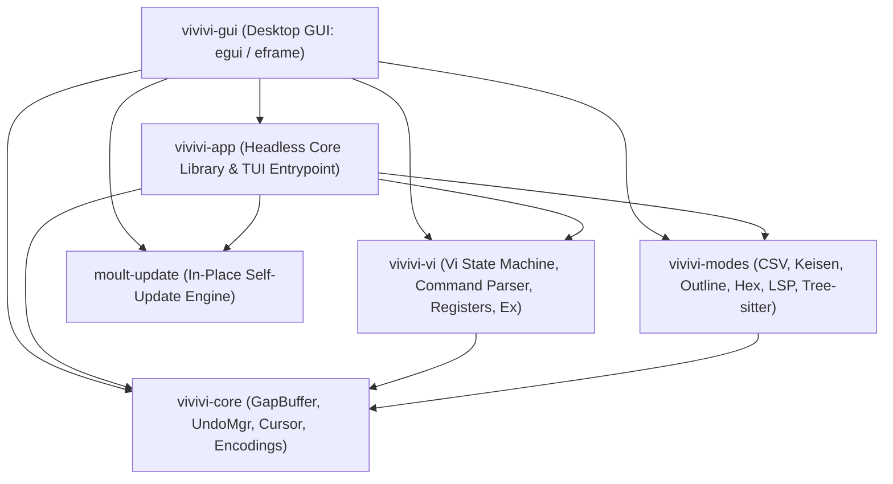

# vivivi: System Architecture Design (ARCHITECTURE)

## 1. Project Purpose
This project is a modern, memory-safe, and high-performance reconstruction in **Rust** of the classic text editor "OpenViVi" (originally implemented in C++ / Qt).
It faithfully integrates signature features from commercial editions (ViVi 3 and ViVi 4)—such as inline CSV/TSV mode, box-drawing (keisen) mode, binary hex editor, and 2D project visualization—alongside modern capabilities including an LSP client, Tree-sitter AST highlighting, and lock-free self-updates.

---

## 2. Reference Resources
- **OpenViVi Source Code**: `%USERPROFILE%\Documents\参考元アプリ\openViVi`
  - Text buffer algorithms (`vivi/buffer/`)
  - Vi command engine (`vivi/vivi64/ViEngine.*`, `vivi/vivi64/TestViCommands.*`)
  - Box-drawing implementation (`vivi/vivi64/keisen.cpp`)
- **Commercial Editions (ViVi 3 & 4)**:
  - ViVi 3: `%USERPROFILE%\Documents\個人ツール\vivi3`
  - ViVi 4: `%USERPROFILE%\Documents\個人ツール\vivi4`
  - Help documentation (`vivihelp.CHM`): Decompiled into `docs/references/vivi4_help/` for specification lookups.

---

## 3. Multi-Crate Architecture (Cargo Workspace)
The editor core is abstracted into a headless session layer shared identically between the terminal TUI (`vivivi-app`) and the native desktop GUI (`vivivi-gui`) across a 6-crate workspace.

| Crate Name     | Responsibilities & Roles                                                                                                    | Dependencies              |
| :------------- | :-------------------------------------------------------------------------------------------------------------------------- | :------------------------ |
| `vivivi-core`  | GapBuffer, line manager, cursor, UndoMgr, persistent undo (undofile), early charset/newline detection, bracket match        | None                      |
| `vivivi-vi`    | Vi state machine, command parser, register history, motions, visual block, custom extensions, folding, ex commands          | `vivivi-core`             |
| `vivivi-modes` | Editing assists & tooling: keisen, CSV, expr subst, DIFF, DiffLog, template, ToDo, folding, grep, filer, PDF, Hex, LSP, AST | `vivivi-core`             |
| `moult-update` | GitHub Releases async query, SHA-256 verification, Windows in-place binary swap, synchronized GUI/TUI pair upgrade          | None (Standalone crate)   |
| `vivivi-app`   | Headless session core (`App`, `Tab`, `WindowTreeNode`), Ratatui TUI frontend, configuration & theme management              | Core / Vi / Modes / Moult |
| `vivivi-gui`   | Native desktop GUI (`egui` / `eframe`), inline Japanese IME, minimap, gravity-drop animation, 2D force-directed graph       | All crates                |

---

## 4. Crate Details & Module Hierarchy

### 4.1 `vivivi-core`
Provides fundamental data structures, transactional undo, and encoding I/O.
- `gap_buffer.rs`: $O(1)$ local edit GapBuffer with dynamic reallocation.
- `undo/`: Transactional undo manager and Persistent Undo (`.undofile`) serializer/deserializer.
- `buffer.rs`: `TextBuffer` integrating `GapBuffer` and `UndoMgr` with persistent undo hooks.
- `encoding.rs`: BOM detection, UTF-8 / Shift_JIS / CP932 / EUC-JP / UTF-16LE/BE conversions, and early signature detection.
- `cursor.rs`: Buffer coordinate tracking (line, column, byte offset).
- `paren.rs`: Matching bracket search for `()`, `{}`, `[]`, `<>` skipping strings and comments.
- `swap.rs`: Crash recovery swap file (`.swp`) checkpointing and restoration.

### 4.2 `vivivi-vi`
Handles Vi/Vim/ViVi modal state transitions, key sequence parsing, and ex commands.
- `mode.rs`: Mode definitions for Normal, Insert, Replace, Visual, VisualLine, VisualBlock, CommandLine.
- `command.rs` / `parser/`: Stateful command parser handling counts, registers, 2-key sequences, and Fold actions (`zc`, `zo`, `za`, `zM`, `zR`, `z<lvl>`).
- `register.rs`: Unnamed, named, system clipboard, and rectangular (`BlockWise`) registers.
- `engine/`: Decomposed submodules (`motion.rs`, `operate.rs`, `visual.rs`, `text_object.rs`, `ex.rs`).

### 4.3 `vivivi-modes`
Houses editing assistance modes and tooling engines.
- `hex.rs`: Binary hex editor engine (`HexDocument`, `HexCursor`, nibble editing, Undo/Redo, byte search).
- `lsp/`: LSP v3.17 client (`protocol.rs` JSON-RPC 2.0 / Content-Length, `client.rs` background stdio transport, `manager.rs` diagnostics, hover, definition & completion orchestration).
- `treesitter.rs`: `tree-sitter` AST parsing, line token extraction, smart selection expand/shrink (`AstSelectionRange`), incremental parsing.
- `trim.rs`: Zero-copy trailing whitespace trimming for ASCII spaces, tabs, and full-width spaces.
- `diff.rs` / `difflog.rs`: LCS Unified Diff generation and `.difflog` revision backups.
- `template.rs` / `todo.rs` / `folding.rs` / `grep.rs` / `filer.rs` / `project.rs` / `print.rs`.
- `migemo.rs` / `keisen/` / `outline.rs` / `csv.rs` / `expr_subst.rs` / `conv.rs` / `align.rs` / `renumber.rs` / `dabbrev.rs` / `abbrev.rs` / `dynamic_macro.rs` / `lex_edit.rs` / `zen_coding.rs` / `calc.rs` / `syntax/`.

### 4.4 `moult-update`
Standalone application-agnostic self-update crate.
- `check.rs`: GitHub Releases API query, 24h TTL rate-limit cache, `semver` evaluation.
- `download.rs`: Streaming download, SHA-256 verification, Zip Slip protected extraction.
- `swap.rs` / `cleanup.rs`: Windows lock-free `.old` rename & swap, startup old binary cleanup.

### 4.5 `vivivi-app`
Provides the headless session layer and terminal TUI frontend.
- `config.rs` / `theme.rs`: 6-category TOML configuration and 5 built-in color themes.
- `tui/app/`: Session state, multi-tab management, window splitting, external process piping, Hex/LSP/Tree-sitter orchestration.
- `tui/event/`: Key dispatch, Windows shortcuts, Ex command execution.
- `tui/ui/`: Modular TUI widgets (`editor.rs`, `hex_view.rs`, `lsp_view.rs`, `outline.rs`, `status.rs`, `settings.rs`, `cmd_exec.rs`).

### 4.6 `vivivi-gui`
Provides the native desktop GUI frontend powered by `egui` / `eframe`.
- `app/`: Main update loop, `canvas.rs` (custom monospace grid, Hex grid, AST highlighting), `input.rs` (IME Preedit protection, particle spawning), `panels.rs`, `modals.rs`, `settings_dialog.rs`, `async_tree.rs`.
- `visualize.rs`: 2D Force-Directed Graph for project dependency and freshness visualization.
- `particles.rs`: Gravity-drop character deletion physics and 0% CPU reactive idle control.

---

## 5. Design Decisions & Related Specifications
- **Zero-Bloat Core Tools**:
  - PDF generation, LCS diffing, persistent undo serialization, and JSON-RPC framing are implemented in clean Rust with minimal external dependencies.
- **Detailed Design Documents**:
  - For desktop GUI architecture and styling details, see [GUI_DESIGN.md](./GUI_DESIGN.md).
  - For configuration schema and theme specifications, see [SETTINGS_DESIGN.md](./SETTINGS_DESIGN.md).
