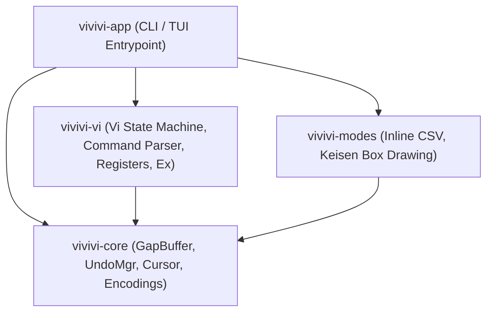

# vivivi: System Architecture Design (ARCHITECTURE)

## 1. Project Purpose
This project is a modern, memory-safe, and high-performance reconstruction in **Rust** of the classic text editor "OpenViVi" (originally implemented in C++ / Qt).
Furthermore, advanced features from the commercial editions (ViVi 3 and ViVi 4), such as inline CSV/TSV mode and box-drawing (keisen) mode, are faithfully ported and integrated.

---

## 2. Reference Resources
- **OpenViVi Source Code**: `%USERPROFILE%\Documents\参考元アプリ\openViVi`
  - Text buffer algorithms (`vivi/buffer/`)
  - Vi command engine (`vivi/vivi64/ViEngine.*`, `vivi/vivi64/TestViCommands.*`)
  - Box-drawing implementation (`vivi/vivi64/keisen.cpp`)
- **Commercial Editions (ViVi 3 & 4)**:
  - ViVi 3: `%USERPROFILE%\Documents\個人ツール\vivi3`
  - ViVi 4: `%USERPROFILE%\Documents\個人ツール\vivi4`
  - Help documentation (`vivihelp.CHM`): Decompiled into `docs/references/vivi4_help/` for specification lookups.

---

## 3. Multi-Crate Architecture (Cargo Workspace)
The editor core is decoupled from frontends (CLI, TUI, or future GUI) to enable high unit test coverage and modularity.

| Crate Name     | Responsibilities & Roles                                     | Dependencies  |
| :------------- | :----------------------------------------------------------- | :------------ |
| `vivivi-core`  | GapBuffer, line manager, cursor, Undo/Redo, encodings        | None          |
| `vivivi-vi`    | Vi state machine, command parsing, registers, ex commands    | `vivivi-core` |
| `vivivi-modes` | Inline CSV/TSV mode, Unicode box-drawing (keisen) mode       | `vivivi-core` |
| `vivivi-app`   | Application binary and execution entrypoint                  | All crates    |
