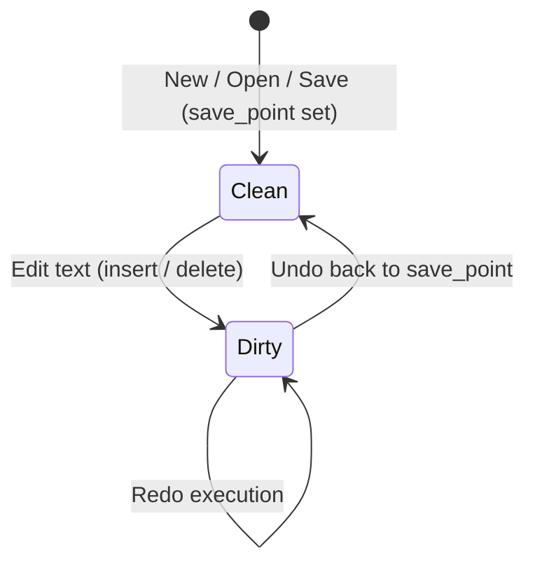

# vivivi: Functional Specifications (SPECIFICATION)

This document defines all functional specifications, data structures, algorithms, and editing modes for `vivivi`.

---

## 1. Text Buffer & Undo/Redo Specifications (OpenViVi Base)

### 1.1 GapBuffer (`GapBuffer<T>`)
Text editing exhibits strong **locality of editing** — users repeatedly type or delete characters at the current cursor position.

Inserting into a conventional continuous array (`Vec<T>`) costs $O(N)$ due to element shifting.
In contrast, `GapBuffer` maintains an empty gap at the edit cursor, achieving **amortized $O(1)$** local insertions and deletions.

#### Memory Layout & Logical Index Mapping
The buffer consists of pre-gap data, the empty gap, and post-gap data.

```
[Logical Text]: "HelloWorld" (Length: 10)

[Physical Memory]:
  Index:   0   1   2   3   4   5   6   7   8   9  10  11  12  13  14
         [ H | e | l | l | o | ■ | ■ | ■ | ■ | ■ | W | o | r | l | d ]
                             |---- Empty Gap ----|
          gap_start = 5      gap_len = 5         capacity = 15
```

- **Logical to Physical Index Formula**:
  $$
  \text{physical\_index}(i) = \begin{cases}
  i & (i < \text{gap\_start}) \\
  i + \text{gap\_len} & (i \ge \text{gap\_start})
  \end{cases}
  $$

#### Core Operations and Complexity
| Operation | Complexity | Description |
| :--- | :--- | :--- |
| **Insert** (`insert`) | $O(1)$ (amortized) | Writes element at `gap_start`, `gap_start += 1`, `gap_len -= 1`. |
| **Remove** (`remove`) | $O(1)$ | Expands gap over deleted elements, `gap_len += 1`. |
| **Move Gap** (`move_gap`) | $O(K)$ | Only executed when the cursor jumps. Shifts intervening $K$ elements. |
| **Reserve** (`reserve_gap`) | $O(N)$ | Only on gap exhaustion. Doubles buffer size and moves post-gap data. |

---

### 1.2 Undo Manager (`UndoMgr`)
Provides natural, intuitive undo/redo functionality for Vi editing through three mechanisms:



#### Action Model (`UndoAction`)
Each operation generates its inverse action upon undo:
- `Insert { pos, text, prohibit_merge }` $\longleftrightarrow$ Inverse: `Delete { pos, text, is_backspace: false }`
- `Delete { pos, text, is_backspace }` $\longleftrightarrow$ Inverse: `Insert { pos, text, prohibit_merge: true }`
- `Replace { pos, old_text, new_text }` $\longleftrightarrow$ Inverse: `Replace { pos, old_text: new_text, new_text: old_text }`

#### Continuous Typing Auto-Merge
- Merges consecutive typings into a single action if contiguous and without newlines.
- Prohibits merging on cursor moves, mode switches (`Escape`), or newlines.

#### Transactional Undo Blocks
- Manages nesting via `open_undo_block()` and `close_undo_block()`.
- Flushes an atomic `UndoBlock` when the nest level reaches 0.
- Applies inverse actions in reverse execution order (LIFO) upon undo.

#### Save Point & Modified Tracking
- Tracks stack depth via `undo_mgr.on_saved()`.
- Automatically restores `is_modified == false` when undone back to the save point.

---

### 1.3 OpenViVi Code Mapping

| Project Crate (`vivivi-core`) | OpenViVi (`vivi/buffer/`) | Notes |
| :--- | :--- | :--- |
| `GapBuffer<T>` | `gap_buffer<Type>` (`gap_buffer.h`) | OpenViVi memory shifting algorithm ported to safe Rust |
| `UndoMgr` | `UndoMgr` (`undoMgr.h` / `undoMgr.cpp`) | Recreates nested blocks, continuous merge, inverse actions |
| `UndoBlock` | `UndoAction::FLAG_BLOCK` | Modernized into a type-safe transactional struct |
| `TextBuffer` | `Buffer` (`Buffer.h` / `Buffer.cpp`) | Combines GapBuffer and UndoMgr with cursor/line conversions |

---

## 2. Vi Engine Specifications (OpenViVi Base)

### 2.1 Modes
- **Normal Mode**: Standard vi navigation and command execution.
- **Insert Mode**: Regular text insertion. `Escape` returns to Normal.
- **Replace Mode**: Character overwriting.
- **Visual Mode**: Character-wise selection.
- **Visual Line Mode**: Line-wise selection (`V`).
- **Visual Block Mode**: Rectangular block selection (`Ctrl-V`).
- **Command-line Mode**: Ex command execution (`:w`, `:q`, `:s`).

---

## 3. Inline CSV/TSV Mode Specifications (ViVi 4 Base)
- **Display Specifications**:
  - Automatically calculates column widths and aligns cells inline.
  - Hides enclosing quotes (`"` / `'`) in display for readability.
  - **Active Line**: Cursor line shows raw text with quotes for accurate editing.
  - **Header Lines**: Recognizes custom header indicator (e.g. `#`) to format table headers.
  - **Multiple Tables**: Supports multiple independent tables within a single document.
- **Editing Specifications**:
  - Full editing support inside CSV mode (character insert, line deletion, vi commands).

---

## 4. Box Drawing (Keisen) Mode Specifications (OpenViVi Base)
- **Operations**:
  - `Shift-F5`: Toggle keisen mode.
  - `Ctrl + Arrow keys`: Draw box lines with automatic junction joining.
  - `Shift + Arrow keys`: Erase box lines.
- **Joining Algorithm (Ported from OpenViVi `keisen.cpp`)**:
  - Bitmask state tracking for Unicode box characters (U+2500 - U+254B).
  - Automatically selects correct cross, T-junction, or corner characters (`┼`, `├`, `┬`, `┴`, `┤`).
- **Keisen Protected Edit Specifications (ViVi 3 / ViVi 4 Lineage)**:
  - While typing inside a box frame, trailing whitespace on the current line is automatically removed to keep the right border intact.
  - Backspacing/deleting text automatically pads spaces to maintain border positions.
  - Box internal text alignment via `:align left`, `:align center`, `:align right`.

---

## 5. Character Conversion & Box Numeric Calculations

### 5.1 Batch Character Conversion (`conv.rs`)
High-speed bijective and unidirectional conversions across full-width, half-width, kana, and case formats:

| Conversion Type                      | Ex Commands               | Description                                                    |
| :----------------------------------- | :------------------------ | :------------------------------------------------------------- |
| Full-width Alphanumeric $\to$ Half   | `:hankaku`, `:%hankaku`   | Maps full-width ASCII/symbols to standard ASCII                |
| Half-width Alphanumeric $\to$ Full   | `:zenkaku`, `:%zenkaku`   | Maps standard ASCII to Unicode full-width (U+FF01〜U+FF5E)     |
| Hiragana $\to$ Full-width Katakana   | `:katakana`, `:%katakana` | Maps Hiragana (U+3041〜U+3096) to Katakana                    |
| Katakana $\to$ Hiragana              | `:hiragana`, `:%hiragana` | Maps Katakana (U+30A1〜U+30F6) to Hiragana                    |
| Full-width Katakana $\to$ Half-width | `:hankata`, `:%hankata`   | Converts full-width Katakana to half-width voiced kana pairs   |
| Half-width Katakana $\to$ Full-width | `:zenkata`, `:%zenkata`   | Composes half-width kana + voice marks into single full glyphs |
| Uppercase / Lowercase Conversion     | `:toupper`, `:tolower`    | Case conversion across ASCII and Unicode text                  |

### 5.2 Box Selection Numeric Calculations (`calc.rs`)
- **Operations**: Select a visual block (`Ctrl-v`) containing numbers and execute `:calc`, `:sum`, or `:total`.
- **Parsing**: Extracts integers, negative numbers, decimals, and comma-separated floats (`1,000.50`).
- **Metrics**: Computes count, sum, arithmetic average, and sample standard deviation, reporting on the status line and copying results to the clipboard.

---

## 6. Advanced Navigation & Search

### 6.1 Romaji Japanese Search (Migemo / `g/`)
- Incremental search for Japanese Kanji/Kana directly via Romaji queries without toggling IME.
- SKK dictionary integration produces optimized regular expressions (e.g., `(検索|けんさく|kensaku)`).
- Standard `n` and `N` navigation supported.

### 6.2 Symbol Outline Pane (`F8`, `:outline`)
- Displays an interactive side tree pane extracting Markdown headers (`#`), Rust items (`fn`, `struct`, `impl`), C/C++, and Python symbols.
- Press `Enter` to jump directly to target definition.

### 6.3 Multi-Window Splits (`Ctrl-w`, `:split`, `:vsplit`)
- Horizontal (`:split`, `Ctrl-w s`) and vertical (`:vsplit`, `Ctrl-w v`) splits sharing the active buffer.
- Window cycling (`Ctrl-w w`), closing (`Ctrl-w c`, `:close`), and single-window maximization (`Ctrl-w o`, `:only`).

---

## 7. Signature ViVi Editing Assists

### 7.1 Text Alignment (`align.rs`)
- **Command**: `:align <target>` (e.g., `:align =`, `:align :`, `:align //`)
- Aligns columns vertically across selected lines (or whole buffer) on the first occurrence of `target`.
- Preserves unmatched lines and computes visual character display width for precise padding.

### 7.2 Renumbering (`renumber.rs`)
- **Command**: `:renumber [start] [step]` / `:renum [start] [step]` (default: 1, 1)
- Identifies numbered lists (`1.`, `2)`, `(1)`, `[1]`) and renumbers sequences sequentially while retaining existing indent depths and delimiters.

### 7.3 Batch Head/Tail String Insertion (`line_edit.rs`)
- **Commands**: `:insbeg <str>`, `:insend <str>`, `:begend <beg> <end>`
- Inserts prefixes (after indentation, skipping blanks) and suffixes across lines simultaneously.

### 7.4 Expression Substitute (`expr_subst.rs` / ViVi 3 / ViVi 4 Compatible)
- **Commands**: `:s/pattern/expression/e`, `:%s/pattern/expression/e`
- Dynamically parses and evaluates replacement strings as arithmetic or scripting expressions:
  - Arithmetic operators: `+`, `-`, `*`, `/`, `%` with parenthesized grouping `(...)`.
  - Built-in variables:
    - `$0`: Entire matched string.
    - `$1` - `$9`: Regular expression capture groups (automatically parsed as numbers when applicable).
    - `$i` / `$n`: Sequential counter automatically incremented on each replacement match (1, 2, ...).
    - `$line`: Physical 1-based line number of the match.
  - String concatenation: String literals (`"..."`, `'...'`) joined with numbers via `+`.

---

## 8. High-Speed Input & Macro Assistance

### 8.1 Dynamic Word Completion (dabbrev / `Ctrl-l`, `Ctrl-m`)
- Scans current buffer backward and forward to cyclically complete words matching typed prefix.

### 8.2 Static Abbreviation Expansion (abbrev / `Ctrl-;`, `Alt-;`, `F4`, `:abbrev`)
- Expands short identifiers (`fn`, `struct`, `hw`) into full code snippets.
- Supports `:abbrev <key> <val>` registration and external dictionary text files.

### 8.3 Dynamic Macro (Masui Repeat / `Alt-m`, `Ctrl-Alt-m`, `:dmacro`)
- Automatically detects recurring keystroke patterns (XX) in recent typing history without prior manual recording.
- Replays the detected editing action immediately upon pressing `Alt-m`.

### 8.4 Lexical Edit Prediction (LexEdit / `Ctrl-j`, `:lexedit`)
- Records word-level substitutions and infers subsequent edits on analogous symbols using prefix/suffix rules.

### 8.5 Zen-Coding (Emmet) Expansion (`Ctrl-,`, `Alt-,`, `:zen`)
- Expands shorthand HTML tags (`table>tr>td*3`, `div#main.row`) into nested, formatted HTML trees.

### 8.6 Keyboard Macro Record & Playback (`Ctrl-Alt-r`, `Ctrl-Alt-p`, `F9`, `F10`, `:macro`)
- Records keystrokes across Normal, Insert, and Command modes; replays them instantly.
- Interoperable with Vi register macros (`qa` ... `q`, `@a`).

---

## 9. AI Integration Architecture (`:ai`)

- **Zero-Latency Principle**: Non-blocking asynchronous worker engine ensuring zero typing latency.
- **Local-First & Pluggable**: Native Ollama / llama.cpp support with cloud API hooks (Gemini, Claude, OpenAI).
- **Commands**: `:ai <instruction>` for in-place text transformation; `:ai commit` for conventional commit message generation.
- **Reference**: Detailed design in [`docs/ja/AI_INTEGRATION_DESIGN.md`](../ja/AI_INTEGRATION_DESIGN.md).

---

## 10. ViVi-Exclusive Vi Command Extensions & Navigation (ViVi 3 / ViVi 4 Compatible)

### 10.1 fFtT Full-width Character Matching (`fftt.rs` / ViVi 3 / ViVi 4 Compatible)
- **Commands**: `f<char>`, `F<char>`, `t<char>`, `T<char>`, `;`, `,`
- Typing ASCII characters (alphanumeric, brackets `()`, `[]`, `{}`, punctuation `:` , `!`) automatically matches both half-width and full-width Japanese equivalents (`（）`, `［］`, `｛｝`, `：`, `！`).
- Supports operator motions such as `df)` or `ct]`.

### 10.2 Word Forward/Backward Search & Prefix/Suffix Match (Common / OpenViVi Compatible)
- **Commands**: `*`, `#`, `g*`, `g#`, `g<`, `g=`
- `*` / `#`: Exact word match (`\bword\b`) under cursor forward / backward.
- `g*` / `g#`: Partial word match without word boundary forward / backward.
- `g<`: Prefix match on word under cursor forward.
- `g=`: Suffix match on word under cursor forward.

### 10.3 Numeric / Alphabet Increment & Decrement & Boolean Toggle (ViVi 3 / ViVi 4 Compatible)
- **Commands**: `#+`, `##`, `#-`, `#!`
- `#+` / `##`: Increment number under cursor (`+1`) or advance alphabet (`a` $\to$ `b`, `z` $\to$ `a`).
- `#-`: Decrement number under cursor (`-1`) or reverse alphabet (`b` $\to$ `a`, `a` $\to$ `z`).
- `#!`: Toggle boolean identifier under cursor (`true` ⇄ `false`, `True` ⇄ `False`, `yes` ⇄ `no`, `on` ⇄ `off`).

### 10.4 Last Edit Location / Line Jump & Line Replication (ViVi 3 / ViVi 4 Compatible)
- **Commands**: `@`, `'@`, `` `@ ``, `=<char>`
- `@`: Instantly jump back to the exact character position of the most recent text modification.
- `'@` / `` `@ ``: Jump to the beginning of the line where the most recent edit occurred.
- `=<char>`: Replicate characters from the line above starting at the current column up to `<char>` (or newline).

### 10.5 Global Marks (ViVi 3 / ViVi 4 Compatible)
- **Commands**: `ma` - `mz`, `mA` - `mZ`, `'a`, `` `a ``, `:marks`
- `ma` - `mz`: Set local buffer mark.
- `mA` - `mZ`: Set global workspace mark preserving file path.
- `'a` / `` `a ``: Jump to mark coordinate.
- `:marks`: Display list of active marks in status bar.

### 10.6 Tag Navigation & Jump Stack (Common / OpenViVi Compatible)
- **Commands**: `Ctrl-]`, `Ctrl-t`, `Ctrl-[`, `:tag <name>`, `:tags`
- `Ctrl-]`: Jump to definition of identifier under cursor via `tags` file with syntax AST outline fallback.
- `Ctrl-t` / `Ctrl-[`: Pop tag stack and return to previous jump coordinate.
- `:tags`: Display list of tag jump history stack.

