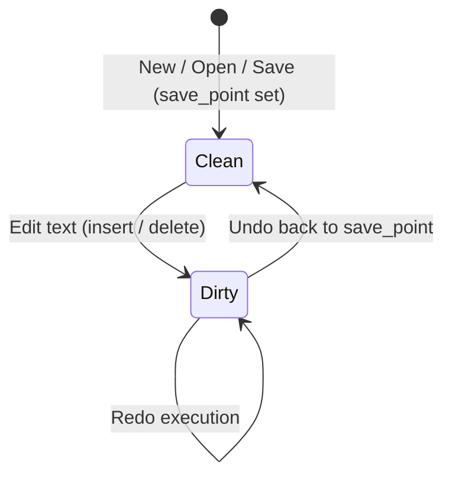

# vivivi: Functional Specifications (SPECIFICATION)

This document defines all functional specifications, data structures, algorithms, and editing modes for `vivivi`.

---

## 1. Text Buffer & Undo/Redo Specifications (OpenViVi Base)

### 1.1 GapBuffer (`GapBuffer<T>`)
Text editing exhibits strong **locality of editing** — users repeatedly type or delete characters at the current cursor position.

Inserting into a conventional continuous array (`Vec<T>`) costs $O(N)$ due to element shifting.
In contrast, `GapBuffer` maintains an empty gap at the edit cursor, achieving **amortized $O(1)$** local insertions and deletions.

#### Memory Layout & Logical Index Mapping
The buffer consists of pre-gap data, the empty gap, and post-gap data.

```
[Logical Text]: "HelloWorld" (Length: 10)

[Physical Memory]:
  Index:   0   1   2   3   4   5   6   7   8   9  10  11  12  13  14
         [ H | e | l | l | o | ■ | ■ | ■ | ■ | ■ | W | o | r | l | d ]
                             |---- Empty Gap ----|
          gap_start = 5      gap_len = 5         capacity = 15
```

- **Logical to Physical Index Formula**:
  $$
  \text{physical\_index}(i) = \begin{cases}
  i & (i < \text{gap\_start}) \\
  i + \text{gap\_len} & (i \ge \text{gap\_start})
  \end{cases}
  $$

#### Core Operations and Complexity
| Operation | Complexity | Description |
| :--- | :--- | :--- |
| **Insert** (`insert`) | $O(1)$ (amortized) | Writes element at `gap_start`, `gap_start += 1`, `gap_len -= 1`. |
| **Remove** (`remove`) | $O(1)$ | Expands gap over deleted elements, `gap_len += 1`. |
| **Move Gap** (`move_gap`) | $O(K)$ | Only executed when the cursor jumps. Shifts intervening $K$ elements. |
| **Reserve** (`reserve_gap`) | $O(N)$ | Only on gap exhaustion. Doubles buffer size and moves post-gap data. |

---

### 1.2 Undo Manager (`UndoMgr`)
Provides natural, intuitive undo/redo functionality for Vi editing through three mechanisms:



#### Action Model (`UndoAction`)
Each operation generates its inverse action upon undo:
- `Insert { pos, text, prohibit_merge }` $\longleftrightarrow$ Inverse: `Delete { pos, text, is_backspace: false }`
- `Delete { pos, text, is_backspace }` $\longleftrightarrow$ Inverse: `Insert { pos, text, prohibit_merge: true }`
- `Replace { pos, old_text, new_text }` $\longleftrightarrow$ Inverse: `Replace { pos, old_text: new_text, new_text: old_text }`

#### Continuous Typing Auto-Merge
- Merges consecutive typings into a single action if contiguous and without newlines.
- Prohibits merging on cursor moves, mode switches (`Escape`), or newlines.

#### Transactional Undo Blocks
- Manages nesting via `open_undo_block()` and `close_undo_block()`.
- Flushes an atomic `UndoBlock` when the nest level reaches 0.
- Applies inverse actions in reverse execution order (LIFO) upon undo.

#### Save Point & Modified Tracking
- Tracks stack depth via `undo_mgr.on_saved()`.
- Automatically restores `is_modified == false` when undone back to the save point.

---

### 1.3 OpenViVi Code Mapping

| Project Crate (`vivivi-core`) | OpenViVi (`vivi/buffer/`) | Notes |
| :--- | :--- | :--- |
| `GapBuffer<T>` | `gap_buffer<Type>` (`gap_buffer.h`) | OpenViVi memory shifting algorithm ported to safe Rust |
| `UndoMgr` | `UndoMgr` (`undoMgr.h` / `undoMgr.cpp`) | Recreates nested blocks, continuous merge, inverse actions |
| `UndoBlock` | `UndoAction::FLAG_BLOCK` | Modernized into a type-safe transactional struct |
| `TextBuffer` | `Buffer` (`Buffer.h` / `Buffer.cpp`) | Combines GapBuffer and UndoMgr with cursor/line conversions |

---

## 2. Vi Engine Specifications (OpenViVi Base)

### 2.1 Modes
- **Normal Mode**: Standard vi navigation and command execution.
- **Insert Mode**: Regular text insertion. `Escape` returns to Normal.
- **Replace Mode**: Character overwriting.
- **Visual Mode**: Character-wise selection.
- **Visual Line Mode**: Line-wise selection (`V`).
- **Visual Block Mode**: Rectangular block selection (`Ctrl-V`).
- **Command-line Mode**: Ex command execution (`:w`, `:q`, `:s`).

---

## 3. Inline CSV/TSV Mode Specifications (ViVi 4 Base)
- **Display Specifications**:
  - Automatically calculates column widths and aligns cells inline.
  - Hides enclosing quotes (`"` / `'`) in display for readability.
  - **Active Line**: Cursor line shows raw text with quotes for accurate editing.
  - **Header Lines**: Recognizes custom header indicator (e.g. `#`) to format table headers.
  - **Multiple Tables**: Supports multiple independent tables within a single document.
- **Editing Specifications**:
  - Full editing support inside CSV mode (character insert, line deletion, vi commands).

---

## 4. Box Drawing (Keisen) Mode Specifications (OpenViVi Base)
- **Operations**:
  - `F5` / `:keisen`: Toggle keisen mode.
  - `Ctrl + Arrow keys` / `Alt + Arrow keys`: Draw box lines with automatic junction joining (automatically expands lines downward).
  - `Shift + Arrow keys`: Erase box lines and repair surrounding connections.
  - Bare arrow keys / `h`/`j`/`k`/`l`: Regular cursor navigation without drawing.
- **Joining Algorithm (Ported from OpenViVi `keisen.cpp`)**:
  - Bitmask state tracking for Unicode box characters (U+2500 - U+254B).
  - Automatically selects correct cross, T-junction, or corner characters (`┼`, `├`, `┬`, `┴`, `┤`).
  - Geometric corner-joining eliminates dangling stubs on closed rectangular paths (`┌`, `┐`, `└`, `┘`).
- **Keisen Protected Edit Specifications (ViVi 3 / ViVi 4 Lineage)**:
  - While typing inside a box frame (`│ ... │`), trailing whitespace on the current line is automatically removed to keep the right border intact (1 space for ASCII, 2 spaces for full-width characters).
  - Deleting text inside boxes—via `Backspace`/`Delete` in Insert mode or `x`/`X` in Normal mode—automatically pads spaces to maintain border positions.
  - Box internal text alignment via `:align left`, `:align center`, `:align right`.

---

## 5. Character Conversion & Box Numeric Calculations

### 5.1 Batch Character Conversion (`conv.rs`)
High-speed bijective and unidirectional conversions across full-width, half-width, kana, and case formats:

| Conversion Type                      | Ex Commands               | Description                                                    |
| :----------------------------------- | :------------------------ | :------------------------------------------------------------- |
| Full-width Alphanumeric $\to$ Half   | `:hankaku`, `:%hankaku`   | Maps full-width ASCII/symbols to standard ASCII                |
| Half-width Alphanumeric $\to$ Full   | `:zenkaku`, `:%zenkaku`   | Maps standard ASCII to Unicode full-width (U+FF01〜U+FF5E)     |
| Hiragana $\to$ Full-width Katakana   | `:katakana`, `:%katakana` | Maps Hiragana (U+3041〜U+3096) to Katakana                    |
| Katakana $\to$ Hiragana              | `:hiragana`, `:%hiragana` | Maps Katakana (U+30A1〜U+30F6) to Hiragana                    |
| Full-width Katakana $\to$ Half-width | `:hankata`, `:%hankata`   | Converts full-width Katakana to half-width voiced kana pairs   |
| Half-width Katakana $\to$ Full-width | `:zenkata`, `:%zenkata`   | Composes half-width kana + voice marks into single full glyphs |
| Uppercase / Lowercase Conversion     | `:toupper`, `:tolower`    | Case conversion across ASCII and Unicode text                  |

### 5.2 Box Selection Numeric Calculations (`calc.rs`)
- **Operations**: Select a visual block (`Ctrl-v`) containing numbers and execute `:calc`, `:sum`, or `:total`.
- **Parsing**: Extracts integers, negative numbers, decimals, and comma-separated floats (`1,000.50`).
- **Metrics**: Computes count, sum, arithmetic average, and sample standard deviation, reporting on the status line and copying results to the clipboard.

---

## 6. Advanced Navigation, Search & Layout

### 6.1 Romaji Japanese Search (Migemo / `g/`)
- **Specification**: Incremental search for Japanese Kanji, Kana, and symbols directly via Romaji queries without toggling IME.
- **Built-in Clean MIT Dictionary**:
  - Embedded `builtin_mit_dict.txt` compiled via `include_str!`, ensuring complete licensing safety (MIT License) with zero external GPL dependencies in binary distributions.
  - **Included Vocabulary (~128 entries covering primary symbols & editor keywords)**:
    - Brackets & Punctuation (`kakko`): `括弧`, `「` `」` `(` `)` `（` `）` `【` `】` `『` `』` `[` `]` `［` `］` `{` `}` `｛` `｝` `〈` `〉`, etc.
    - Arrow Symbols (`yajirushi`): `矢印`, `→` `←` `↑` `↓` `⇒` `⇔` `->` `=>` `<-`
    - Circles & Marks (`maru`, `ten`, `kara`, `nami`): `○`, `●`, `◎`, `。`, `、`, `・`, `〜`, `～`
    - Directions & Positions: `migi (→)`, `hidari (←)`, `ue (↑)`, `shita (↓)`, inside, outside, vertical, horizontal
    - Editor & UI Core Terms: Search, replace, save, edit, file, line, column, window, command, buffer, cursor, scroll, split, setting, execute, result, etc.
    - Common Daily Words: Japan, Tokyo, world, today, tomorrow, yesterday, time, weather, school, work, company, etc.
  - **Dynamic Incremental Prefix Match**: Expands matching Kanji for prefix queries with 2+ syllables, enhancing interactive typing responsiveness.
- **External SKK Dictionary Expansion (Recommended for Full Use)**:
  - Strongly recommended for extensive document writing, programming comments, and comprehensive vocabulary coverage (~100,000 words).
  - Automatically loads and transparently merges `%USERPROFILE%\.vivivi\SKK-JISYO.L` (or current directory) upon application startup.
  - Automatic charset detection: EUC-JP, UTF-8, and Shift_JIS/CP932.
  - Official download site: [https://github.com/skk-dev/dict](https://github.com/skk-dev/dict) (Recommends `SKK-JISYO.L`).
- **Commands**: Normal mode `g/` prompt, `:migemo <query>` / `:m <query>` ex commands, and synchronized viewport follow.

### 6.2 Symbol Outline Pane (`F2`, `F8`, `:outline`)
- **Specification**: Extracts Markdown headers (`#`), Rust items (`fn`, `struct`, `impl`), C/C++, and Python symbols.
- **UI & Controls**: Toggle via `F2`, `F8`, or `:outline`. Focus automatically transfers to the outline tree upon opening (`j`/`k` to select, `Enter` to jump). Press `Tab` or `Esc` to toggle focus between outline tree and editor buffer.

### 6.3 Multi-Window Splits (`Ctrl-w`, `:split`, `:vsplit`)
- **Specification**: Independent viewports maintaining separate cursor positions and vertical/horizontal scroll offsets without unwanted sync.
- **Vim-Compatible Nested Split Tree (`WindowTreeNode`)**:
  - Binary tree representation (`WindowTreeNode::Leaf` / `Split`) allows complex nested splits (e.g. splitting the bottom pane horizontally or vertically without mutating top panes).
- **Keybindings**:
  - Split: `Ctrl-w s` / `:split`, `Ctrl-w v` / `:vsplit`
  - Focus Navigation: Geometric nearest-neighbor via `Ctrl-w h/j/k/l` (Left, Down, Up, Right) or cycling via `Ctrl-w w`
  - Close / Maximize: `Ctrl-w c` / `:close` / `:q`, `Ctrl-w o` / `:only`

### 6.4 Horizontal Scrolling for Long Lines
- **Specification**: Automatically scrolls viewport left and right to follow cursor movements and `$` line-end motions on lines exceeding screen width.
- **Visual Column Metrics**: Accurately computes display widths for ASCII (1), East Asian Wide characters (2), and Tab stops (4) via `UnicodeWidthChar`, clipping characters safely at the window boundary.

---

## 7. Signature ViVi Editing Assists

### 7.1 Text Alignment (`align.rs`)
- **Command**: `:align <target>` (e.g., `:align =`, `:align :`, `:align //`)
- Aligns columns vertically across selected lines (or whole buffer) on the first occurrence of `target`.
- Preserves unmatched lines and computes visual character display width for precise padding.

### 7.2 Renumbering (`renumber.rs`)
- **Command**: `:renumber [start] [step]` / `:renum [start] [step]` (default: 1, 1)
- Identifies numbered lists (`1.`, `2)`, `(1)`, `[1]`) and renumbers sequences sequentially while retaining existing indent depths and delimiters.

### 7.3 Batch Head/Tail String Insertion (`line_edit.rs`)
- **Commands**: `:insbeg <str>`, `:insend <str>`, `:begend <beg> <end>`
- Inserts prefixes (after indentation, skipping blanks) and suffixes across lines simultaneously.

### 7.4 Expression Substitute (`expr_subst.rs` / ViVi 3 / ViVi 4 Compatible)
- **Commands**: `:s/pattern/expression/e`, `:%s/pattern/expression/e`
- Dynamically parses and evaluates replacement strings as arithmetic or scripting expressions:
  - Arithmetic operators: `+`, `-`, `*`, `/`, `%` with parenthesized grouping `(...)`.
  - Built-in variables:
    - `$0`: Entire matched string.
    - `$1` - `$9`: Regular expression capture groups (automatically parsed as numbers when applicable).
    - `$i` / `$n`: Sequential counter automatically incremented on each replacement match (1, 2, ...).
    - `$line`: Physical 1-based line number of the match.
  - String concatenation: String literals (`"..."`, `'...'`) joined with numbers via `+`.

---

## 8. High-Speed Input & Macro Assistance

### 8.1 Dynamic Word Completion (dabbrev / `Ctrl-l`, `Ctrl-m`)
- Scans current buffer backward and forward to cyclically complete words matching typed prefix.

### 8.2 Static Abbreviation Expansion (abbrev / `Ctrl-;`, `Alt-;`, `F4`, `:abbrev`)
- Expands short identifiers (`fn`, `struct`, `hw`) into full code snippets.
- Supports `:abbrev <key> <val>` registration and external dictionary text files.

### 8.3 Dynamic Macro (Masui Repeat / `Alt-m`, `Ctrl-Alt-m`, `:dmacro`)
- Automatically detects recurring keystroke patterns (XX) in recent typing history without prior manual recording.
- Replays the detected editing action immediately upon pressing `Alt-m`.

### 8.4 Lexical Edit Prediction (LexEdit / `Ctrl-j`, `:lexedit`)
- Records word-level substitutions and infers subsequent edits on analogous symbols using prefix/suffix rules.

### 8.5 Zen-Coding (Emmet) Expansion (`Ctrl-,`, `Alt-,`, `:zen`)
- Expands shorthand HTML tags (`table>tr>td*3`, `div#main.row`) into nested, formatted HTML trees.

### 8.6 Keyboard Macro Record & Playback (`Ctrl-Alt-r`, `Ctrl-Alt-p`, `F9`, `F10`, `:macro`)
- Records keystrokes across Normal, Insert, and Command modes; replays them instantly.
- Interoperable with Vi register macros (`qa` ... `q`, `@a`).

---

## 9. AI Integration Architecture (`:ai`)

- **Zero-Latency Principle**: Non-blocking asynchronous worker engine ensuring zero typing latency.
- **Local-First & Pluggable**: Native Ollama / llama.cpp support with cloud API hooks (Gemini, Claude, OpenAI).
- **Commands**: `:ai <instruction>` for in-place text transformation; `:ai commit` for conventional commit message generation.
- **Reference**: Detailed design in [`docs/ja/AI_INTEGRATION_DESIGN.md`](../ja/AI_INTEGRATION_DESIGN.md).

---

## 10. ViVi-Exclusive Vi Command Extensions & Navigation (ViVi 3 / ViVi 4 Compatible)

### 10.1 fFtT Full-width Character Matching (`fftt.rs` / ViVi 3 / ViVi 4 Compatible)
- **Commands**: `f<char>`, `F<char>`, `t<char>`, `T<char>`, `;`, `,`
- Typing ASCII characters (alphanumeric, brackets `()`, `[]`, `{}`, punctuation `:` , `!`) automatically matches both half-width and full-width Japanese equivalents (`（）`, `［］`, `｛｝`, `：`, `！`).
- Supports operator motions such as `df)` or `ct]`.

### 10.2 Word Forward/Backward Search & Prefix/Suffix Match (Common / OpenViVi Compatible)
- **Commands**: `*`, `#`, `g*`, `g#`, `g<`, `g=`
- `*` / `#`: Exact word match (`\bword\b`) under cursor forward / backward.
- `g*` / `g#`: Partial word match without word boundary forward / backward.
- `g<`: Prefix match on word under cursor forward.
- `g=`: Suffix match on word under cursor forward.

### 10.3 Numeric / Alphabet Increment & Decrement & Boolean Toggle (ViVi 3 / ViVi 4 Compatible)
- **Commands**: `#+`, `##`, `#-`, `#!`
- `#+` / `##`: Increment number under cursor (`+1`) or advance alphabet (`a` $\to$ `b`, `z` $\to$ `a`).
- `#-`: Decrement number under cursor (`-1`) or reverse alphabet (`b` $\to$ `a`, `a` $\to$ `z`).
- `#!`: Toggle boolean identifier under cursor (`true` ⇄ `false`, `True` ⇄ `False`, `yes` ⇄ `no`, `on` ⇄ `off`).

### 10.4 Last Edit Location / Line Jump & Line Replication (ViVi 3 / ViVi 4 Compatible)
- **Commands**: `@`, `'@`, `` `@ ``, `=<char>`
- `@`: Instantly jump back to the exact character position of the most recent text modification.
- `'@` / `` `@ ``: Jump to the beginning of the line where the most recent edit occurred.
- `=<char>`: Replicate characters from the line above starting at the current column up to `<char>` (or newline).

### 10.5 Global Marks (ViVi 3 / ViVi 4 Compatible)
- **Commands**: `ma` - `mz`, `mA` - `mZ`, `'a`, `` `a ``, `:marks`
- `ma` - `mz`: Set local buffer mark.
- `mA` - `mZ`: Set global workspace mark preserving file path.
- `'a` / `` `a ``: Jump to mark coordinate.
- `:marks`: Display list of active marks in status bar.

### 10.6 Tag Navigation & Jump Stack (Common / OpenViVi Compatible)
- **Commands**: `Ctrl-]`, `Ctrl-t`, `Ctrl-[`, `:tag <name>`, `:tags`
- `Ctrl-]`: Jump to definition of identifier under cursor via `tags` file with syntax AST outline fallback.
- `Ctrl-t` / `Ctrl-[`: Pop tag stack and return to previous jump coordinate.
- `:tags`: Display list of tag jump history stack.

---

## 11. Tool Features & File Management Specification (ViVi 3 / ViVi 4 Compatible)

### 11.1 Persistent Undo (`undo.rs`, `buffer.rs`)
- **Overview**: Preserves full undo/redo transaction history across editor sessions or file reloads.
- **Storage Location**: `.<filename>.undofile` in the same directory as the target file.
- **Format**: Lightweight, zero-dependency plain-text format with escape sequence handling (`INSERT <pos> <text>`, `DELETE <pos> <text>`, `BLOCK_START`, `BLOCK_END`).
- **Triggers**:
  - Automatically saved upon file write (`:w`).
  - Automatically discovered and loaded upon file open.
  - Manual commands: `:undofile save [path]`, `:undofile load [path]`.

### 11.2 Text Difference & Revision History (DIFF & DiffLog / `diff.rs`, `difflog.rs`)
- **Diff Engine (`diff.rs`)**:
  - High-accuracy line diff based on Longest Common Subsequence (LCS) algorithm.
  - Unified Diff generation (`create_unified_diff`) and patch application (`apply_unified_patch`).
  - Synchronized side-by-side line correspondence mapping (`create_side_by_side`).
- **Revision Backup (`difflog.rs`)**:
  - **Storage Location**: `.<filename>.difflog`.
  - Records diffs and UNIX timestamps on each file save.
  - **Commands**:
    - `:difflog`: List all backup revisions with timestamps and line delta counts.
    - `:difflog restore <generation>`: Sequentially apply patches from initial revision to completely restore past file state.
    - `:blame`: Trace per-line last-modified revisions and timestamps (lightweight blame).

### 11.3 Template Auto-Loading (`template.rs`)
- **Specification**:
  - When opening a non-existent new file, automatically searches for `.template.<ext>` in the target directory and parent hierarchy.
  - Expands macro variables into initial buffer content:
    - `%FileName%`: Full filename (e.g., `main.rs`)
    - `%FileBase%`: Stem filename without extension (e.g., `main`)
    - `%Ext%`: File extension (e.g., `rs`)
    - `%Date%`: Current date (`YYYY-MM-DD`)
    - `%Time%`: Current time (`HH:MM:SS`)
    - `%UserName%`: System login username
    - `%Cursor%`: Initial cursor position after loading

### 11.4 In-Code ToDo Extractor (`todo.rs`)
- **Commands**: `:todo [dir]`, `:undone [dir]`
- **Specification**:
  - Recursively scans the current buffer or target directory for tags (`TODO`, `FIXME`, `BUG`, `UNDONE`, `HACK`, `NOTE`, `XXX`).
  - Outputs a structured list (filename, line number, tag, description) accessible via QuickFix navigation.

### 11.5 Code Folding (`folding.rs`)
- **Specification**:
  - Analyzes indentation hierarchy (2/4 spaces or tabs) to detect parent and nested block boundaries.
  - Collapses child blocks and replaces them with summary preview lines (`... (+N lines)`).
- **Commands & Keybindings**:
  - `zc`: Close fold under cursor.
  - `zo`: Open fold under cursor.
  - `za`: Toggle fold under cursor.
  - `zM`: Close all folds across entire buffer.
  - `zR`: Open all folds across entire buffer.
  - `z<lvl>`: Fold all blocks deeper than specified indentation level `<lvl>`.
  - `:fold <toggle|close|open|all|none>`

### 11.6 Fast Project Grep Search (`grep.rs`)
- **Commands**: `:grep <pattern> [dir]`, `:cnext` / `:cn`, `:cprev` / `:cp`
- **Specification**:
  - Scans project files using regex patterns, skipping ignore directories (`.git`, `target`, `node_modules`, `dist`, `build`) and binary files.
  - Maintains an active search session navigable via `:cnext` / `:cprev`.

### 11.7 2-Pane Directory Browser (Filer / `filer.rs`)
- **Commands**: `:filer [path]`
- **Specification**:
  - Dual independent directory navigation panes.
  - **Key Controls**:
    - `Tab`: Switch focus between left and right panes.
    - `j` / `k`: Move selection cursor.
    - `Enter`: Open directory (or `..` to go up) / open selected file in editor.
    - `Space`: Multi-item selection toggle.
    - `c`: Copy selected items to target directory in opposite pane.
    - `m`: Move selected items to target directory in opposite pane.
    - `d`: Delete selected items.

### 11.8 Project Management & Batch Tags Generation (`project.rs`)
- **Commands**: `:maketags [dir]`
- **Specification**:
  - Traverses workspace files, performs AST symbol parsing (functions, structs, traits, modules), and outputs ctags-compatible `tags` files.

### 11.9 Print Preview & Standalone PDF Export (`print.rs`)
- **Commands**: `:preview` / `:print`, `:pdf [path]`
- **Specification**:
  - **Print Preview**: Standard A4 pagination (60 lines/page, line numbers, header with filename, footer with page numbers). Rendered in a full-screen modal UI with scroll navigation (`j`/`k`, `d`/`u`).
  - **Direct PDF Export**: Zero-dependency standalone PDF 1.4 binary generator (Courier Type 1 font, page stream operators, xref table) written in pure Rust.
  - *(Note: Desktop GUI frontend (egui) and GUI-dependent features were migrated to Phase 5 per user instruction, focusing current capabilities on TUI and core tooling engines)*.

---

## 12. TUI/UX Editing & Visual Assistance Specifications (Phase 4.6)

### 12.1 Line Change Markers in Gutter (`gutter.rs`)
- **Overview**: An OpenViVi visual editing aid that highlights modified lines in real-time within the leftmost gutter column (line number margin).
- **Marker Types**:
  - **Modified (Unsaved / Yellow `▌`)**: Lines where text has been inserted, replaced, or deleted since the last save (or file load).
  - **Saved (Green `▌`)**: Lines that were modified during the session but subsequently saved to disk via `:w`.
  - **Unchanged (None)**: Lines unchanged since file load.
- **Algorithm**:
  - Tracks line-level modifications through `TextBuffer` Undo stack states and `save_point` snapshots.

### 12.2 Recent Files & Favorite Files (`recent.rs`)
- **Overview**: Persistent tracking of recently accessed files and customizable favorites.
- **Storage**: `%USERPROFILE%\.vivivi\recent_files.json`.
- **Keys & Commands**:
  - `F7` / `:recent`: Popup modal dialog for selecting recent files.
  - `:fav`: Popup list of favorite files.
  - `:fav add [path]`: Add current buffer or target path to favorites.
  - `:fav del [path]`: Remove from favorites.
- **Dialog Navigation**:
  - `j` / `k` (or `↑` / `↓`): Navigate list.
  - `Enter`: Open selected file in active buffer.
  - `Esc` / `q`: Close modal dialog.

### 12.3 Invisible / Whitespace Character Visualization (`invisible.rs`)
- **Overview**: Prevents indentation errors and full-width Japanese space confusion during code editing.
- **Commands**:
  - `:set list`: Enable invisible character rendering.
  - `:set nolist`: Disable invisible character rendering (default).
  - `:set list!`: Toggle rendering.
- **Glyph Specifications**:
  - **Full-width space (U+3000)**: Displayed as an open square (`□`).
  - **Tab character (`\t`)**: Displayed with a lead arrow and trailing dashes (e.g. `▸---` for tabstop 4).
  - **EOL marker**: Displayed as a dollar sign (`$`) or return symbol.
  - **Trailing spaces**: Highlighted with warning colors or underline.

### 12.4 Search Match Highlighting
- **Overview**: Real-time visual highlight for all pattern matches in the visible viewport when searching with `/` or `?`.
- **Navigation & Controls**:
  - `n` / `N`: Jump to next / previous match.
  - `:noh`, `:nohl`, `:nohlsearch`: Clear active search highlights.
  - `:set hls` / `:set hlsearch`: Search highlights permanently ON.
  - `:set nohls` / `:set nohlsearch`: Search highlights permanently OFF.

### 12.5 Mode-Synchronized Terminal Cursor Shapes
- **Overview**: Dynamically changes the terminal cursor shape using standard DECSCUSR ANSI escape sequences matching the active Vi mode.
- **Modes and Shapes**:
  - **Normal / Visual Mode**: Steady Block cursor (`\x1b[2 q` / █)
  - **Insert Mode**: Steady Bar / Beam cursor (`\x1b[6 q` / ▎)
  - **Replace Mode**: Steady Underline cursor (`\x1b[4 q` /   )

---

## 13. Testing & Documentation Conventions

### 13.1 Testing Architecture (`tests/` vs `src/`)
- **Public API Integration Tests (`tests/*.rs`)**:
  - Black-box verification from external crate perspective using only `pub` APIs.
  - Validates cross-module interactions, realistic multi-step workflows, and end-to-end scenarios.
- **Internal Unit Tests (`src/**/tests.rs` or `mod tests`)**:
  - White-box verification focused purely on private/internal helper logic, edge cases, and internal state invariants.
  - Prevents production source file bloat by migrating public API tests to `tests/`.

### 13.2 Rustdoc Documentation Standard
- **Natural Language Descriptions**: Comprehensive Japanese explanations covering context, invariants, and side effects rather than trivial signature restatements.
- **Mandatory Sections**:
  1. **One-line summary**: Purpose of the type or function.
  2. **Detailed explanation**: Invariants, prerequisites, related types ([`Type`]).
  3. **# Errors**: Conditions under which `Result::Err` is returned.
  4. **# Panics**: Boundary or invalid input conditions triggering panic.
  5. **# Examples**: Verifiable, copy-pasteable minimal examples tested by `cargo test --doc`.

---

## 14. Advanced Power Tools & Hardening Specifications (Phase 4.8)

### 14.1 Multi-Tab Buffer Management (`TabPage`, Tab Bar UI)
- **Data Structure**: `TabPage` encapsulates per-tab active buffer ID, recursive window tree (`WindowTreeNode`), cursor position, and scroll offsets.
- **Tab Bar UI**: Automatically drawn at the top line when tab count $\ge 2$. Active tab is highlighted; unsaved modified buffers display a `[+]` badge.
- **State Synchronization**: `sync_active_tab_state` persists active editor states to the tab before switching, and `load_tab_state` restores target tab states, ensuring complete isolation across tabs.
- **Keybindings & Commands**: `gt`, `gT`, `[count]gt`, `:tabnew [file]`, `:tabclose`, `:tabnext`, `:tabprev`, `:tabonly`.

### 14.2 Visual Block Column Operations (`VisualBlock`)
- **Column-wise Manipulation**: Operates on rectangular regions across multiple lines selected via `Ctrl-v`.
- **Prepend (`I`) & Append (`A`)**: Batch text insertion at the left or right column boundary across all selected lines. Short lines are auto-padded with spaces.
- **Replace (`c`) & Fill (`r`)**: Column replacement with arbitrary text or uniform fill with a single character.
- **Delete (`d`, `x`)**: Columnar deletion shifting trailing characters leftward uniformly.

### 14.3 Configuration File & Customization (`config.toml`)
- **Location**: `%USERPROFILE%\.vivivi\config.toml` (or `~/.vivivi/config.toml`).
- **Configuration Schema**:
  - `[editor]`: `tab_stop`, `number`, `relative_number`, `gutter`, `hlsearch`, `clipboard`, `theme`
  - `[invisible]`: `enabled`, `space`, `tab`, `eol`
  - `[keymap.normal]`, `[keymap.insert]`: Custom key remapping tables
- **Dynamic Reload**: `:config` ex command reloads settings from disk on the fly.

### 14.4 Explicit Encoding Reload & Line Ending Format
- **Explicit Encoding Reopening (`:e ++enc=<enc>`)**: Bypass auto-detection and force reload buffer using `utf-8`, `sjis`, or `euc-jp`.
- **Target Save Encoding (`:set fenc=<enc>`)**: Specify destination encoding on next save.
- **Line Ending Format (`:set ff=unix|dos`)**: Convert newline convention between LF and CRLF on save.

### 14.5 Crash Recovery & Auto-Save Swap Files (.swp)
- **Swap Creation**: Creates hidden `.<filename>.swp` in the same directory for modified buffers.
- **Periodic Checkpoints**: Automatically writes buffer snapshots every 20 keystrokes and on `Esc` (return to Normal mode).
- **Recovery Workflow**: Detects uncleaned swap files on startup, emits status warning, and restores buffer content via `:recover` (`:swap` inspects metadata).
- **Safe Cleanup**: Swap files are automatically deleted upon successful `:w` save or clean exit.

### 14.6 System Clipboard Integration
- **Trait Abstraction**: UI-independent `ClipboardProvider` trait defined in `vivivi-vi`.
- **Provider Implementation**: `SystemClipboard` leveraging `arboard` in `vivivi-app`.
- **Register Binding**: Transparent synchronization between `"+` / `"*` registers and the OS system clipboard. Unnamed register sync available via `:set clipboard=unnamed`.

### 14.7 Syntax Highlighting Expansion (18 Languages)
- **New Languages**: Go (`.go`), Ruby (`.rb`), TOML (`.toml`), PowerShell (`.ps1`), YAML (`.yaml`), XML (`.xml`), and Windows Batch (`.bat`, `.cmd`).
- **Lexical Analysis**: Accurate tokenization of keywords, types/classes, strings, numbers, comments, symbols, and environment variables (Batch).
- **Status Bar Badges**: Distinct language badges (`[Go]`, `[Ruby]`, `[TOML]`, `[PowerShell]`, `[YAML]`, `[XML]`, `[Batch]`) rendered in the status bar.


