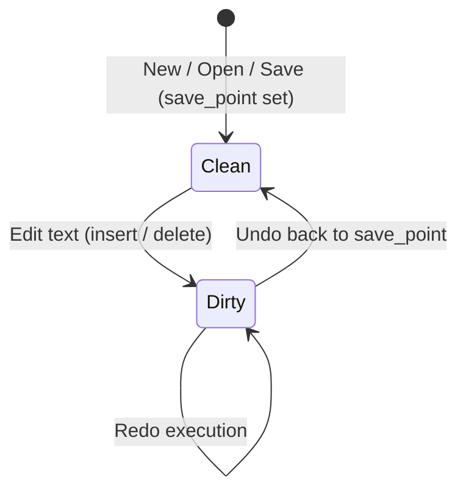

# vivivi: Functional Specifications (SPECIFICATION)

This document defines all functional specifications, data structures, algorithms, and editing modes for `vivivi`.

---

## 1. Text Buffer & Undo/Redo Specifications (OpenViVi Base)

### 1.1 GapBuffer (`GapBuffer<T>`)
Text editing exhibits strong **locality of editing** — users repeatedly type or delete characters at the current cursor position.

Inserting into a conventional continuous array (`Vec<T>`) costs $O(N)$ due to element shifting.
In contrast, `GapBuffer` maintains an empty gap at the edit cursor, achieving **amortized $O(1)$** local insertions and deletions.

#### Memory Layout & Logical Index Mapping
The buffer consists of pre-gap data, the empty gap, and post-gap data.

```
[Logical Text]: "HelloWorld" (Length: 10)

[Physical Memory]:
  Index:   0   1   2   3   4   5   6   7   8   9  10  11  12  13  14
         [ H | e | l | l | o | ■ | ■ | ■ | ■ | ■ | W | o | r | l | d ]
                             |---- Empty Gap ----|
          gap_start = 5      gap_len = 5         capacity = 15
```

- **Logical to Physical Index Formula**:
  $$
  \text{physical\_index}(i) = \begin{cases}
  i & (i < \text{gap\_start}) \\
  i + \text{gap\_len} & (i \ge \text{gap\_start})
  \end{cases}
  $$

#### Core Operations and Complexity
| Operation | Complexity | Description |
| :--- | :--- | :--- |
| **Insert** (`insert`) | $O(1)$ (amortized) | Writes element at `gap_start`, `gap_start += 1`, `gap_len -= 1`. |
| **Remove** (`remove`) | $O(1)$ | Expands gap over deleted elements, `gap_len += 1`. |
| **Move Gap** (`move_gap`) | $O(K)$ | Only executed when the cursor jumps. Shifts intervening $K$ elements. |
| **Reserve** (`reserve_gap`) | $O(N)$ | Only on gap exhaustion. Doubles buffer size and moves post-gap data. |

---

### 1.2 Undo Manager (`UndoMgr`)
Provides natural, intuitive undo/redo functionality for Vi editing through three mechanisms:



#### Action Model (`UndoAction`)
Each operation generates its inverse action upon undo:
- `Insert { pos, text, prohibit_merge }` $\longleftrightarrow$ Inverse: `Delete { pos, text, is_backspace: false }`
- `Delete { pos, text, is_backspace }` $\longleftrightarrow$ Inverse: `Insert { pos, text, prohibit_merge: true }`
- `Replace { pos, old_text, new_text }` $\longleftrightarrow$ Inverse: `Replace { pos, old_text: new_text, new_text: old_text }`

#### Continuous Typing Auto-Merge
- Merges consecutive typings into a single action if contiguous and without newlines.
- Prohibits merging on cursor moves, mode switches (`Escape`), or newlines.

#### Transactional Undo Blocks
- Manages nesting via `open_undo_block()` and `close_undo_block()`.
- Flushes an atomic `UndoBlock` when the nest level reaches 0.
- Applies inverse actions in reverse execution order (LIFO) upon undo.

#### Save Point & Modified Tracking
- Tracks stack depth via `undo_mgr.on_saved()`.
- Automatically restores `is_modified == false` when undone back to the save point.

---

### 1.3 OpenViVi Code Mapping

| Project Crate (`vivivi-core`) | OpenViVi (`vivi/buffer/`) | Notes |
| :--- | :--- | :--- |
| `GapBuffer<T>` | `gap_buffer<Type>` (`gap_buffer.h`) | OpenViVi memory shifting algorithm ported to safe Rust |
| `UndoMgr` | `UndoMgr` (`undoMgr.h` / `undoMgr.cpp`) | Recreates nested blocks, continuous merge, inverse actions |
| `UndoBlock` | `UndoAction::FLAG_BLOCK` | Modernized into a type-safe transactional struct |
| `TextBuffer` | `Buffer` (`Buffer.h` / `Buffer.cpp`) | Combines GapBuffer and UndoMgr with cursor/line conversions |

---

## 2. Vi Engine Specifications (OpenViVi Base)

### 2.1 Modes
- **Normal Mode**: Standard vi navigation and command execution.
- **Insert Mode**: Regular text insertion. `Escape` returns to Normal.
- **Replace Mode**: Character overwriting.
- **Visual Mode**: Character-wise selection.
- **Visual Line Mode**: Line-wise selection (`V`).
- **Visual Block Mode**: Rectangular block selection (`Ctrl-V`).
- **Command-line Mode**: Ex command execution (`:w`, `:q`, `:s`).

---

## 3. Inline CSV/TSV Mode Specifications (ViVi 4 Base)
- **Display Specifications**:
  - Automatically calculates column widths and aligns cells inline.
  - Hides enclosing quotes (`"` / `'`) in display for readability.
  - **Active Line**: Cursor line shows raw text with quotes for accurate editing.
  - **Header Lines**: Recognizes custom header indicator (e.g. `#`) to format table headers.
  - **Multiple Tables**: Supports multiple independent tables within a single document.
- **Editing Specifications**:
  - Full editing support inside CSV mode (character insert, line deletion, vi commands).

---

## 4. Box Drawing (Keisen) Mode Specifications (OpenViVi Base)
- **Operations**:
  - `Shift-F5`: Toggle keisen mode.
  - `Ctrl + Arrow keys`: Draw box lines with automatic junction joining.
  - `Shift + Arrow keys`: Erase box lines.
- **Joining Algorithm (Ported from OpenViVi `keisen.cpp`)**:
  - Bitmask state tracking for Unicode box characters (U+2500 - U+254B).
  - Automatically selects correct cross, T-junction, or corner characters (`┼`, `├`, `┬`, `┴`, `┤`).
