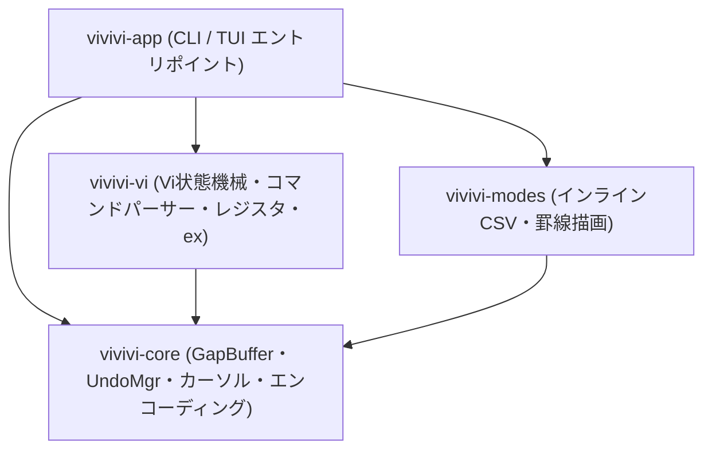

# vivivi: システムアーキテクチャ設計書 (ARCHITECTURE)

## 1. プロジェクト目的
本プロジェクトは、C++ / Qtベースで開発されていた高機能テキストエディタ「OpenViVi」の仕様をベースに、モダンかつ安全・高速なプログラミング言語である **Rust** で再構築するプロジェクトです。
また、有償版（ViVi 3 / ViVi 4）に実装されていた独自仕様（インラインCSV/TSVモード、罫線モード等）についても、ヘルプファイルや仕様を忠実に反映・移植します。

---

## 2. 参考元リソースの参照方針
- **OpenViVi ソースコード**: `%USERPROFILE%\Documents\参考元アプリ\openViVi`
  - テキストバッファ (`vivi/buffer/`)
  - Viエンジン・コマンド体系 (`vivi/vivi64/ViEngine.*`, `vivi/vivi64/TestViCommands.*`)
  - 罫線モード基礎実装 (`vivi/vivi64/keisen.cpp`)
- **有償版 ViVi 3 / ViVi 4**:
  - ViVi 3: `%USERPROFILE%\Documents\個人ツール\vivi3`
  - ViVi 4: `%USERPROFILE%\Documents\個人ツール\vivi4`
  - ヘルプファイル (`vivihelp.CHM`): `docs/references/vivi4_help/` 配下にデコンパイル・UTF-8化して配置。

---

## 3. クレート構成（Cargo Workspace）
エディタのコアロジックをUI（CLI / TUI / 将来のGUI）から完全に独立させ、高カバレッジな単体テストを可能にするため、マルチクレート構成（Cargo Workspace）を採用しています。

| クレート名     | 役割・責務                                                                                                                     | 依存クレート  |
| :------------- | :----------------------------------------------------------------------------------------------------------------------------- | :------------ |
| `vivivi-core`  | ギャップバッファ (`GapBuffer`)、行管理、カーソル、UndoMgr、永続Undo (`undofile`)、文字コード判別・変換、対応括弧探索           | なし          |
| `vivivi-vi`    | Vi状態機械、コマンドパーサー、レジスタ、モーション、矩形編集、独自vi拡張、Foldingキーバインド、フェーズ4.5 exコマンド統合      | `vivivi-core` |
| `vivivi-modes` | 編集支援＆ツール機能（罫線、CSV、式置換、文字変換、DIFF、DiffLog、Template、ToDo、Folding、Grep、Filer、Project、PDF直接出力） | `vivivi-core` |
| `vivivi-app`   | Ratatui TUIフロントエンド、マルチウィンドウ画面分割、マクロ記録再生、印刷プレビュー、永続Undo/DiffLog連携、AI連携スロット      | 全クレート    |

---

## 4. クレート詳細とモジュール階層

### 4.1 `vivivi-core`
テキストバッファの基盤データ構造とファイルI/O、エンコーディング処理を担当します。
- `gap_buffer.rs`: $O(1)$ 局所編集を実現するギャップバッファ。
- `undo.rs`: トランザクション対応Undoマネージャおよび永続Undo（`.undofile`）シリアライザ。
- `buffer.rs`: `GapBuffer` と `UndoMgr` を統合した `TextBuffer`。永続Undo自動保存・復元フック。
- `encoding.rs`: BOM判定、UTF-8 / Shift_JIS / CP932 / EUC-JP / UTF-16LE/BE 相互変換、改行コード正規化。
- `cursor.rs`: バッファ内座標（行・列・オフセット）追跡。
- `paren.rs`: `()`, `{}`, `[]`, `<>` の文字列・コメントスキップ対応括弧探索。

### 4.2 `vivivi-vi`
Vi/VimおよびViVi互換のモード状態遷移とコマンドパース、exコマンドディスパッチを担当します。
- `mode.rs`: Normal, Insert, Replace, Visual, VisualLine, VisualBlock, CommandLine モード定義。
- `command.rs` / `parser.rs`: カウント・レジスタ・2打鍵・Foldアクション（`zc`, `zo`, `za`, `zM`, `zR`, `z<lvl>`）を含む状態機械パーサー。
- `register.rs`: 無名、名前付き、クリップボード、矩形（`BlockWise`）レジスタ管理。
- `engine/`: サブモジュール分割された実行コア（`motion.rs`, `operate.rs`, `visual.rs`, `ex.rs`, `tests.rs`）。
  - フェーズ4.5 exコマンド統合: `:grep`, `:cnext`/`:cn`, `:cprev`/`:cp`, `:todo`/`:undone`, `:fold`, `:filer`, `:difflog`/`:blame`, `:preview`/`:print`, `:pdf`, `:maketags`, `:undofile`。

### 4.3 `vivivi-modes`
ViVi特有のキラー編集支援機能およびツール機能エンジン群を提供します。
- `diff.rs`: LCSアルゴリズムに基づくUnified Diff生成、パッチ適用、左右2画面同期データ生成。
- `difflog.rs`: `.difflog` 形式の世代バックアップ追記、任意世代の完全復元、簡易blame行解析。
- `template.rs`: `.template.<ext>` 探索とマクロ変数展開（`%FileName%`, `%Date%` 等）。
- `todo.rs`: バッファおよびディレクトリ内のToDo/FIXMEタグ再帰走査・抽出。
- `folding.rs`: インデント階層解析によるブロック折り畳み、プレビュー行生成。
- `grep.rs`: 除外フィルタ付きプロジェクト内高速Grep検索およびナビゲーションセッション。
- `filer.rs`: 左右独立2ペイン型ディレクトリビュー、ファイル操作（コピー・移動・削除）。
- `project.rs`: 複数ファイルプロジェクト管理、一括tagsファイル生成。
- `print.rs`: A4標準改ページ・行番号・ヘッダー・フッター整形、外部依存ゼロのPDF 1.4直接出力。
- `migemo.rs`: 独自MIT辞書（約物記号セット収録）の内蔵、および外部SKK辞書の自動ロードに対応した、ライセンス安全なローマ字日本語検索エンジン。
- `keisen.rs`: 幾何学的角結合アルゴリズム、文字入力およびノーマルモード `x`/`X` 削除時の枠線保護・空白自動伸縮。
- `outline.rs`: Markdown見出し（全階層）および主要言語シンボルツリー抽出エンジン。自動縦スクロール追従。
- `csv.rs`, `expr_subst.rs`, `fftt.rs`, `conv.rs`, `align.rs`, `renumber.rs`, `dabbrev.rs`, `abbrev.rs`, `dmacro.rs`, `lexedit.rs`, `zen.rs`, `calc.rs`, `syntax.rs`。

### 4.4 `vivivi-app`
Ratatui/Crosstermを用いた端末フロントエンドおよびアプリケーションライフサイクル管理を担当します。
- `tui/app.rs`: アプリケーション状態、ファイル保存時DiffLog/永続Undoフック、ファイルオープン時テンプレート/永続Undo復元フック。
- `tui/event.rs`: キーイベントディスパッチ、ダブルEsc検出、Migemo/アウトライン/プレビューモード操作。
- `tui/window.rs`: `WindowTreeNode`（二分木）によるVim互換階層分割ツリー管理、独立スクロール・独立カーソル管理、幾何学的配置に基づくフォーカス移動。
- `tui/ui/`: UIコンポーネント描画（`editor.rs`, `outline.rs`, `status.rs`, `help.rs`, `preview.rs`）。
  - `editor.rs`: Visual Column（表示幅）に基づく長行水平スクロール自動追従、全角文字・タブ文字の安全なクリッピング描画。
  - `outline.rs`: 左サイドペインツリー描画と選択ハイライト。
  - `preview.rs`: 印刷プレビュー全画面モーダルUI描画。

---

## 5. 設計判断・制約事項
- **外部依存の極小化**:
  - PDF出力、LCS差分、永続Undoシリアライズ等は外部クレートを追加せず標準ライブラリ（純Rust）で完結実装。
  - 高速コンパイル性能とポータビリティを両立。
- **デスクトップGUI（egui）のフェーズ5移行**:
  - デスクトップGUIフロントエンドおよびGUI前提の機能（ミニマップ、落下アニメーション等）はユーザー指示に基づきフェーズ5へ移行し、現在はTUIフロントエンドとコアツール機能に特化。
