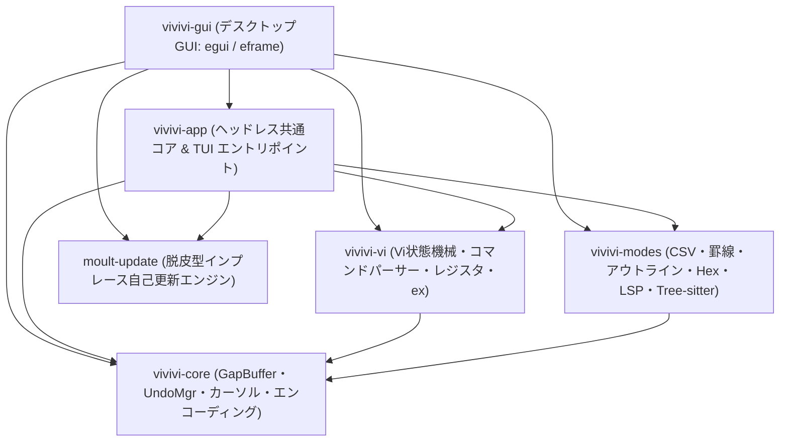

# vivivi: システムアーキテクチャ設計書 (ARCHITECTURE)

## 1. プロジェクト目的
本プロジェクトは、C++ / Qtベースで開発されていた高機能テキストエディタ「OpenViVi」の仕様をベースに、モダンかつ安全・高速なプログラミング言語である **Rust** で再構築するプロジェクトです。
また、有償版（ViVi 3 / ViVi 4）に実装されていた独自仕様（インラインCSV/TSVモード、罫線モード、バイナリモード、プロジェクト可視化グラフ等）およびモダン拡張（LSP クライアント、Tree-sitter 構文木ハイライト、インプレース自己更新）を統合しています。

---

## 2. 参考元リソースの参照方針
- **OpenViVi ソースコード**: `%USERPROFILE%\Documents\参考元アプリ\openViVi`
  - テキストバッファ (`vivi/buffer/`)
  - Viエンジン・コマンド体系 (`vivi/vivi64/ViEngine.*`, `vivi/vivi64/TestViCommands.*`)
  - 罫線モード基礎実装 (`vivi/vivi64/keisen.cpp`)
- **有償版 ViVi 3 / ViVi 4**:
  - ViVi 3: `%USERPROFILE%\Documents\個人ツール\vivi3`
  - ViVi 4: `%USERPROFILE%\Documents\個人ツール\vivi4`
  - ヘルプファイル (`vivihelp.CHM`): `docs/references/vivi4_help/` 配下にデコンパイル・UTF-8化して配置。

---

## 3. クレート構成（Cargo Workspace）
エディタのコアロジックをヘッドレス共通基盤として抽象化し、ターミナル TUI（`vivivi-app`）とデスクトップ GUI（`vivivi-gui`）の双方が同一セッション層を共有する 6 クレート構成を採用しています。

| クレート名     | 役割・責務                                                                                                                   | 依存クレート              |
| :------------- | :--------------------------------------------------------------------------------------------------------------------------- | :------------------------ |
| `vivivi-core`  | ギャップバッファ (`GapBuffer`)、行管理、カーソル、UndoMgr、永続Undo (`undofile`)、文字コード・改行早期判別、対応括弧探索     | なし                      |
| `vivivi-vi`    | Vi状態機械、コマンドパーサー、レジスタ、モーション、矩形編集、独自vi拡張、Foldingキーバインド、exコマンド統合                | `vivivi-core`             |
| `vivivi-modes` | 編集支援＆ツール機能（罫線、CSV、式置換、文字変換、DIFF、DiffLog、Template、ToDo、Folding、Grep、Filer、PDF、Hex、LSP、AST） | `vivivi-core`             |
| `moult-update` | GitHub Releases 非同期照会、SHA-256 検証、Windows インプレース・スワップ自己更新、GUI/TUI ペアバイナリ一括同期               | なし (独立汎用クレート)   |
| `vivivi-app`   | ヘッドレス共通セッション基盤 (`App`, `Tab`, `WindowTreeNode`)、Ratatui TUI フロントエンド、設定・テーマ管理                  | Core / Vi / Modes / Moult |
| `vivivi-gui`   | ネイティブ・デスクトップ GUI (`egui` / `eframe`)、日本語 IME インライン統合、ミニマップ、落下アニメーション、2D力学グラフ    | 全クレート                |

---

## 4. クレート詳細とモジュール階層

### 4.1 `vivivi-core`
テキストバッファの基盤データ構造とファイルI/O、エンコーディング処理を担当します。
- `gap_buffer.rs`: $O(1)$ 局所編集を実現するギャップバッファ。
- `undo/`: トランザクション対応Undoマネージャおよび永続Undo（`.undofile`）シリアライザ。
- `buffer.rs`: `GapBuffer` と `UndoMgr` を統合した `TextBuffer`。永続Undo自動保存・復元フック。
- `encoding.rs`: BOM判定、UTF-8 / Shift_JIS / CP932 / EUC-JP / UTF-16LE/BE 相互変換、早期自動判別。
- `cursor.rs`: バッファ内座標（行・列・オフセット）追跡。
- `paren.rs`: `()`, `{}`, `[]`, `<>` の文字列・コメントスキップ対応括弧探索。
- `swap.rs`: クラッシュリカバリ用スワップファイル（`.swp`）生成・復元。

### 4.2 `vivivi-vi`
Vi/VimおよびViVi互換のモード状態遷移とコマンドパース、exコマンドディスパッチを担当します。
- `mode.rs`: Normal, Insert, Replace, Visual, VisualLine, VisualBlock, CommandLine モード定義。
- `command.rs` / `parser/`: カウント・レジスタ・2打鍵・Foldアクション（`zc`, `zo`, `za`, `zM`, `zR`, `z<lvl>`）を含む状態機械パーサー。
- `register.rs`: 無名、名前付き、クリップボード、矩形（`BlockWise`）レジスタおよび履歴管理。
- `engine/`: サブモジュール分割された実行コア（`motion.rs`, `operate.rs`, `visual.rs`, `text_object.rs`, `ex.rs`）。

### 4.3 `vivivi-modes`
ViVi特有のキラー編集支援機能およびモダンツール機能エンジン群を提供します。
- `hex.rs`: 16進ダンプ＋ASCII並行表示によるバイナリ直接編集エンジン（`HexDocument`, `HexCursor`, ニブル編集, Undo/Redo, バイト検索）。
- `lsp/`: LSP v3.17 クライアント基盤（`protocol.rs` JSON-RPC 2.0 / Content-Length, `client.rs` バックグラウンド stdio 通信, `manager.rs` 診断・ホバー・定義・補完管理）。
- `treesitter.rs`: `tree-sitter` 抽象構文木（AST）解析、行トークン抽出、スマート選択拡大/縮小（`AstSelectionRange`）、インクリメンタルパース。
- `trim.rs`: 半角・タブ・全角スペース対応のゼロコピー行末空白トリミング。
- `diff.rs` / `difflog.rs`: LCSアルゴリズムに基づくUnified Diff生成と `.difflog` 世代バックアップ。
- `template.rs` / `todo.rs` / `folding.rs` / `grep.rs` / `filer.rs` / `project.rs` / `print.rs`。
- `migemo.rs` / `keisen/` / `outline.rs` / `csv.rs` / `expr_subst.rs` / `conv.rs` / `align.rs` / `renumber.rs` / `dabbrev.rs` / `abbrev.rs` / `dynamic_macro.rs` / `lex_edit.rs` / `zen_coding.rs` / `calc.rs` / `syntax/`。

### 4.4 `moult-update`
アプリケーション非依存の汎用自己更新ライブラリです。
- `check.rs`: GitHub Releases API 照会、24時間TTLキャッシュ、`semver` 比較。
- `download.rs`: ストリーミングダウンロード、SHA-256 チェックサム照合、Zip Slip 防御付き展開。
- `swap.rs` / `cleanup.rs`: Windows 実行中ロックを回避する `.old` リネーム＆スワップ、起動時自動クリーンアップ。

### 4.5 `vivivi-app`
ヘッドレス共通セッション層および Ratatui/Crossterm 端末フロントエンドを担当します。
- `config.rs` / `theme.rs`: 6大カテゴリ TOML 設定管理と 5大ビルトインテーマ。
- `tui/app/`: アプリケーション状態、マルチタブ管理、画面分割、外部プロセス連携、Hex/LSP/Tree-sitter 統合。
- `tui/event/`: キーイベントディスパッチ、Windows ショートカット共存、Ex コマンド実行。
- `tui/ui/`: TUI ウィジェット描画（`editor.rs`, `hex_view.rs`, `lsp_view.rs`, `outline.rs`, `status.rs`, `settings.rs`, `cmd_exec.rs` 等）。

### 4.6 `vivivi-gui`
`egui` / `eframe` によるネイティブ・デスクトップ GUI フロントエンドを担当します。
- `app/`: メインループ、`canvas.rs`（カスタム等幅グリッド描画・Hex描画・ASTハイライト）、`input.rs`（日本語IME Preedit保護・パーティクル発火）、`panels.rs`、`modals.rs`、`settings_dialog.rs`、`async_tree.rs`。
- `visualize.rs`: 2D 力学モデル（Force-Directed Graph）によるプロジェクト可視化グラフ。
- `particles.rs`: 削除文字の物理重力落下アニメーションと 0% CPU アイドル制御。

---

## 5. 設計判断・関連設計書
- **コアツールの純Rust実装と高速性**:
  - PDF出力、LCS差分、永続Undoシリアライズ、JSON-RPCフレーミング等は標準ライブラリ・最小依存で完結実装。
- **詳細設計ドキュメント**:
  - デスクトップ GUI の設計詳細は [GUI_DESIGN.md](./GUI_DESIGN.md) を参照。
  - 設定基盤・テーマ設計の詳細は [SETTINGS_DESIGN.md](./SETTINGS_DESIGN.md) を参照。
