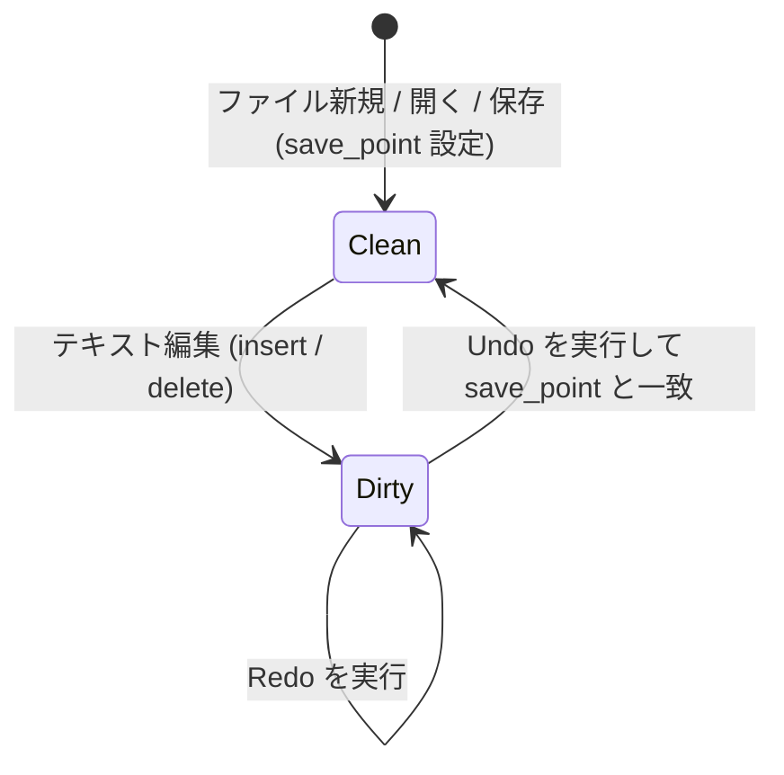

# vivivi: 機能仕様要件定義書 (SPECIFICATION)

本書は、`vivivi` エディタの全機能要件、データ構造、アルゴリズム、およびモード体系の詳細仕様を定義します。

---

## 1. テキストバッファ＆アンドゥ仕様（OpenViVi準拠）

### 1.1 ギャップバッファ (`GapBuffer<T>`)
テキストエディタにおける文字編集は、「現在のカーソル位置周辺で連続して文字の入力や削除が行われる」という極めて強い**編集の局所性（Locality）**を持ちます。

通常の連続配列（`Vec<T>`）の中間に挿入を行うと、挿入位置以降の全要素をシフトするため毎回 $O(N)$ のコストが発生します。
これに対し、GapBuffer はバッファ内部の編集位置に**「ギャップ（空き領域）」**を常駐させることで、局所的な挿入・削除を **$O(1)$** で実行します。

#### メモリ配置とインデックス変換
バッファは「データ前半部」「ギャップ（空き領域）」「データ後半部」の3要素で構成されます。

```
【論理テキスト】: "HelloWorld" (有効要素数: 10)

【物理メモリ構造】:
  Index:   0   1   2   3   4   5   6   7   8   9  10  11  12  13  14
         [ H | e | l | l | o | ■ | ■ | ■ | ■ | ■ | W | o | r | l | d ]
                             ├─── ギャップ領域 ───┤
          gap_start = 5      gap_len = 5         capacity = 15
```

- **論理インデックス $\to$ 物理インデックス変換式**:
  $$
  \text{physical\_index}(i) = \begin{cases}
  i & (i < \text{gap\_start}) \\
  i + \text{gap\_len} & (i \ge \text{gap\_start})
  \end{cases}
  $$

#### 主要アルゴリズムと計算量
| 操作 | 計算量 | 動作概要 |
| :--- | :--- | :--- |
| **文字挿入** (`insert`) | $O(1)$ (償却) | ギャップ先頭に要素を書き込み、`gap_start += 1`、`gap_len -= 1` とする。 |
| **文字削除** (`remove`) | $O(1)$ | ギャップ手前（BS）またはギャップ直後（DEL）を空き領域に組み入れ、`gap_len += 1` とする。 |
| **ギャップ移動** (`move_gap`) | $O(K)$ | カーソル移動時のみ実行。ギャップと目的位置の間の $K$ 要素を反対側へスライド移動させる。 |
| **容量拡張** (`reserve_gap`)| $O(N)$ | ギャップ枯渇時のみ実行。配列サイズを倍増させ、後半データを末尾に退避させてギャップを拡大する。 |

---

### 1.2 アンドゥマネージャ (`UndoMgr`)
Viエディタにおいて自然な使い心地を提供するため、以下の3つの高度な仕組みを備えています。



#### アクションモデル（`UndoAction`）
各編集操作は以下の列挙体として表現され、Undo実行時にはそれぞれ「逆操作（Inverse）」が生成されます。
- `Insert { pos, text, prohibit_merge }` $\longleftrightarrow$ 逆操作: `Delete { pos, text, is_backspace: false }`
- `Delete { pos, text, is_backspace }` $\longleftrightarrow$ 逆操作: `Insert { pos, text, prohibit_merge: true }`
- `Replace { pos, old_text, new_text }` $\longleftrightarrow$ 逆操作: `Replace { pos, old_text: new_text, new_text: old_text }`

#### 連続タイピングの自動マージ仕様
- 直前の操作が `UndoAction::Insert` であり、今回の挿入位置が直前のアクション末尾と連続し、改行を含まない場合、1つのアクションに自動統合します。
- 矢印キー移動、モード切替（`Escape`）、改行時には `prohibit_merge` がセットされ、マージが禁止されます。

#### トランザクション対応「Undoブロック」仕様
- `open_undo_block()` と `close_undo_block()` でネストレベルを管理します。
- ネストが 0 に達した時点で、内部に含まれる全アクションをひとつの `UndoBlock` として確定します。
- Undo実行時は、ブロック内の全アクションを逆順（LIFO）で走査し、逆操作を一括適用します。

#### 保存点（Save Point）と変更フラグ追跡
- ファイル保存時に `undo_mgr.on_saved()` でスタック深度を記録します。
- Undoを繰り返して保存時の状態に戻った場合、自動的に `is_modified == false` に復帰します。

---

### 1.3 参考元（OpenViVi）との対応対照表

| 本プロジェクト (`vivivi-core`) | OpenViVi (`vivi/buffer/`) | 備考 |
| :--- | :--- | :--- |
| `GapBuffer<T>` | `gap_buffer<Type>` (`gap_buffer.h`) | OpenViViのメモリ移動アルゴリズムをRust安全コードへ移植 |
| `UndoMgr` | `UndoMgr` (`undoMgr.h` / `undoMgr.cpp`) | ブロックネスト・マージ判定・逆操作生成を再現 |
| `UndoBlock` | `UndoAction::FLAG_BLOCK` | OpenViViのビットフラグ管理をRustの型安全な構造体へ昇華 |
| `TextBuffer` | `Buffer` (`Buffer.h` / `Buffer.cpp`) | GapBufferとUndoMgrを統合し、行・カーソル変換を提供 |

---

## 2. Viエンジン仕様（OpenViVi準拠）

### 2.1 モード体系
- **Normal（コマンド）モード**: viの基本移動・編集コマンド。
- **Insert（挿入）モード**: 通常のテキスト入力。`Escape` でNormalモードへ復帰。
- **Replace（上書き）モード**: 文字単位の上書き入力。
- **Visual（文字選択）モード**: 文字単位の範囲選択。
- **Visual Line（行選択）モード**: `V` で開始。行単位選択。
- **Visual Block（矩形選択）モード**: `Ctrl-V` で開始。矩形範囲の編集・挿入。
- **CommandLine（exコマンド）モード**: `:` で開始。保存・終了・置換。

---

## 3. インラインCSV/TSVモード仕様（ViVi 4準拠）
- **表示仕様**:
  - 各列（カラム）の最大文字幅に合わせてインラインで自動整列。
  - セルのクォート（`"` / `'`）は表示上は隠し、データ本体を見やすく表示。
  - **カーソル行の表示**: カーソルが存在する行は編集作業のため、クォートを含めた生のソース文字列を表示。
  - **ヘッダ行認識**: 指定文字（例: `#`）で始まる行をヘッダ行として認識・強調。
  - **複数表サポート**: 独立したセル幅を持つ複数の表を1つの文書内に混在可能。
- **編集仕様**:
  - 通常モードと同様に文字挿入・削除、Viコマンド（`dd`, `p` 等）が可能。

---

## 4. 罫線モード仕様（OpenViVi / ViVi 4準拠）
- **操作仕様**:
  - `F5` / `:keisen`: 罫線モードのON/OFF切り替え。
  - `Ctrl + 矢印キー` / `Alt + 矢印キー`: 罫線を描画（自動結合）。最下行を超えて下へ引く場合は自動で行拡張。
  - `Shift + 矢印キー`: 罫線を消去（周囲の接続関係を自動再計算して修復）。
  - 修飾キーなし矢印キー / `h`/`j`/`k`/`l`: 通常のカーソル移動（罫線描画なし）。
- **自動結合アルゴリズム（OpenViVi `keisen.cpp` 準拠）**:
  - Unicode罫線文字（U+2500〜U+254B）の上下左右ビットマスク判定に基づき、交差する適切な罫線文字（`┼`, `├`, `┬`, `┴`, `┤` など）へ自動接続。
  - 幾何学的角結合により、四角形描画時の余分な角の突き抜け（T字化）を自動解消し、完璧な角（`┌`, `┐`, `└`, `┘`）に結合。
- **罫線保護編集仕様（ViVi 3 / ViVi 4 準拠）**:
  - 罫線で囲まれた枠内（`│ ... │`）での文字入力時、右側の空白文字を自動削減して右側縦枠線の位置を維持（半角文字は半角1文字、全角文字は半角2文字分または全角1文字分を自動消費）。
  - 文字削除時、右側に半角スペースを自動補填して右側縦枠線の位置を維持。
    - 挿入モード: `Backspace` / `Delete`
    - ノーマルモード: `x` / `X`（1文字削除）
  - 枠内のテキスト整列（`:align left`, `:align center`, `:align right`）に対応。

---

## 5. 文字種変換＆BOX数値集計仕様（ViVi 4準拠）

### 5.1 文字種一括変換 (`conv.rs`)
全角・半角、ひらがな・カタカナ、大文字・小文字の文字コードマッピングに基づく高速一括変換を提供します。

| 変換種別                    | 対応コマンド             | 仕様概要                                                       |
| :-------------------------- | :----------------------- | :------------------------------------------------------------- |
| 全角英数記号 $\to$ 半角     | `:hankaku`, `:%hankaku`  | 全角アルファベット・数字・基本記号（`！`〜`～`）をASCII半角へ  |
| 半角英数記号 $\to$ 全角     | `:zenkaku`, `:%zenkaku`  | ASCII文字をUnicode全角（U+FF01〜U+FF5E）へ変換                 |
| ひらがな $\to$ 全角カタカナ | `:katakana`, `:%katakana`| 濁点・半濁点を含むひらがな領域（U+3041〜U+3096）をカタカナへ   |
| カタカナ $\to$ ひらがな     | `:hiragana`, `:%hiragana`| カタカナ領域（U+30A1〜U+30F6）をひらがなへ変換                 |
| 全角カタカナ $\to$ 半角     | `:hankata`, `:%hankata`  | 全角カタカナを半角カナ（濁点 `ｶﾞ` 分離形式）へ変換             |
| 半角カタカナ $\to$ 全角     | `:zenkata`, `:%zenkata`  | 半角カナおよび後続濁点・半濁点記号を1文字の全角カタカナへ合成  |
| 大文字 / 小文字変換         | `:toupper`, `:tolower`   | ASCIIおよびUnicode規則に沿ったケース変換                       |

### 5.2 BOX選択数値集計 (`calc.rs`)
- **操作**: 矩形ビジュアル選択（`Ctrl-v`）で数値列を選択し、`:calc` / `:sum` / `:total` を実行。
- **解析アルゴリズム**:
  - 選択範囲内の各行から浮動小数点数（整数、負数、カンマ区切り `1,000.50`）を正規表現で抽出。
  - 件数（Count）、合計（Sum）、平均（Average）、標本標準偏差（StdDev）を算出し、ステータスラインへ表示。
  - 集計結果を無名レジスタおよびOSクリップボードへ自動コピー。

---

## 6. 高度検索・ナビゲーション・レイアウト仕様

### 6.1 ローマ字日本語検索（Migemo / `g/`）
- **仕様**: 日本語IMEをオフにした状態のまま、ローマ字入力（例: `kensaku`, `kakko`, `yajirushi`）でバッファ内の日本語テキスト（漢字・記号・ひらがな・カタカナ）をダイレクトにインクリメンタル検索。
- **内蔵辞書仕様（独自MITクリーン辞書）**:
  - ライセンス完全性を確保するため、外部GPLデータに依存せず、独自作成したMIT適合辞書（`builtin_mit_dict.txt`）をバイナリ内に標準埋め込み（`include_str!`）。
  - **収録内容（約128語・主要記号群）**:
    - 約物・括弧類（`kakko`）: `括弧`, `「` `」` `(` `)` `（` `）` `【` `】` `『` `』` `[` `]` `［` `］` `{` `}` `｛` `｝` `〈` `〉` 等
    - 矢印各種（`yajirushi`）: `矢印`, `→` `←` `↑` `↓` `⇒` `⇔` `->` `=>` `<-`
    - 丸・点・波線（`maru`, `ten`, `kara`, `nami`）: `○`, `●`, `◎`, `。`, `、`, `・`, `〜`, `～`
    - 方向・位置: `みぎ(→)`, `ひだり(←)`, `うえ(↑)`, `した(↓)`, `なか`, `そと`, `たて`, `よこ`
    - エディタ操作・UI基本語彙: 検索、置換、保存、編集、ファイル、行、列、画面、コマンド、バッファ、カーソル、スクロール、分割、設定、実行、結果等
    - 日常生活・基本語彙: 日本、東京、世界、今日、明日、昨日、時間、天気、学校、仕事、会社等
  - **インクリメンタル前方一致展開**: 2文字以上のローマ字入力時、前方一致する漢字候補も動的に抽出し、打鍵途中でのヒット率を向上。
- **外部SKK辞書拡張（本格利用時推奨）**:
  - 本格的な長文執筆、プログラミング、専門用語等の網羅的検索には、公式の外部SKK辞書の併用を推奨。
  - `%USERPROFILE%\.vivivi\SKK-JISYO.L`（またはカレントディレクトリ）に配置された辞書ファイルを起動時に自動検出してシームレスにマージ。
  - 文字コード自動判別対応（EUC-JP, UTF-8, Shift_JIS/CP932）。
  - 公式配布元: [https://github.com/skk-dev/dict](https://github.com/skk-dev/dict)（`SKK-JISYO.L` 約10万語推奨）
- **コマンド体系**:
  - ノーマルモード `g/` による検索プロンプト起動
  - exコマンド `:migemo <query>` / `:m <query>` によるダイレクト検索
  - マッチ行への自動スクロール追従および `n` / `N` による前後ジャンプ

### 6.2 アウトライン解析ペイン (`F2`, `F8`, `:outline`)
- **仕様**: Markdown の見出し（`#` 〜 `######`）、Rust のシンボル（`fn`, `struct`, `impl`, `enum`, `trait`, `mod`）、C/C++、Python の関数・クラス定義を正規表現ベースで高速走査。
- **UI & 操作**:
  - `F2` または `F8`、exコマンド `:outline` で画面左側にツリーペインを表示／非表示トグル。
  - 開いた直後に自動的にアウトラインツリーへフォーカスが移行し、`j`/`k` で選択、`Enter` で当該行へジャンプ。
  - `Tab` または `Esc` でアウトラインを表示したままエディタ本文へフォーカスを復帰。

### 6.3 画面分割・マルチビュー（`Ctrl-w`, `:split`, `:vsplit`）
- **仕様**: 同一バッファを複数の独立したビューポート（カーソル位置・垂直および水平スクロール位置を個別保持）で並行編集。スクロールの意図しない連動を防止。
- **Vim互換階層分割ツリー（`WindowTreeNode`）**:
  - 画面レイアウトを二分木（`WindowTreeNode::Leaf` / `Split`）で再帰管理。
  - 上下分割後に下側ウィンドウで左右分割しても、全体が縦3列にならず下側のみが左右2分割される自然なネスト分割を実現。
- **キーバインド**:
  - 水平分割: `Ctrl-w s` / `:split`
  - 垂直分割: `Ctrl-w v` / `:vsplit`
  - ウィンドウフォーカス移動: `Ctrl-w h` (左), `Ctrl-w j` (下), `Ctrl-w k` (上), `Ctrl-w l` (右) の幾何学的近傍判定移動、`Ctrl-w w` (巡回)
  - ウィンドウ閉鎖: `Ctrl-w c` / `:close` / `:q`
  - 単一ウィンドウ化: `Ctrl-w o` / `:only`

### 6.4 長行表示 & 水平スクロール追従
- **仕様**: エディタの表示可能桁数（80桁等）を超える長い行において、カーソルの水平移動や `$` 行末移動に応じて画面を左右に自動追従スクロール。
- **Visual Column（表示幅）基準算出**:
  - 単純な文字インデックス（char count）ではなく、ASCII（幅1）、全角文字（幅2）、タブ文字（幅4）の表示カラムを `UnicodeWidthChar` で累積計算。
  - 水平スクロールオフセット（`scroll.1`）に基づき、画面外の文字を安全にクリッピングして描画し、全角文字の泣き別れや表示崩れを防止。

---

## 7. ViViキラー編集支援仕様（ViVi 3 / ViVi 4準拠）

### 7.1 テキストアライン (`align.rs`)
- **コマンド**: `:align <target>`（例: `:align =`, `:align :`, `:align //`）
- **仕様**:
  - ビジュアル選択範囲、またはバッファ全体の行を対象に、指定した区切り文字列 `target` の位置で縦の列を垂直一括整列。
  - 各行の左辺の表示文字幅（半角・全角考慮）を算出し、最大表示幅に合わせてスペースを自動パディング。
  - `target` を含まない行はそのままスキップ・維持。

### 7.2 リナンバ (`renumber.rs`)
- **コマンド**: `:renumber [start] [step]` / `:renum [start] [step]`（デフォルト: start=1, step=1）
- **仕様**:
  - 箇条書きリストや連番行（`1.`, `2)`, `(1)`, `[1]` 形式）を正規表現で検出。
  - インデント深さや区切り文字を完全に維持したまま、指定した `start` から `step` 刻みで自動再付番。

### 7.3 行頭・行末一括挿入 (`line_edit.rs`)
- **コマンド**:
  - `:insbeg <str>`: 各行の行頭（インデント直後）に文字列を挿入（空行スキップ）。
  - `:insend <str>`: 各行の行末に文字列を挿入（空行スキップ）。
  - `:begend <beg> <end>` / `:insbegend <beg> <end>`: 行頭・行末に一括挿入。
- **仕様**: コメントアウト（`// `）やHTMLタグ囲み（`<li>` ... `</li>`）などの定型反復編集を瞬時に完了。

### 7.4 式置換仕様 (`expr_subst.rs` / ViVi 3 / ViVi 4 準拠)
- **コマンド**: `:s/pattern/expression/e`, `:%s/pattern/expression/e`
- **仕様**:
  - 置換後文字列を算術式・スクリプト式として動的に字句解析および再帰下降構文解析して評価。
  - 四則演算（`+`, `-`, `*`, `/`, `%`）、括弧階層 `(...)`。
  - 組み込み変数:
    - `$0`: マッチした文字列全体
    - `$1`〜`$9`: 正規表現のキャプチャグループ（数値の場合は自動的に数値型として演算）
    - `$i` / `$n`: 置換マッチごとの自動インクリメント連番カウンタ（1, 2, ...）
    - `$line`: 現在置換対象行の行番号（1-based）
  - 文字列結合: 文字列リテラル（`"..."`, `'...'`）と数値の `+` 演算子による自動結合。

---

## 8. 高速入力・マクロ支援仕様（ViVi 3 / ViVi 4準拠）

### 8.1 動的単語補完（dabbrev / `Ctrl-l`, `Ctrl-m`）
- **仕様**: カーソル直前の入力プレフィックスから、現在バッファ内を後方・前方へ走査し、合致する単語候補を巡回補完。
  - `Ctrl-l`: 次の候補へ順送り
  - `Ctrl-m`: 前の候補へ戻る

### 8.2 静的略語展開（abbrev / `Ctrl-;`, `Alt-;`, `F4`, `:abbrev`）
- **仕様**: カーソル直前の英数字識別子（`fn`, `struct`, `hw` 等）を略語テーブルと照合し、定型スニペットコードへ一発展開。
- **コマンド**: `:abbrev <key> <val>` による動的登録、外部辞書ファイルの読み込みに対応。

### 8.3 ダイナミックマクロ（Dynamic Macro / `Alt-m`, `Ctrl-Alt-m`, `:dmacro`）
- **増井俊之式アルゴリズム**:
  - ユーザーの打鍵履歴（キーストローク列）から、直前に実行された反復規則（XX パターン）を最長一致で自動検出。
  - 事前のマクロ記録操作を一切必要とせず、2回同じ操作を繰り返した直後に `Alt-m` を押すだけで、その操作を瞬時に再現・反復実行。

### 8.4 字句編集予測（LexEdit / `Ctrl-j`, `:lexedit`）
- **仕様**:
  - 単語の編集・置換履歴（`:s` コマンドや手動置換）を自動記録。
  - `Ctrl-j` 打鍵時、カーソル下の単語に対して「接頭辞・接尾辞の類似性」に基づき次の置換語句を自動予測し、ワンタッチで置換を適用。

### 8.5 Zen-Coding (Emmet) 展開（`Ctrl-,`, `Alt-,`, `:zen`）
- **仕様**: HTML/XMLの短縮省略記法（例: `div#container>ul.menu>li*3>a`）を構文木ノードへパースし、正規のインデント付きタグ構造へ一括展開。

### 8.6 キーボードマクロ記録・再生（`Ctrl-Alt-r`, `Ctrl-Alt-p`, `F9`, `F10`, `:macro`）
- **仕様**:
  - `Ctrl-Alt-r` / `F9`: マクロ記録の開始／停止をトグル。ノーマル・インサート・exコマンドの全キーストロークを完全記録。
  - `Ctrl-Alt-p` / `F10`: 記録されたキーストローク列を高速フィードバック再生。
  - Vi標準のレジスタマクロ（`qa` ... `q`, `@a`, `@@`）とも完全連携。

---

## 9. AI連携アーキテクチャ仕様（`:ai`）

- **設計原則**:
  - **Zero-Latency UI**: LLM推論・通信は完全非同期ワーカーで実行し、エディタの打鍵を一切ブロックしない。
  - **Local-First**: `Ollama` / `llama.cpp` のローカル推論を優先サポートし、外部API（Gemini, Claude, OpenAI）もプラグイン可能。
- **コマンド体系**:
  - `:ai <指示>`: 選択行やカレントブロックの自然言語リファクタリング。
  - `:ai commit`: `git diff` からのコミットメッセージ自動生成。
  - 将来構想: ゴーストテキストによるインライン先読み補完（`Tab`）、セマンティックLexEdit。
- **詳細設計書**: [`docs/ja/AI_INTEGRATION_DESIGN.md`](./AI_INTEGRATION_DESIGN.md) に準拠。

---

## 10. ViVi独自vi拡張コマンド・ナビゲーション仕様（ViVi 3 / ViVi 4準拠）

### 10.1 fFtT 全角文字自動マッチ (`fftt.rs` / ViVi 3 / ViVi 4準拠)
- **コマンド**: `f<char>`, `F<char>`, `t<char>`, `T<char>`, `;`, `,`
- **仕様**:
  - 半角のASCII英数記号が指定された場合、対応する全角文字（数字、アルファベット、括弧 `（）［］｛｝`、句読点・記号 `：；！？` 等）にも透過的にマッチ。
  - `df)` や `ct]` などのオペレータモーションでも全角文字を包含して正確に処理。

### 10.2 カーソル単語の前後方検索 & 前後方一致検索 (共通 / OpenViVi準拠)
- **コマンド**: `*`, `#`, `g*`, `g#`, `g<`, `g=`
- **仕様**:
  - `*` / `#`: カーソル下の単語を完全一致（`\bword\b`）で前方／後方検索。
  - `g*` / `g#`: 単語境界なし（部分一致）で前方／後方検索。
  - `g<`: カーソル下の単語を前方一致（プレフィックス一致）で前方検索。
  - `g=`: カーソル下の単語を後方一致（サフィックス一致）で前方検索。

### 10.3 数値・英字インクリメント/デクリメント & 真偽値トグル (ViVi 3 / ViVi 4準拠)
- **コマンド**: `#+`, `##`, `#-`, `#!`
- **仕様**:
  - `#+` / `##`: カーソル下の数値を `+1`、またはアルファベットを順送り（`a` $\to$ `b`, `z` $\to$ `a`）。
  - `#-`: カーソル下の数値を `-1`、またはアルファベットを逆送り（`b` $\to$ `a`, `a` $\to$ `z`）。
  - `#!`: カーソル下の真偽値識別子（`true`/`false`, `True`/`False`, `TRUE`/`FALSE`, `yes`/`no`, `on`/`off` 等）をトグル反転。

### 10.4 直前編集位置・行ジャンプ & 直前行文字列複製 (ViVi 3 / ViVi 4準拠)
- **コマンド**: `@`, `'@`, `` `@ ``, `=<char>`
- **仕様**:
  - `@`: テキスト変更（挿入・削除・置換・増減）が発生した直前の文字座標へ即座にジャンプ。
  - `'@` / `` `@ ``: 直前に編集した行の先頭へジャンプ。
  - `=<char>`: 直前の行の同列位置にある文字から、指定文字 `<char>` までの文字列（または改行まで）を現在行へ複製挿入。

### 10.5 グローバルマーク (ViVi 3 / ViVi 4準拠)
- **コマンド**: `ma`〜`mz`, `mA`〜`mZ`, `'a`, `` `a ``, `:marks`
- **仕様**:
  - `ma`〜`mz`: カレントバッファ内のローカルマーク登録。
  - `mA`〜`mZ`: ファイルパスを保持する大文字のワークスペース永続グローバルマーク登録。
  - `'a` / `` `a ``: マークした行・列へジャンプ。
  - `:marks`: 登録済みマーク一覧のステータス表示。

### 10.6 タグジャンプ & スタック復帰 (共通 / OpenViVi準拠)
- **コマンド**: `Ctrl-]`, `Ctrl-t`, `Ctrl-[`, `:tag <name>`, `:tags`
- **仕様**:
  - `Ctrl-]`: カーソル下のシンボル名を `tags` ファイルから検索して定義位置へジャンプ。`tags` がない場合は同一バッファ内の構文解析アウトライン（Rust, Python, Markdown等）から定義行を探索してジャンプ。
  - `Ctrl-t` / `Ctrl-[`: タグジャンプ履歴スタックをポップし、ジャンプ前の位置へ復帰。
  - `:tags`: タグ履歴スタックの一覧を表示。

---

## 11. ツール機能・ファイル管理仕様（ViVi 3 / ViVi 4準拠）

### 11.1 永続Undo (Persistent Undo / `undo.rs`, `buffer.rs`)
- **概要**: エディタ終了やファイルリロード後もアンドゥ・リドゥ履歴を完全に保持する機能。
- **保存先**: 対象ファイルと同一ディレクトリの `.<filename>.undofile`。
- **データ形式**: 外部クレートに依存しない軽量プレーンテキスト形式（改行・タブ等のエスケープシーケンス対応）。
  - `INSERT <pos> <escaped_text>`
  - `DELETE <pos> <escaped_text>`
  - `BLOCK_START` / `BLOCK_END`
- **動作契機**:
  - ファイル保存時（`:w` 等）に自動シリアライズ出力。
  - ファイルオープン時に自動探索・デシリアライズ復元。
  - 手動コマンド: `:undofile save [path]`, `:undofile load [path]`

### 11.2 テキスト差分 & 世代バックアップ (DIFF & DiffLog / `diff.rs`, `difflog.rs`)
- **差分エンジン (`diff.rs`)**:
  - 最長共通部分列（LCS）アルゴリズムによる高精度行単位差分検出。
  - Unified Diff形式のテキスト生成（`create_unified_diff`）およびパッチ適用（`apply_unified_patch`）。
  - 左右2画面同期比較ビュー用の対応行マッピング（`create_side_by_side`）。
- **世代バックアップ (`difflog.rs`)**:
  - **保存先**: `.<filename>.difflog`。
  - ファイル保存ごとに前世代との差分（Unified Diff）およびUNIXタイムスタンプを追記記録。
  - **コマンド**:
    - `:difflog`: 全世代のタイムスタンプ・行数差分一覧表示。
    - `:difflog restore <generation>`: 初代ベーステキストと各世代パッチの順次適用により、指定した過去世代の状態へ完全にバッファを復元。
    - `:blame`: ファイルの各行がどの世代（タイムスタンプ）で追加・更新されたかを逆順パッチ追跡により特定・表示（簡易blame）。

### 11.3 テンプレート自動読み込み (`template.rs`)
- **仕様**:
  - 存在しない新規ファイルをオープンした際、同一ディレクトリまたは上位ディレクトリへ向けて `.template.<ext>`（例: `.template.rs`, `.template.md`）を自動探索。
  - 発見された場合、以下のマクロ変数を自動置換してバッファの初期テキストとして展開。
  - **マクロ展開変数**:
    - `%FileName%`: ファイル名（例: `main.rs`）
    - `%FileBase%`: 拡張子なしファイル名（例: `main`）
    - `%Ext%`: 拡張子（例: `rs`）
    - `%Date%`: 現在日付（`YYYY-MM-DD`）
    - `%Time%`: 現在時刻（`HH:MM:SS`）
    - `%UserName%`: システムログインユーザー名
    - `%Cursor%`: 展開後の初期カーソル位置（バッファ読み込み時に自動配置）

### 11.4 コード内 ToDo 抽出 (`todo.rs`)
- **コマンド**: `:todo [dir]`, `:undone [dir]`
- **仕様**:
  - カレントバッファまたは指定ディレクトリ（省略時はカレントディレクトリ）内の全ソースファイルを再帰走査。
  - コメント内の特定タグ（`TODO`, `FIXME`, `BUG`, `UNDONE`, `HACK`, `NOTE`, `XXX`）を検出。
  - 抽出結果（ファイル名、行番号、タグ名、コメント本文）を一覧化し、QuickFix形式で該当箇所へ即座にジャンプ可能。

### 11.5 コード折り畳み (Code Folding / `folding.rs`)
- **仕様**:
  - 各行のインデント階層（スペース2/4個またはタブ単位）を解析し、親行と子ブロックを自動判定。
  - 折り畳み時は子ブロック行を画面上非表示とし、プレビュー行（`... (+N lines)`）を表示。
- **キー操作 & コマンド**:
  - `zc`: カーソル行のブロックを折り畳む（Close）。
  - `zo`: カーソル行の折り畳みを展開する（Open）。
  - `za`: カーソル行の折り畳み／展開をトグル。
  - `zM`: バッファ全体の全ブロックを折り畳み。
  - `zR`: バッファ全体の全ブロックを展開。
  - `z<lvl>`: 指定インデント深度 `<lvl>` より深いブロックを一括折り畳み。
  - `:fold <toggle|close|open|all|none>`

### 11.6 プロジェクト内高速 Grep 検索 (`grep.rs`)
- **コマンド**: `:grep <pattern> [dir]`, `:cnext` / `:cn`, `:cprev` / `:cp`
- **仕様**:
  - 指定ディレクトリ内の全テキストファイルを走査し、正規表現パターンにマッチする行を抽出。
  - `.git`, `target`, `node_modules`, `dist`, `build` 等の除外ディレクトリ、およびバイナリファイル（NULL文字含有）を自動スキップ。
  - 検索結果をセッションとして保持し、`:cnext` / `:cprev` でファイル・行間をシームレスに巡回移動。

### 11.7 2ペイン ディレクトリビュー（ファイラー / `filer.rs`)
- **コマンド**: `:filer [path]`
- **仕様**:
  - 左右2つの独立したディレクトリブラウザペインを表示。
  - **操作体系**:
    - `Tab`: 左右ペイン間のフォーカス切り替え。
    - `j` / `k`: ファイル・ディレクトリカーソル移動。
    - `Enter`: ディレクトリ展開／進入（`..` で親階層へ）。ファイル選択時はバッファとして開く。
    - `Space`: 複数ファイル選択／解除。
    - `c`: 選択したファイル・ディレクトリを反対側ペインのディレクトリへコピー。
    - `m`: 反対側ペインのディレクトリへ移動。
    - `d`: 選択ファイルの削除。

### 11.8 プロジェクト管理 & 一括tags生成 (`project.rs`)
- **コマンド**: `:maketags [dir]`
- **仕様**:
  - プロジェクトルート内の全ソースファイルを再帰探索。
  - 関数、構造体、トレイト、モジュール等のシンボル定義行をAST解析し、標準 ctags 形式の `tags` ファイルを一括出力。

### 11.9 印刷プレビュー & PDF直接出力 (`print.rs`)
- **コマンド**: `:preview` / `:print`, `:pdf [path]`
- **仕様**:
  - **印刷プレビュー**: A4用紙（標準60行/ページ、行番号、ヘッダー【ファイル名】、フッター【ページ番号/総ページ数】）に自動改ページ分割。全画面モーダルUIでプレビュー描画し、`j`/`k` や `d`/`u` でスクロール確認可能。
  - **PDF直接出力**: 外部ライブラリ（Cairoやwkhtmltopdf等）を一切使用せず、純粋なRust実装のみで PDF 1.4 仕様に準拠したバイナリストリーム（Type 1 Courierフォント、テキスト描画オペレータ、クロスリファレンステーブル）を直接生成・ファイル保存。
  - *(注: デスクトップGUIフロントエンド (egui) およびGUI前提機能は、ユーザー指示に基づきフェーズ5へ移行し、現在はTUIフロントエンドおよびコアツールエンジンに特化)*

---

## 12. TUI/UX編集・視覚支援仕様（Phase 4.6）

### 12.1 編集行・保存済み行のガター強調表示 (Change Markers / `gutter.rs`)
- **概要**: OpenViVi の視覚的編集支援機能であり、ファイル内で変更された行を左端ガター（行番号領域）にカラーバーとしてリアルタイム表示。
- **マーカー種別**:
  - **未保存変更行 (Modified / 黄色 `▌`)**: 前回保存（またはファイル読み込み）以降にテキストが挿入・置換・削除された行。
  - **保存済み変更行 (Saved / 緑色 `▌`)**: セッション中に変更されたが、一度 `:w` 等でディスクに保存された行。
  - **未変更行 (Unchanged / 無表示)**: ファイルオープン時から一切変更されていない行。
- **判定アルゴリズム**:
  - `TextBuffer` の Undo スタックおよび `save_point` スナップショットと連動し、行単位のハッシュまたは行境界の編集トランザクションを追跡して瞬時に差分状態を判定。

### 12.2 最近使ったファイル & お気に入りファイル (`recent.rs`)
- **概要**: 直近に開いたファイル履歴（Recent Files）および頻繁に利用するお気に入りファイル（Favorite Files）の永続管理とクイック選択。
- **データ保存**: `%USERPROFILE%\.vivivi\recent_files.json`（外部クレート非依存、または標準JSON）。
- **キー操作 & コマンド**:
  - `F7` / `:recent`: 最近使ったファイル選択モーダルダイアログのポップアップ。
  - `:fav`: お気に入りファイル一覧のポップアップ表示。
  - `:fav add [path]`: 現在のバッファまたは指定パスをお気に入りに追加。
  - `:fav del [path]`: お気に入りから削除。
- **ダイアログ操作**:
  - `j` / `k` (または `↑` / `↓`): 履歴リストの選択移動。
  - `Enter`: 選択したファイルをアクティブバッファで開く。
  - `Esc` / `q`: ダイアログを閉じる。

### 12.3 不可視文字・空白文字の可視化 (`invisible.rs`)
- **概要**: 日本語テキストおよびソースコード編集時のインデント誤りや全角スペース混入を防ぐための視覚化機能。
- **コマンド**:
  - `:set list`: 不可視文字表示の有効化。
  - `:set nolist`: 不可視文字表示の無効化（デフォルト）。
  - `:set list!`: 表示トグル。
- **表示仕様**:
  - **全角スペース (U+3000)**: 四角記号（`□`）として明瞭に可視化。
  - **タブ文字 (`\t`)**: 先頭に矢印、後続をダッシュ（例: `▸---`、タブ幅4の場合）で展開。
  - **改行記号**: 行末にドル記号（`$`）または改行マークを表示。
  - **行末の余分な半角スペース (Trailing Spaces)**: 警告色またはアンダーバーで強調。

### 12.4 検索ハイライト制御
- **概要**: `/` または `?` による検索実行時、画面内の全一致箇所をリアルタイムにカラー反転ハイライト表示。
- **操作 & コマンド**:
  - `n`: 次の一致箇所へカーソルジャンプ。
  - `N`: 前の一致箇所へカーソルジャンプ。
  - `:noh`, `:nohl`, `:nohlsearch`: 画面上の検索ハイライトを消去。
  - `:set hls` / `:set hlsearch`: ハイライト常時ON。
  - `:set nohls` / `:set nohlsearch`: ハイライト常時OFF。
  - *(ダブルEsc連打によるハイライト消去はフィードバック課題として改善対応予定)*

### 12.5 モード連動ターミナルカーソル形状制御
- **概要**: 端末エミュレータ（Windows Terminal, WezTerm, Alacritty 等）の DECSCUSR ANSI エスケープシーケンスを活用し、Viモードに応じてカーソル形状を動的に切り替え。
- **モードとカーソル形状**:
  - **Normal / Visual モード**: ブロック型カーソル (`\x1b[2 q` / █)
  - **Insert モード**: 縦棒（ビーム）型カーソル (`\x1b[6 q` / ▎)
  - **Replace モード**: 下線（アンダーライン）型カーソル (`\x1b[4 q` /   )

---

## 13. テスト・ドキュメント規約体系

### 13.1 テスト設計・分離規約 (`tests/` vs `src/`)
- **公開 API 統合テスト (`tests/*.rs`)**:
  - 外部の利用側（バイナリや他クレート）と同一の視点で、公開された型・関数・トレイトのみを用いたブラックボックステストを実施。
  - モジュール間の結合挙動、複数操作を組み合わせたユースケース、エンドツーエンドの処理フローを検証。
- **内部実装・非公開ユニットテスト (`src/**/tests.rs` or `mod tests`)**:
  - `pub(crate)` または非公開（`fn`）の内部アルゴリズム、エッジケース、プライベート状態遷移を直接検証するホワイトボックステストに純化。
  - プロダクションコードの肥大化を防ぐため、公開APIで検証可能なテストは速やかに `tests/` へ移管。

### 13.2 日本語 Rustdoc 生成規約
- **完全日本語記述**: 概要、詳細、エラー条件、パニック条件、コード例コメントはすべて自然で格調高い日本語で統一。
- **必須セクション**:
  1. **1行の概要**: 関数・型の目的を端的に説明。
  2. **詳細説明**: 前提条件、不変条件、関連する型へのリンク（[`Type`]）。
  3. **# Errors**: `Result` を返す場合、発生しうるエラー条件を網羅。
  4. **# Panics**: パニックを引き起こす入力・境界値条件を明記（パニックしない場合は省略または明記）。
  5. **# Examples**: `cargo test --doc` でそのまま実行検証可能な最小コード例。

---

## 14. 高度エディタ機能 & 堅牢化仕様（Phase 4.8）

### 14.1 マルチタブ管理仕様 (`TabPage`, `Tab Bar UI`)
- **データ構造**: 各タブは `TabPage` 構造体としてカレントバッファ・ウィンドウ分割ツリー（`WindowTreeNode`）・カーソル位置・スクロールオフセットを完全保持。
- **タブバー描画**: タブ数が2以上の場合に画面最上部に自動描画。アクティブタブは反転色、未保存変更バッファには `[+]` バッジを付与。
- **状態同期**: タブ切り替え時にアクティブエディタの現在状態を退避（`sync_active_tab_state`）し、目的タブの状態をロード（`load_tab_state`）することで既存編集ロジックと完全透過動作。
- **キー・コマンド**: `gt`, `gT`, `[count]gt`, `:tabnew [file]`, `:tabclose`, `:tabnext`, `:tabprev`, `:tabonly`。

### 14.2 矩形選択一括編集仕様 (`VisualBlock`)
- **列方向編集**: `Ctrl-v` による矩形ブロック選択に対し、各行の選択開始列・終了列に基づき一括編集を実行。
- **一括挿入 (`I`, `A`)**: 先頭列または末尾列にテキストを一括挿入。行長が選択列に満たない行には空白を自動補填。
- **一括置換 (`c`) & 一括文字塗りつぶし (`r`)**: 選択領域の各行文字を置換テキストまたは指定単一文字で一括更新。
- **一括削除 (`d`, `x`)**: 矩形範囲を削除し、各行の後続文字を左方向へ均等にシフト。

### 14.3 設定ファイル永続化仕様 (`config.toml`)
- **格納パス**: `%USERPROFILE%\.vivivi\config.toml`（または `~/.vivivi/config.toml`）。
- **構成スキーマ**:
  - `[editor]`: `tab_stop`, `number`, `relative_number`, `gutter`, `hlsearch`, `clipboard`, `theme`
  - `[invisible]`: `enabled`, `space`, `tab`, `eol`
  - `[keymap.normal]`, `[keymap.insert]`: ユーザーキーリマップ辞書
- **動的再読込**: `:config` コマンドによるディスクからのオンザフライ再読込とアクティブバッファへの即時適用。

### 14.4 文字コード指定・改行変換仕様
- **強制再読込 (`:e ++enc=<enc>`)**: 自動判別をバイパスし、指定エンコーディング（`utf-8`, `sjis`, `euc-jp`）として再読込。
- **保存文字コード (`:set fenc=<enc>`)**: バッファ保存時の出力文字コードを動的変更。
- **改行コード変換 (`:set ff=unix|dos`)**: バッファ保存時の行末コード（LF / CRLF）を動的変換。

### 14.5 クラッシュリカバリ・スワップファイル仕様 (`.swp`)
- **スワップ生成**: 変更のあるバッファに対して、対象ファイルと同一階層に `.<filename>.swp` を作成。
- **自動同期**: 20打鍵ごとおよび `Esc`（ノーマル復帰時）に最新テキストレコードをアトミックに書き出し。
- **復旧プロトコル**: 起動時にスワップファイルが残存している場合、ステータスバーに警告を表示し、`:recover` で即時復元、`:swap` でメタ情報確認。
- **自動クリーンアップ**: `:w` による正常保存時および未変更 `:q` 終了時にスワップファイルを安全に自動削除。

### 14.6 システム共有クリップボード連携仕様
- **トレイト抽象化**: `vivivi-vi` 内に `ClipboardProvider` トレイトを定義し、UI非依存のアーキテクチャを維持。
- **システム実装**: `vivivi-app` 側で `arboard::Clipboard` をラップした `SystemClipboard` を注入。
- **レジスタ連携**: `"+` および `"*` レジスタへのヤンク／プット時に OS クリップボードと透過同期。`:set clipboard=unnamed` により無名レジスタ操作も自動同期。

### 14.7 構文強調対応言語仕様 (全18言語)
- **拡充言語**: Go (`.go`), Ruby (`.rb`), TOML (`.toml`), PowerShell (`.ps1`, `.psm1`, `.psd1`), YAML (`.yaml`, `.yml`), XML (`.xml`), Windows Batch (`.bat`, `.cmd`)。
- **字句解析**: キーワード、型・クラス名、文字列（シングル/ダブル/生文字列）、数値、コメント、記号、環境変数（Batch）等のトークン分離。
- **ステータスバー言語バッジ**: 各言語の標準バッジ（`[Go]`, `[Ruby]`, `[TOML]`, `[PowerShell]`, `[YAML]`, `[XML]`, `[Batch]`）をステータスバーに表示。


