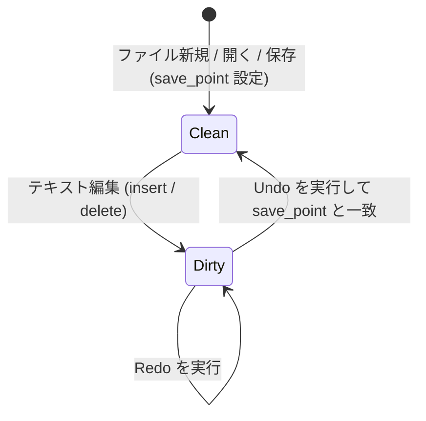

# vivivi: 機能仕様要件定義書 (SPECIFICATION)

本書は、`vivivi` エディタの全機能要件、データ構造、アルゴリズム、およびモード体系の詳細仕様を定義します。

---

## 1. テキストバッファ＆アンドゥ仕様（OpenViVi準拠）

### 1.1 ギャップバッファ (`GapBuffer<T>`)
テキストエディタにおける文字編集は、「現在のカーソル位置周辺で連続して文字の入力や削除が行われる」という極めて強い**編集の局所性（Locality）**を持ちます。

通常の連続配列（`Vec<T>`）の中間に挿入を行うと、挿入位置以降の全要素をシフトするため毎回 $O(N)$ のコストが発生します。
これに対し、GapBuffer はバッファ内部の編集位置に**「ギャップ（空き領域）」**を常駐させることで、局所的な挿入・削除を **$O(1)$** で実行します。

#### メモリ配置とインデックス変換
バッファは「データ前半部」「ギャップ（空き領域）」「データ後半部」の3要素で構成されます。

```
【論理テキスト】: "HelloWorld" (有効要素数: 10)

【物理メモリ構造】:
  Index:   0   1   2   3   4   5   6   7   8   9  10  11  12  13  14
         [ H | e | l | l | o | ■ | ■ | ■ | ■ | ■ | W | o | r | l | d ]
                             ├─── ギャップ領域 ───┤
          gap_start = 5      gap_len = 5         capacity = 15
```

- **論理インデックス $\to$ 物理インデックス変換式**:
  $$
  \text{physical\_index}(i) = \begin{cases}
  i & (i < \text{gap\_start}) \\
  i + \text{gap\_len} & (i \ge \text{gap\_start})
  \end{cases}
  $$

#### 主要アルゴリズムと計算量
| 操作 | 計算量 | 動作概要 |
| :--- | :--- | :--- |
| **文字挿入** (`insert`) | $O(1)$ (償却) | ギャップ先頭に要素を書き込み、`gap_start += 1`、`gap_len -= 1` とする。 |
| **文字削除** (`remove`) | $O(1)$ | ギャップ手前（BS）またはギャップ直後（DEL）を空き領域に組み入れ、`gap_len += 1` とする。 |
| **ギャップ移動** (`move_gap`) | $O(K)$ | カーソル移動時のみ実行。ギャップと目的位置の間の $K$ 要素を反対側へスライド移動させる。 |
| **容量拡張** (`reserve_gap`)| $O(N)$ | ギャップ枯渇時のみ実行。配列サイズを倍増させ、後半データを末尾に退避させてギャップを拡大する。 |

---

### 1.2 アンドゥマネージャ (`UndoMgr`)
Viエディタにおいて自然な使い心地を提供するため、以下の3つの高度な仕組みを備えています。



#### アクションモデル（`UndoAction`）
各編集操作は以下の列挙体として表現され、Undo実行時にはそれぞれ「逆操作（Inverse）」が生成されます。
- `Insert { pos, text, prohibit_merge }` $\longleftrightarrow$ 逆操作: `Delete { pos, text, is_backspace: false }`
- `Delete { pos, text, is_backspace }` $\longleftrightarrow$ 逆操作: `Insert { pos, text, prohibit_merge: true }`
- `Replace { pos, old_text, new_text }` $\longleftrightarrow$ 逆操作: `Replace { pos, old_text: new_text, new_text: old_text }`

#### 連続タイピングの自動マージ仕様
- 直前の操作が `UndoAction::Insert` であり、今回の挿入位置が直前のアクション末尾と連続し、改行を含まない場合、1つのアクションに自動統合します。
- 矢印キー移動、モード切替（`Escape`）、改行時には `prohibit_merge` がセットされ、マージが禁止されます。

#### トランザクション対応「Undoブロック」仕様
- `open_undo_block()` と `close_undo_block()` でネストレベルを管理します。
- ネストが 0 に達した時点で、内部に含まれる全アクションをひとつの `UndoBlock` として確定します。
- Undo実行時は、ブロック内の全アクションを逆順（LIFO）で走査し、逆操作を一括適用します。

#### 保存点（Save Point）と変更フラグ追跡
- ファイル保存時に `undo_mgr.on_saved()` でスタック深度を記録します。
- Undoを繰り返して保存時の状態に戻った場合、自動的に `is_modified == false` に復帰します。

---

### 1.3 参考元（OpenViVi）との対応対照表

| 本プロジェクト (`vivivi-core`) | OpenViVi (`vivi/buffer/`) | 備考 |
| :--- | :--- | :--- |
| `GapBuffer<T>` | `gap_buffer<Type>` (`gap_buffer.h`) | OpenViViのメモリ移動アルゴリズムをRust安全コードへ移植 |
| `UndoMgr` | `UndoMgr` (`undoMgr.h` / `undoMgr.cpp`) | ブロックネスト・マージ判定・逆操作生成を再現 |
| `UndoBlock` | `UndoAction::FLAG_BLOCK` | OpenViViのビットフラグ管理をRustの型安全な構造体へ昇華 |
| `TextBuffer` | `Buffer` (`Buffer.h` / `Buffer.cpp`) | GapBufferとUndoMgrを統合し、行・カーソル変換を提供 |

---

## 2. Viエンジン仕様（OpenViVi準拠）

### 2.1 モード体系
- **Normal（コマンド）モード**: viの基本移動・編集コマンド。
- **Insert（挿入）モード**: 通常のテキスト入力。`Escape` でNormalモードへ復帰。
- **Replace（上書き）モード**: 文字単位の上書き入力。
- **Visual（文字選択）モード**: 文字単位の範囲選択。
- **Visual Line（行選択）モード**: `V` で開始。行単位選択。
- **Visual Block（矩形選択）モード**: `Ctrl-V` で開始。矩形範囲の編集・挿入。
- **CommandLine（exコマンド）モード**: `:` で開始。保存・終了・置換。

---

## 3. インラインCSV/TSVモード仕様（ViVi 4準拠）
- **表示仕様**:
  - 各列（カラム）の最大文字幅に合わせてインラインで自動整列。
  - セルのクォート（`"` / `'`）は表示上は隠し、データ本体を見やすく表示。
  - **カーソル行の表示**: カーソルが存在する行は編集作業のため、クォートを含めた生のソース文字列を表示。
  - **ヘッダ行認識**: 指定文字（例: `#`）で始まる行をヘッダ行として認識・強調。
  - **複数表サポート**: 独立したセル幅を持つ複数の表を1つの文書内に混在可能。
- **編集仕様**:
  - 通常モードと同様に文字挿入・削除、Viコマンド（`dd`, `p` 等）が可能。

---

## 4. 罫線モード仕様（OpenViVi / ViVi 4準拠）
- **操作仕様**:
  - `Shift-F5`: 罫線モードのON/OFF切り替え。
  - `Ctrl + 矢印キー`: 罫線を描画（自動結合）。
  - `Shift + 矢印キー`: 罫線を消去。
- **自動結合アルゴリズム（OpenViVi `keisen.cpp` 準拠）**:
  - Unicode罫線文字（U+2500〜U+254B）の上下左右ビットマスク判定に基づき、交差する適切な罫線文字（`┼`, `├`, `┬`, `┴`, `┤` など）へ自動接続。
