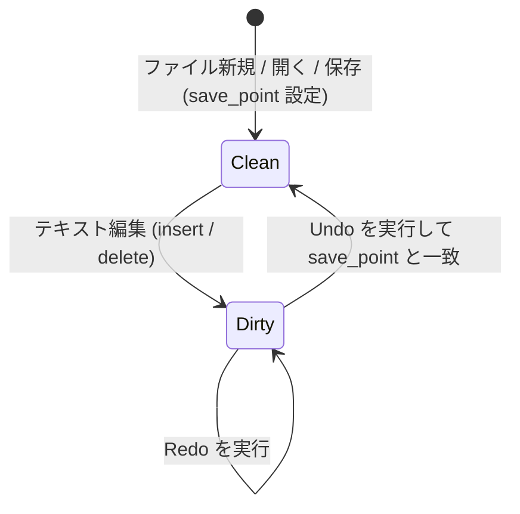

# vivivi: 機能仕様要件定義書 (SPECIFICATION)

本書は、`vivivi` エディタの全機能要件、データ構造、アルゴリズム、およびモード体系の詳細仕様を定義します。

---

## 1. テキストバッファ＆アンドゥ仕様（OpenViVi準拠）

### 1.1 ギャップバッファ (`GapBuffer<T>`)
テキストエディタにおける文字編集は、「現在のカーソル位置周辺で連続して文字の入力や削除が行われる」という極めて強い**編集の局所性（Locality）**を持ちます。

通常の連続配列（`Vec<T>`）の中間に挿入を行うと、挿入位置以降の全要素をシフトするため毎回 $O(N)$ のコストが発生します。
これに対し、GapBuffer はバッファ内部の編集位置に**「ギャップ（空き領域）」**を常駐させることで、局所的な挿入・削除を **$O(1)$** で実行します。

#### メモリ配置とインデックス変換
バッファは「データ前半部」「ギャップ（空き領域）」「データ後半部」の3要素で構成されます。

```
【論理テキスト】: "HelloWorld" (有効要素数: 10)

【物理メモリ構造】:
  Index:   0   1   2   3   4   5   6   7   8   9  10  11  12  13  14
         [ H | e | l | l | o | ■ | ■ | ■ | ■ | ■ | W | o | r | l | d ]
                             ├─── ギャップ領域 ───┤
          gap_start = 5      gap_len = 5         capacity = 15
```

- **論理インデックス $\to$ 物理インデックス変換式**:
  $$
  \text{physical\_index}(i) = \begin{cases}
  i & (i < \text{gap\_start}) \\
  i + \text{gap\_len} & (i \ge \text{gap\_start})
  \end{cases}
  $$

#### 主要アルゴリズムと計算量
| 操作 | 計算量 | 動作概要 |
| :--- | :--- | :--- |
| **文字挿入** (`insert`) | $O(1)$ (償却) | ギャップ先頭に要素を書き込み、`gap_start += 1`、`gap_len -= 1` とする。 |
| **文字削除** (`remove`) | $O(1)$ | ギャップ手前（BS）またはギャップ直後（DEL）を空き領域に組み入れ、`gap_len += 1` とする。 |
| **ギャップ移動** (`move_gap`) | $O(K)$ | カーソル移動時のみ実行。ギャップと目的位置の間の $K$ 要素を反対側へスライド移動させる。 |
| **容量拡張** (`reserve_gap`)| $O(N)$ | ギャップ枯渇時のみ実行。配列サイズを倍増させ、後半データを末尾に退避させてギャップを拡大する。 |

---

### 1.2 アンドゥマネージャ (`UndoMgr`)
Viエディタにおいて自然な使い心地を提供するため、以下の3つの高度な仕組みを備えています。



#### アクションモデル（`UndoAction`）
各編集操作は以下の列挙体として表現され、Undo実行時にはそれぞれ「逆操作（Inverse）」が生成されます。
- `Insert { pos, text, prohibit_merge }` $\longleftrightarrow$ 逆操作: `Delete { pos, text, is_backspace: false }`
- `Delete { pos, text, is_backspace }` $\longleftrightarrow$ 逆操作: `Insert { pos, text, prohibit_merge: true }`
- `Replace { pos, old_text, new_text }` $\longleftrightarrow$ 逆操作: `Replace { pos, old_text: new_text, new_text: old_text }`

#### 連続タイピングの自動マージ仕様
- 直前の操作が `UndoAction::Insert` であり、今回の挿入位置が直前のアクション末尾と連続し、改行を含まない場合、1つのアクションに自動統合します。
- 矢印キー移動、モード切替（`Escape`）、改行時には `prohibit_merge` がセットされ、マージが禁止されます。

#### トランザクション対応「Undoブロック」仕様
- `open_undo_block()` と `close_undo_block()` でネストレベルを管理します。
- ネストが 0 に達した時点で、内部に含まれる全アクションをひとつの `UndoBlock` として確定します。
- Undo実行時は、ブロック内の全アクションを逆順（LIFO）で走査し、逆操作を一括適用します。

#### 保存点（Save Point）と変更フラグ追跡
- ファイル保存時に `undo_mgr.on_saved()` でスタック深度を記録します。
- Undoを繰り返して保存時の状態に戻った場合、自動的に `is_modified == false` に復帰します。

---

### 1.3 参考元（OpenViVi）との対応対照表

| 本プロジェクト (`vivivi-core`) | OpenViVi (`vivi/buffer/`) | 備考 |
| :--- | :--- | :--- |
| `GapBuffer<T>` | `gap_buffer<Type>` (`gap_buffer.h`) | OpenViViのメモリ移動アルゴリズムをRust安全コードへ移植 |
| `UndoMgr` | `UndoMgr` (`undoMgr.h` / `undoMgr.cpp`) | ブロックネスト・マージ判定・逆操作生成を再現 |
| `UndoBlock` | `UndoAction::FLAG_BLOCK` | OpenViViのビットフラグ管理をRustの型安全な構造体へ昇華 |
| `TextBuffer` | `Buffer` (`Buffer.h` / `Buffer.cpp`) | GapBufferとUndoMgrを統合し、行・カーソル変換を提供 |

---

## 2. Viエンジン仕様（OpenViVi準拠）

### 2.1 モード体系
- **Normal（コマンド）モード**: viの基本移動・編集コマンド。
- **Insert（挿入）モード**: 通常のテキスト入力。`Escape` でNormalモードへ復帰。
- **Replace（上書き）モード**: 文字単位の上書き入力。
- **Visual（文字選択）モード**: 文字単位の範囲選択。
- **Visual Line（行選択）モード**: `V` で開始。行単位選択。
- **Visual Block（矩形選択）モード**: `Ctrl-V` で開始。矩形範囲の編集・挿入。
- **CommandLine（exコマンド）モード**: `:` で開始。保存・終了・置換。

---

## 3. インラインCSV/TSVモード仕様（ViVi 4準拠）
- **表示仕様**:
  - 各列（カラム）の最大文字幅に合わせてインラインで自動整列。
  - セルのクォート（`"` / `'`）は表示上は隠し、データ本体を見やすく表示。
  - **カーソル行の表示**: カーソルが存在する行は編集作業のため、クォートを含めた生のソース文字列を表示。
  - **ヘッダ行認識**: 指定文字（例: `#`）で始まる行をヘッダ行として認識・強調。
  - **複数表サポート**: 独立したセル幅を持つ複数の表を1つの文書内に混在可能。
- **編集仕様**:
  - 通常モードと同様に文字挿入・削除、Viコマンド（`dd`, `p` 等）が可能。

---

## 4. 罫線モード仕様（OpenViVi / ViVi 4準拠）
- **操作仕様**:
  - `Shift-F5`: 罫線モードのON/OFF切り替え。
  - `Ctrl + 矢印キー`: 罫線を描画（自動結合）。
  - `Shift + 矢印キー`: 罫線を消去。
- **自動結合アルゴリズム（OpenViVi `keisen.cpp` 準拠）**:
  - Unicode罫線文字（U+2500〜U+254B）の上下左右ビットマスク判定に基づき、交差する適切な罫線文字（`┼`, `├`, `┬`, `┴`, `┤` など）へ自動接続。
- **罫線保護編集仕様（ViVi 3 / ViVi 4 準拠）**:
  - 罫線で囲まれた枠内での文字入力時、右側の空白文字（半角/全角スペース）を1文字自動削減して右側縦枠線の位置を維持。
  - バックスペース/削除時、右側に半角スペースを1文字自動補填して右側縦枠線の位置を維持。
  - 枠内のテキスト整列（`:align left`, `:align center`, `:align right`）に対応。

---

## 5. 文字種変換＆BOX数値集計仕様（ViVi 4準拠）

### 5.1 文字種一括変換 (`conv.rs`)
全角・半角、ひらがな・カタカナ、大文字・小文字の文字コードマッピングに基づく高速一括変換を提供します。

| 変換種別                    | 対応コマンド             | 仕様概要                                                       |
| :-------------------------- | :----------------------- | :------------------------------------------------------------- |
| 全角英数記号 $\to$ 半角     | `:hankaku`, `:%hankaku`  | 全角アルファベット・数字・基本記号（`！`〜`～`）をASCII半角へ  |
| 半角英数記号 $\to$ 全角     | `:zenkaku`, `:%zenkaku`  | ASCII文字をUnicode全角（U+FF01〜U+FF5E）へ変換                 |
| ひらがな $\to$ 全角カタカナ | `:katakana`, `:%katakana`| 濁点・半濁点を含むひらがな領域（U+3041〜U+3096）をカタカナへ   |
| カタカナ $\to$ ひらがな     | `:hiragana`, `:%hiragana`| カタカナ領域（U+30A1〜U+30F6）をひらがなへ変換                 |
| 全角カタカナ $\to$ 半角     | `:hankata`, `:%hankata`  | 全角カタカナを半角カナ（濁点 `ｶﾞ` 分離形式）へ変換             |
| 半角カタカナ $\to$ 全角     | `:zenkata`, `:%zenkata`  | 半角カナおよび後続濁点・半濁点記号を1文字の全角カタカナへ合成  |
| 大文字 / 小文字変換         | `:toupper`, `:tolower`   | ASCIIおよびUnicode規則に沿ったケース変換                       |

### 5.2 BOX選択数値集計 (`calc.rs`)
- **操作**: 矩形ビジュアル選択（`Ctrl-v`）で数値列を選択し、`:calc` / `:sum` / `:total` を実行。
- **解析アルゴリズム**:
  - 選択範囲内の各行から浮動小数点数（整数、負数、カンマ区切り `1,000.50`）を正規表現で抽出。
  - 件数（Count）、合計（Sum）、平均（Average）、標本標準偏差（StdDev）を算出し、ステータスラインへ表示。
  - 集計結果を無名レジスタおよびOSクリップボードへ自動コピー。

---

## 6. 高度検索・ナビゲーション仕様

### 6.1 ローマ字日本語検索（Migemo / `g/`）
- **仕様**: 日本語IMEをオフにした状態のまま、ローマ字入力（例: `kensaku`）でバッファ内の日本語テキスト（「検索」「けんさく」等）をダイレクトにインクリメンタル検索。
- **SKK辞書展開**:
  - 組み込みのローマ字・ひらがな展開テーブルおよび SKK 辞書に基づき、正規表現（例: `(検索|けんさく|kensaku)`）を自動生成。
  - `n` / `N` による検索結果ジャンプに対応。

### 6.2 アウトライン解析ペイン (`F8`, `:outline`)
- **仕様**: Markdown の見出し（`#` 〜 `######`）、Rust のシンボル（`fn`, `struct`, `impl`, `enum`, `trait`, `mod`）、C/C++、Python の関数・クラス定義を正規表現ベースで高速走査。
- **UI**: 画面左側に幅30カラムのツリーペインを表示。`j`/`k` で移動し、`Enter` で当該行へダイレクトジャンプ。

### 6.3 画面分割・マルチビュー（`Ctrl-w`, `:split`, `:vsplit`）
- **仕様**: 同一バッファを複数の独立したビューポート（カーソル位置・スクロール行を個別保持）で並行編集。
- **キーバインド**:
  - 水平分割: `Ctrl-w s` / `:split`
  - 垂直分割: `Ctrl-w v` / `:vsplit`
  - ウィンドウ巡回: `Ctrl-w w`
  - ウィンドウ閉鎖: `Ctrl-w c` / `:close`
  - 単一ウィンドウ化: `Ctrl-w o` / `:only`

---

## 7. ViViキラー編集支援仕様（ViVi 3 / ViVi 4準拠）

### 7.1 テキストアライン (`align.rs`)
- **コマンド**: `:align <target>`（例: `:align =`, `:align :`, `:align //`）
- **仕様**:
  - ビジュアル選択範囲、またはバッファ全体の行を対象に、指定した区切り文字列 `target` の位置で縦の列を垂直一括整列。
  - 各行の左辺の表示文字幅（半角・全角考慮）を算出し、最大表示幅に合わせてスペースを自動パディング。
  - `target` を含まない行はそのままスキップ・維持。

### 7.2 リナンバ (`renumber.rs`)
- **コマンド**: `:renumber [start] [step]` / `:renum [start] [step]`（デフォルト: start=1, step=1）
- **仕様**:
  - 箇条書きリストや連番行（`1.`, `2)`, `(1)`, `[1]` 形式）を正規表現で検出。
  - インデント深さや区切り文字を完全に維持したまま、指定した `start` から `step` 刻みで自動再付番。

### 7.3 行頭・行末一括挿入 (`line_edit.rs`)
- **コマンド**:
  - `:insbeg <str>`: 各行の行頭（インデント直後）に文字列を挿入（空行スキップ）。
  - `:insend <str>`: 各行の行末に文字列を挿入（空行スキップ）。
  - `:begend <beg> <end>` / `:insbegend <beg> <end>`: 行頭・行末に一括挿入。
- **仕様**: コメントアウト（`// `）やHTMLタグ囲み（`<li>` ... `</li>`）などの定型反復編集を瞬時に完了。

### 7.4 式置換仕様 (`expr_subst.rs` / ViVi 3 / ViVi 4 準拠)
- **コマンド**: `:s/pattern/expression/e`, `:%s/pattern/expression/e`
- **仕様**:
  - 置換後文字列を算術式・スクリプト式として動的に字句解析および再帰下降構文解析して評価。
  - 四則演算（`+`, `-`, `*`, `/`, `%`）、括弧階層 `(...)`。
  - 組み込み変数:
    - `$0`: マッチした文字列全体
    - `$1`〜`$9`: 正規表現のキャプチャグループ（数値の場合は自動的に数値型として演算）
    - `$i` / `$n`: 置換マッチごとの自動インクリメント連番カウンタ（1, 2, ...）
    - `$line`: 現在置換対象行の行番号（1-based）
  - 文字列結合: 文字列リテラル（`"..."`, `'...'`）と数値の `+` 演算子による自動結合。

---

## 8. 高速入力・マクロ支援仕様（ViVi 3 / ViVi 4準拠）

### 8.1 動的単語補完（dabbrev / `Ctrl-l`, `Ctrl-m`）
- **仕様**: カーソル直前の入力プレフィックスから、現在バッファ内を後方・前方へ走査し、合致する単語候補を巡回補完。
  - `Ctrl-l`: 次の候補へ順送り
  - `Ctrl-m`: 前の候補へ戻る

### 8.2 静的略語展開（abbrev / `Ctrl-;`, `Alt-;`, `F4`, `:abbrev`）
- **仕様**: カーソル直前の英数字識別子（`fn`, `struct`, `hw` 等）を略語テーブルと照合し、定型スニペットコードへ一発展開。
- **コマンド**: `:abbrev <key> <val>` による動的登録、外部辞書ファイルの読み込みに対応。

### 8.3 ダイナミックマクロ（Dynamic Macro / `Alt-m`, `Ctrl-Alt-m`, `:dmacro`）
- **増井俊之式アルゴリズム**:
  - ユーザーの打鍵履歴（キーストローク列）から、直前に実行された反復規則（XX パターン）を最長一致で自動検出。
  - 事前のマクロ記録操作を一切必要とせず、2回同じ操作を繰り返した直後に `Alt-m` を押すだけで、その操作を瞬時に再現・反復実行。

### 8.4 字句編集予測（LexEdit / `Ctrl-j`, `:lexedit`）
- **仕様**:
  - 単語の編集・置換履歴（`:s` コマンドや手動置換）を自動記録。
  - `Ctrl-j` 打鍵時、カーソル下の単語に対して「接頭辞・接尾辞の類似性」に基づき次の置換語句を自動予測し、ワンタッチで置換を適用。

### 8.5 Zen-Coding (Emmet) 展開（`Ctrl-,`, `Alt-,`, `:zen`）
- **仕様**: HTML/XMLの短縮省略記法（例: `div#container>ul.menu>li*3>a`）を構文木ノードへパースし、正規のインデント付きタグ構造へ一括展開。

### 8.6 キーボードマクロ記録・再生（`Ctrl-Alt-r`, `Ctrl-Alt-p`, `F9`, `F10`, `:macro`）
- **仕様**:
  - `Ctrl-Alt-r` / `F9`: マクロ記録の開始／停止をトグル。ノーマル・インサート・exコマンドの全キーストロークを完全記録。
  - `Ctrl-Alt-p` / `F10`: 記録されたキーストローク列を高速フィードバック再生。
  - Vi標準のレジスタマクロ（`qa` ... `q`, `@a`, `@@`）とも完全連携。

---

## 9. AI連携アーキテクチャ仕様（`:ai`）

- **設計原則**:
  - **Zero-Latency UI**: LLM推論・通信は完全非同期ワーカーで実行し、エディタの打鍵を一切ブロックしない。
  - **Local-First**: `Ollama` / `llama.cpp` のローカル推論を優先サポートし、外部API（Gemini, Claude, OpenAI）もプラグイン可能。
- **コマンド体系**:
  - `:ai <指示>`: 選択行やカレントブロックの自然言語リファクタリング。
  - `:ai commit`: `git diff` からのコミットメッセージ自動生成。
  - 将来構想: ゴーストテキストによるインライン先読み補完（`Tab`）、セマンティックLexEdit。
- **詳細設計書**: [`docs/ja/AI_INTEGRATION_DESIGN.md`](./AI_INTEGRATION_DESIGN.md) に準拠。

---

## 10. ViVi独自vi拡張コマンド・ナビゲーション仕様（ViVi 3 / ViVi 4準拠）

### 10.1 fFtT 全角文字自動マッチ (`fftt.rs` / ViVi 3 / ViVi 4準拠)
- **コマンド**: `f<char>`, `F<char>`, `t<char>`, `T<char>`, `;`, `,`
- **仕様**:
  - 半角のASCII英数記号が指定された場合、対応する全角文字（数字、アルファベット、括弧 `（）［］｛｝`、句読点・記号 `：；！？` 等）にも透過的にマッチ。
  - `df)` や `ct]` などのオペレータモーションでも全角文字を包含して正確に処理。

### 10.2 カーソル単語の前後方検索 & 前後方一致検索 (共通 / OpenViVi準拠)
- **コマンド**: `*`, `#`, `g*`, `g#`, `g<`, `g=`
- **仕様**:
  - `*` / `#`: カーソル下の単語を完全一致（`\bword\b`）で前方／後方検索。
  - `g*` / `g#`: 単語境界なし（部分一致）で前方／後方検索。
  - `g<`: カーソル下の単語を前方一致（プレフィックス一致）で前方検索。
  - `g=`: カーソル下の単語を後方一致（サフィックス一致）で前方検索。

### 10.3 数値・英字インクリメント/デクリメント & 真偽値トグル (ViVi 3 / ViVi 4準拠)
- **コマンド**: `#+`, `##`, `#-`, `#!`
- **仕様**:
  - `#+` / `##`: カーソル下の数値を `+1`、またはアルファベットを順送り（`a` $\to$ `b`, `z` $\to$ `a`）。
  - `#-`: カーソル下の数値を `-1`、またはアルファベットを逆送り（`b` $\to$ `a`, `a` $\to$ `z`）。
  - `#!`: カーソル下の真偽値識別子（`true`/`false`, `True`/`False`, `TRUE`/`FALSE`, `yes`/`no`, `on`/`off` 等）をトグル反転。

### 10.4 直前編集位置・行ジャンプ & 直前行文字列複製 (ViVi 3 / ViVi 4準拠)
- **コマンド**: `@`, `'@`, `` `@ ``, `=<char>`
- **仕様**:
  - `@`: テキスト変更（挿入・削除・置換・増減）が発生した直前の文字座標へ即座にジャンプ。
  - `'@` / `` `@ ``: 直前に編集した行の先頭へジャンプ。
  - `=<char>`: 直前の行の同列位置にある文字から、指定文字 `<char>` までの文字列（または改行まで）を現在行へ複製挿入。

### 10.5 グローバルマーク (ViVi 3 / ViVi 4準拠)
- **コマンド**: `ma`〜`mz`, `mA`〜`mZ`, `'a`, `` `a ``, `:marks`
- **仕様**:
  - `ma`〜`mz`: カレントバッファ内のローカルマーク登録。
  - `mA`〜`mZ`: ファイルパスを保持する大文字のワークスペース永続グローバルマーク登録。
  - `'a` / `` `a ``: マークした行・列へジャンプ。
  - `:marks`: 登録済みマーク一覧のステータス表示。

### 10.6 タグジャンプ & スタック復帰 (共通 / OpenViVi準拠)
- **コマンド**: `Ctrl-]`, `Ctrl-t`, `Ctrl-[`, `:tag <name>`, `:tags`
- **仕様**:
  - `Ctrl-]`: カーソル下のシンボル名を `tags` ファイルから検索して定義位置へジャンプ。`tags` がない場合は同一バッファ内の構文解析アウトライン（Rust, Python, Markdown等）から定義行を探索してジャンプ。
  - `Ctrl-t` / `Ctrl-[`: タグジャンプ履歴スタックをポップし、ジャンプ前の位置へ復帰。
  - `:tags`: タグ履歴スタックの一覧を表示。

